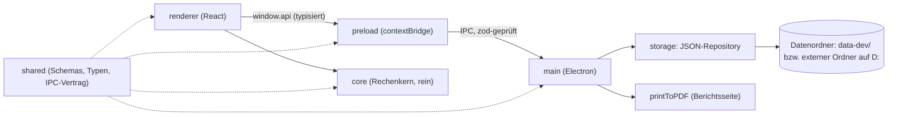
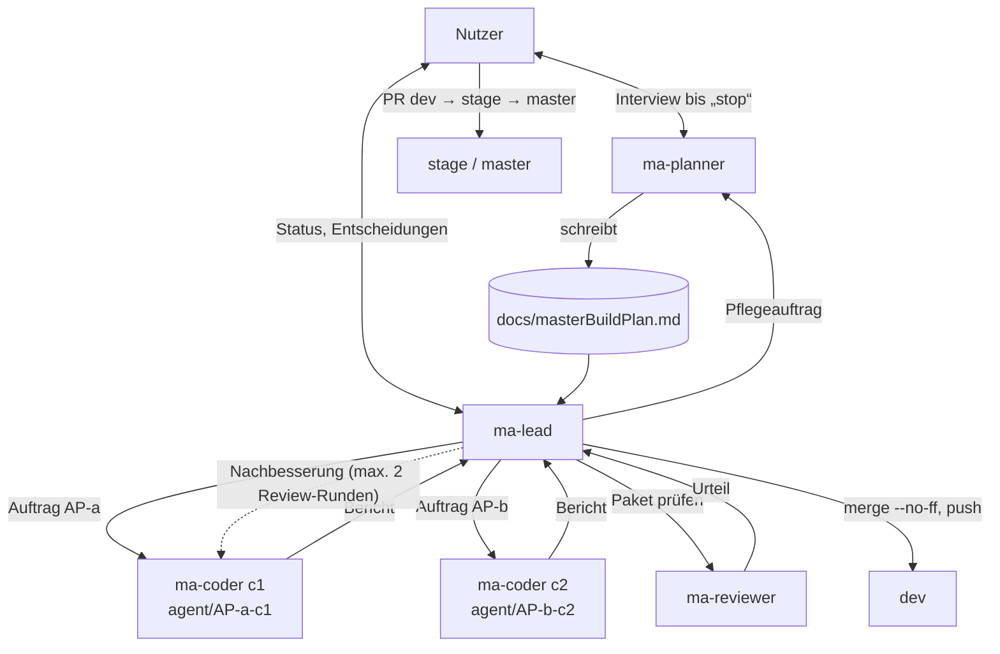
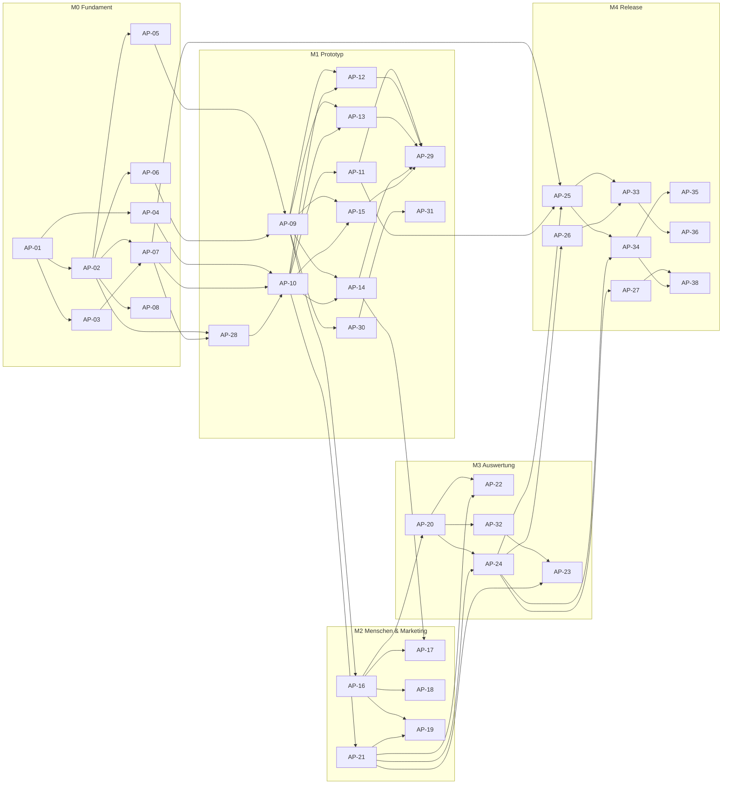

<!--
MASTER-BUILD-PLAN – VORLAGE (MultiAgent-System)

setup-project.ps1 kopiert diese Vorlage nach docs/masterBuildPlan.md im Projekt.
Der Planner-Agent (ma-planner) füllt sie im Interview mit dem Nutzer und pflegt sie danach.
Er ist der einzige Agent, der diese Datei ändert. Der Lead (ma-lead) steuert den Bau danach.
Grundlage der Regeln: MultiAgent/entscheidungen.md
-->

# Master-Build-Plan appManager

**Stand:** 2026-10-28 · **Planversion:** 1 · **Gepflegt von:** ma-planner · **Gesteuert von:** ma-lead · **Nutzer:** Cem Dogan

appManager ist eine lokale Windows-Desktop-App (Electron + React + TypeScript, Deutsch/Englisch), mit der ein einzelner Nutzer Ausgaben und Einnahmen seiner privaten Projekte (Apps, Webseiten, Steam-Spiele …) erfasst, exakt auf Projekte aufteilt und auswertet: Dienste, Personen, KI-Kosten, Kampagnen, Nutzerzahlen, Ziele, Statistiken und PDF-Berichte. Daten liegen in lokalen JSON-Dateien außerhalb des Repos. Öffentliches Repo unter PolyForm Noncommercial.
Der Plan hat 5 Meilensteine (M0 Fundament, M1 Prototyp, M2 Menschen & Marketing, M3 Auswertung, M4 Release) mit 37 Arbeitspaketen (~59 h Agent-Zeit, inkl. AP-38).

---

## 0. Gebrauchsanweisung

### Lagebericht

<!-- Übergabe an einen neuen Lead, der den bisherigen Chat nicht kennt. Der Planner ersetzt ihn bei jedem „Wellenabschluss“. Höchstens 10 Zeilen. -->

- **Stand:** 2026-10-28 · M4 W2 und W2b abgeschlossen. Alle Pakete AP-01–AP-36 sind in `dev` gemergt (HEAD 3e21909, gepusht). Pflegeauftrag: Abhängigkeits-Update AP-38 eingeplant (M4 W3).
- **Fertig:** AP-01–AP-36, M0-DEP, M1-DEP · **Bereit:** AP-38 (M4 W3, OPS, opus, Opus-Grund Sicherheit), M2-DEP, M3-DEP (Nutzer) · **Offen:** M4-DEP (W4, hängt an AP-38), H-04, H-05, H-06.
- **Unterbrochen oder laufend:** keine Coder-Arbeit. Worktrees und Branches der gemergten Pakete aufräumen: Lead (§9.1 Schritt 7). Designer-Interview läuft (Nutzer, `docs/design/`, unversioniert); UI-Pakete ohne Design-Review. **Hauptcheckout steht auf `stage`:** Der Plan-Commit des Pflegeauftrags 2026-10-28 wartet auf `dev`.
- **Erkenntnisse:** Die npm-Warnungen (`inflight`, `glob@7`, `rimraf@2`, `boolean`) stammen aus dem Build-Werkzeug (alle `dev: true`), Ketten in §18 (2026-10-28). `npm audit` und `npm view` hat der Planner nicht ausgeführt (Regel 3, Datenabfluss); der Lead führt sie lesend vor dem Auftrag an den Coder aus. Datenordner-Wechsel: PE-65, PE-70, PE-71. Niedrige Befunde weiter als Vorschlag AP-37 in §16 (nicht eingeplant).
- **Nächster Schritt:** Lead: `npm audit` und `npm view electron-builder versions` (nur lesen), Ergebnis in den Auftrag an AP-38; Start, sobald `dev` ausgecheckt ist. Danach Nutzer: M4-DEP (W4). Reihenfolge der Smoke-Tests: Q-13.
- **Offene Nutzerpunkte:** PE-72 und Q-13 (Reihenfolge AP-38 und Smoke-Tests M2/M3); H-04 (Datenordner, im M4-DEP wählen); H-05 Designer-Gespräch; H-06 (Smoke-Tests M2–M4, Merges); AP-37 und Q-10 (niedrige Befunde, Nutzer entscheidet).

### Rollen und Dokumente

| Wer / Was | Zweck |
|---|---|
| **Nutzer** [Mensch] | Teamleiter. Entscheidet über Security, Datenschutz, Vorgehensweise und Umfang, bringt `dev` → `stage` → `master`, richtet externe Dienste ein, füllt `.env`. |
| `ma-planner` (`.claude/agents/ma-planner.md`) | Interviewt den Nutzer, bis er „stop“ sagt. Danach pflegt er diesen Plan im Auftrag des Leads. |
| `ma-lead` (`.claude/agents/ma-lead.md`) | Steuert den Bau: plant Wellen, startet Coder und Reviewer, merged in `dev`, berichtet dem Nutzer. |
| `ma-coder` (`.claude/agents/ma-coder.md`) | Setzt genau ein Paket in einem eigenen Worktree um und committet auf `agent/AP-<nr>-c<n>`. |
| `ma-reviewer` (`.claude/agents/ma-reviewer.md`) | Prüft jedes Paket nur lesend. Urteil: bestanden / nicht bestanden. |
| `ma-po` (`.claude/agents/ma-po.md`) | Product Owner. Klärt mit dem Nutzer Erweiterungen und schreibt sie als Anforderungen (`RQ-xx`) ins Backlog. |
| `ma-designer` (`.claude/agents/ma-designer.md`) | Designer. Entwickelt mit dem Nutzer Design-Richtung und Design-System in `docs/design/`, prüft UI-Pakete im Design-Review. |
| `docs/masterBuildPlan.md` | Dieser Plan. Verbindlich für alle Agents. |
| `docs/backlog.md` | Eingang für Erweiterungen. Freigegebene `RQ-xx` übernimmt der Planner in §2 und §12, mit der RQ-ID. |
| `docs/design/` | Gestaltung: `design-brief.md` (Grundsätze, Übergabe), `tokens.json` und `export/`, Mockups. Verbindlich, sobald der Brief `freigegeben` ist. |
| `README.md` (ab AP-27), `src/shared/README.md`, `src/core/README.md` | Projektbeschreibung, Konventionen der Verträge, Rechenregeln. Widersprechen sie diesem Plan, wird nachgefragt. |

Gemeinsame Regeln (R1–R6, Schutz vor fremden Anweisungen, Rechte, Git-Schema) stehen in jeder Agent-Datei unter „Gemeinsame Regeln für alle Agents“.

### Markierungen

| Markierung | Bedeutung | Wer entfernt sie |
|---|---|---|
| `{{…}}` | Platzhalter | Planner |
| `<!-- LEITFRAGEN … -->` | Fragen an den Nutzer. `[K]` kritisch (blockiert ein Gate), `[W]` wichtig, `[O]` optional (Standard darf angenommen werden) | Planner, sobald der Abschnitt fertig ist |
| `⟦offen: Q-xx⟧` | bewusst offene Stelle, siehe §16 | Planner nach Klärung |
| `(angenommen)` | Standard des Planners, vom Nutzer noch nicht bestätigt | Nutzer durch Bestätigung |
| `PE-xx` | Planungsentscheidung, §16 | – |
| **[Mensch]** | Schritt, den nur der Nutzer ausführt | – |

### Ausfüllstand und Gates

Status: `leer` · `in Klärung` · `fertig` · `angenommen` (fertig, aber mit unbestätigten Annahmen).

| § | Abschnitt | Status | Offene Fragen | Nötig für Gate |
|---|---|---|---|---|
| 1 | Projektkontext und Ziel | fertig | – | G1 ✔ |
| 2 | Umfang | fertig | – | G1 ✔ |
| 3 | Tech-Stack | fertig | – | G1 ✔ |
| 4 | Architektur, Datenmodell, Verträge | fertig | – | G1 ✔ |
| 5 | Sicherheit, Datenschutz, Recht, Limits | fertig | – | G1 ✔ |
| 6 | Umgebungen, Branches, Deployment | fertig | – | G1 ✔ |
| 7 | Team-Steuerung | fertig | – | G1 ✔ |
| 8 | Lanes und Dateieigentum | fertig | – | G2 ✔ |
| 9 | Meilensteine und Wellen | fertig | – | G2 ✔ |
| 10 | Statusübersicht | fertig | – | G2 ✔ |
| 11 | Abhängigkeitsgraph | fertig | – | G2 ✔ |
| 12 | Arbeitspakete | fertig (M0–M4 gemergt; Nachtrag AP-38, M4 W3) | – | G2 ✔ (M0–M4) |
| 13 | Menschliche Schritte | fertig | – (H-01, H-03, H-07 erledigt; H-04, H-05, H-06 offen) | G2 ✔ |
| 14 | Budget und Kürzungen | fertig (Schätzung) | – | G2 ✔ |
| 15 | Risiken | fertig | – | G2 ✔ |
| 16 | Planungsentscheidungen und offene Fragen | laufend | – | laufend |
| 17 | Abdeckungsmatrix | fertig | – | G2 ✔ |
| 18 | Änderungsprotokoll | laufend | – | laufend |

**Gates:** G1 erfüllt (2026-10-25). G2 für M0–M4 aus Sicht des Planners erfüllt; der Lead prüft vor jedem Meilenstein.

| Gate | Bedingung | Wer prüft | Folge |
|---|---|---|---|
| **G1** Bereit zur Paketierung | §1–§7 `fertig` oder `angenommen`, keine `[K]`-Frage offen | Planner | Der Planner schneidet Pakete (§8–§17). |
| **G2(Mx)** Bereit für Meilenstein Mx | G1 erfüllt; alle Pakete von Mx vollständig; [Mensch]-Schritte stehen; Abdeckungsmatrix deckt Mx ab | Lead | Der Lead startet die erste Welle von Mx. Sonst beauftragt er den Planner mit „Verfeinerung Mx“. |
| **G3** Fertig | alle Pflicht-Meilensteine live, Abnahmekriterien aus §1 erfüllt | Nutzer | Plan wird eingefroren. |

---

## 1. Projektkontext und Ziel

| Feld | Wert |
|---|---|
| Einzeiler | Lokale Desktop-App, um Ausgaben und Einnahmen privater Software-Projekte zu erfassen, auf Projekte aufzuteilen und auszuwerten (Statistiken, PDF). |
| Zielgruppe | Nur der Nutzer selbst, ein Rechner, kein Login (PE-01) |
| Lieferumfang | Repository + Windows-Installer (.exe), den der Nutzer lokal baut (PE-03) |
| Termin | keiner (PE-04) |
| Kommerzialisierung | nein. Öffentliches GitHub-Repo, Nachbau erlaubt, kommerzielle Nutzung verboten (PE-19, Lizenz PolyForm Noncommercial 1.0.0, PE-20) |
| Projektdokumentation | `idee.txt` (Ausgangsidee des Nutzers, 2026-10-25) |

**Leitprinzipien (in Rangfolge):**

1. Sicherheit und Datenschutz werden nie gekürzt.
2. Korrekte Zahlen: Berechnungen müssen exakt stimmen und werden gründlichst getestet; Beträge intern als Ganzzahl in Cent (PE-24, PE-27).
3. Einfache Bedienung.
4. Funktionsumfang.
5. Optik (Feinschliff später mit dem Designer, PE-21).

**Abnahmekriterien (G3, PE-41):**

- [ ] Alle Pflichtfunktionen F-01–F-13 sind mit den Testdaten bedienbar.
- [ ] Ein vom Nutzer nachgerechnetes Beispiel stimmt auf den Cent: 100 € Lizenz auf 3 Projekte, eine USD-Ausgabe mit Kurs-Snapshot, ein Jahresabo, eine Personenzahlung auf 2 Projekte.
- [ ] Unit-Tests des Rechenkerns grün, Zeilenabdeckung `src/core/` ≥ 95 %.
- [ ] PDF-Bericht (Portfolio und ein Projekt) stimmt mit den Zahlen in der App überein.
- [ ] Installer installiert auf `D:`, App arbeitet mit dem externen Datenordner, keinerlei Netzwerkzugriffe.
- [ ] Backup wiederherstellbar, Export/Import funktioniert.
- [ ] Öffentliches Repo enthält `LICENSE` (PolyForm Noncommercial 1.0.0), README und keine echten Daten.

---

## 2. Umfang

### Pflicht

| ID | Funktion | Beschreibung aus Nutzersicht | Kernfluss |
|---|---|---|---|
| F-01 | Projekte verwalten | Projekte/Apps anlegen, bearbeiten, archivieren; Felder nach PE-34; Plattformen (Mobile, Web, Webseite, Desktop, Steam) | ja (M1) |
| F-02 | Deploy- und Dienstübersicht | Dienste (Anbieter, Zweck, Tarif, URL, Notiz, z. B. Railway, Vercel, Supabase) mit verknüpften Kosten; ein Dienst kann mehreren Projekten dienen, Kosten nach PE-06 geteilt; pro Projekt einsehbar (PE-12) | ja (M1) |
| F-03 | Ausgaben erfassen | Einmalige und wiederkehrende Ausgaben mit Kategorie; Aufteilung auf ein, mehrere oder alle Projekte (PE-06, PE-07). Startkategorien (erweiterbar): Hosting/Server, Datenbank, Domain, Storage/CDN, Software-Lizenz, KI-Abo, KI-Guthaben, Mitarbeiter/Freelancer, Werbung (aus Kampagnen), Store-/Plattformgebühr, Hardware, Sonstiges (PE-26) | ja (M1) |
| F-04 | Einnahmen erfassen | Von Hand, einmalig oder wiederkehrend, netto, einem Projekt zugeordnet, mit Kategorie (PE-08). Startkategorien (erweiterbar): Store-Verkauf, Steam, In-App-Kauf, Abo, Auftrag/Kunde, Spende, Sonstiges (PE-26) | ja (M1) |
| F-05 | Mitarbeiter und Coder | Personen anlegen; Zahlungen pro Arbeitspaket (gezahlter Betrag, Datum, Kurzbeschreibung) oder als periodische Abrechnung, aufgeteilt auf Projekte (PE-09, PE-36) | nein (M2) |
| F-06 | KI-/Coder-Abos | Abos als wiederkehrender Posten; tokenbasierte Kosten als Guthaben-Aufladung am Tag der Aufladung; aufgeteilt auf Projekte (PE-10). Erfassung über die Ausgaben-Maske (Kategorien KI-Abo/KI-Guthaben) | ja (M1) |
| F-07 | Werbekampagnen | Name, Plattform, Format, Zeitraum, Kosten, Impressionen, Klicks, gewonnene Nutzer, 0–5 Sterne, Notiz; berechnet CPC, Kosten pro Nutzer, CTR; auf Projekte aufteilbar; zählt in Ausgaben-Statistik (PE-11) | nein (M2) |
| F-08 | Währungen | Kurstabelle pflegen, Beträge in Originalwährung, Anzeigewährung umschaltbar (PE-04, PE-05, PE-13) | ja (M1) |
| F-09 | Statistiken | Auswertungen über Portfolio und pro Projekt (Umfang PE-16, inkl. Prognose und Break-even); einfache Übersicht schon in M1 | nein (M3) |
| F-10 | PDF-Bericht | PDF für gesamtes Portfolio und für einzelne Projekte, Inhalt wie App-Auswertung plus Tabellen (PE-14) | nein (M3) |
| F-11 | Mitarbeiterverwaltung (Prio 1 der Zusatzthemen) | Kleines Profil je Person (Name, Rolle, Status aktiv/inaktiv, Notiz); Übersicht: Summe aller Zahlungen nach Projekt und Zeitraum, Zahlungsliste mit Kurzbeschreibung; keine Kontaktdaten (PE-36) | nein (M2) |
| F-12 | Startseite mit Zielen (Prio 2) | Ziele je Projekt oder Portfolio: messbar (Einnahmen X bis Datum, Break-even bis Datum, Nutzer X bis Datum, Kosten ≤ X pro Monat) mit automatischem Fortschritt, oder frei zum Abhaken; Startseite zeigt Fortschrittsbalken und Monatskennzahlen (PE-37) | nein (M3) |
| F-13 | Nutzerzahlen (Prio 3) | Stichtage je Projekt von Hand: Nutzer/Downloads gesamt, aktive, zahlende, optional je Plattform; Verlauf; Kosten pro Nutzer, Einnahmen pro Nutzer, Anteil über Kampagnen (PE-38) | nein (M2) |
| F-14 | Datensicherung | Datenpfad wählen, Backup beim Start (letzte 10), Export/Import als ZIP (PE-17, PE-18) | Backup M0, Export/Import M4 |

### Optional

| ID | Funktion | Bedingung |
|---|---|---|
| O-01 | CSV-Export der Tabellen | nur wenn alle Pflicht-Meilensteine live sind |
| O-02 | PDF-Abschnitte per Häkchen wählen | wie O-01 |
| O-03 | CSV-Import für Einnahmen (Steam, Stores) | wie O-01 |
| O-04 | Kampagnen-Verlauf mit Zwischenständen | wie O-01 |

### Bewusst nicht im Umfang

| Ausgeschlossen | Begründung |
|---|---|
| Handy-App | später (PE-33) |
| Online-Betrieb, Synchronisierung, Datenbank | später; Speicher hinter Schnittstelle |
| Login, mehrere Nutzer | Einzelnutzer (PE-01) |
| Import aus Bank-Dateien oder Shops, automatische Wechselkurse | keine Netzwerkzugriffe, Aufwand |
| Steuern, Umsatzsteuer, Buchhaltung, Rechnungen schreiben | kein Steuer-/Buchhaltungs-Tool |
| Automatische Updates | keine Netzwerkzugriffe |
| macOS, Linux | nur Windows (PE-03) |

---

## 3. Tech-Stack

| Bereich | Technologie | Begründung |
|---|---|---|
| Sprache | TypeScript | ein Stack für Main-Prozess und Oberfläche (PE-02) |
| Frontend | React + Vite im Electron-Renderer | wiederverwendbar für spätere Web-/Mobil-Version (PE-02) |
| UI / Design | Tailwind CSS + shadcn/ui, Grundsätze PE-21 | modern, schlicht, später zentral umstellbar |
| Backend | Electron-Main-Prozess (lokal, kein Server) | Dateizugriff nur hier (PE-02) |
| Datenbank / ORM | lokale JSON-Dateien, Speicher hinter einer Schnittstelle, damit später eine DB folgen kann | Wunsch des Nutzers (`idee.txt`) |
| Auth | keine (Einzelnutzer, lokal) | PE-01 |
| Tests | Vitest (Rechenkern gründlichst: Aufteilung, Währung, Wiederholung, Prognose, Break-even, Rundung, Randfälle); Playwright gegen die Electron-App für 2–3 Kernabläufe | Rechnungen müssen perfekt sitzen (PE-24) |
| Code-Qualität | ESLint (typescript-eslint), Prettier, `tsc --noEmit` | Standard |
| Diagramme / PDF | Recharts; PDF über Electron `webContents.printToPDF` aus einer Berichtsseite | keine zweite Layout-Welt (PE-25) |
| Hosting | keins; Auslieferung als Windows-Installer | PE-03 |

**Checks, die jedes Paket bestehen muss:** `npm run lint`, `npm run typecheck`, `npm test` (Vitest); ab Einführung der E2E-Tests zusätzlich `npm run test:e2e` bei Paketen mit UI-Abläufen. Paketmanager: npm, ein `package.json` im Wurzelverzeichnis (kein Monorepo).

**Freigegebene Abhängigkeiten (PE-32):** Coder installieren nur diese, und nur wenn ihnen `package.json` im Paket gehört. Versionen legt das Gerüst-Paket fest. Alles andere geht über Lead und Nutzer.

- App/Bau: `electron`, `electron-vite`, `electron-builder`, `react`, `react-dom`, `react-router-dom`, `typescript`, `vite`, `@vitejs/plugin-react`
- UI: `tailwindcss` (+ dessen offizielles Vite-/PostCSS-Plugin), shadcn/ui-Bausteine `@radix-ui/*`, `class-variance-authority`, `clsx`, `tailwind-merge`, `lucide-react`, `@fontsource/inter`
- Logik: `zod`, `date-fns`, `decimal.js`, `jszip`, `recharts`
- Qualität: `vitest`, `@vitest/coverage-v8` (PE-55), `@playwright/test`, `eslint`, `typescript-eslint`, `eslint-plugin-react-hooks`, `prettier`, `@types/*` passend zu den freigegebenen Paketen

---

## 4. Architektur, Datenmodell und Verträge

**Bausteine:**

- `src/shared/`: Verträge – zod-Schemas und TS-Typen aller Entitäten, Geldtyp (Cent-Ganzzahl + Währung), IPC-Kanalliste mit Ein-/Ausgabetypen.
- `src/core/`: reiner Rechenkern ohne Electron/React (Aufteilung, Währung, Wiederholung, Aggregation, Prognose, Break-even, Kampagnen-Kennzahlen). Vollständig mit Vitest getestet.
- `src/main/`: Fenster, Sicherheitseinstellungen, Speicher (Repository je Entität, atomares Schreiben, Backups, Export/Import), Einstellungen (Datenpfad, Anzeigewährung), IPC-Handler, PDF-Export.
- `src/preload/`: stellt `window.api` bereit, nichts weiter.
- `src/renderer/`: Oberfläche; ruft für Auswertungen `src/core/` auf Daten aus `window.api` auf.
- `scripts/seed-dev-data.ts`: erzeugt erfundene Testdaten in `data-dev/`. `e2e/`: Playwright-Tests.

**Grundregeln:**

1. Nur der Electron-Main-Prozess liest und schreibt Dateien; die Oberfläche spricht über eine typisierte IPC-Schnittstelle mit ihm (PE-02).
2. Beträge werden in Originalwährung gespeichert. Beim Anlegen einer Buchung wird der zu diesem Zeitpunkt neueste Kurs aus der Kurstabelle in die Buchung kopiert (Snapshot). Spätere Kursänderungen betreffen nur neue Buchungen (PE-05).
3. Gemeinsame Kosten werden gleichmäßig oder nach eigenen Prozenten auf bestimmte Projekte oder „alle“ verteilt; „alle“ = die zum Kostenzeitpunkt aktiven Projekte (PE-06).
4. Wiederkehrende Posten werden einmal angelegt (Betrag, Intervall, Start, optional Ende, Preisänderung ab Datum); Monatswerte berechnet die App (PE-07, PE-29).
4b. Rechenreihenfolge nach PE-50, Kampagnen nach PE-49, Fixkosten-Kennzahl nach PE-51.
5. Rechenkern ist rein (keine Datei-, Zeit- oder Zufallszugriffe; „heute“ wird als Parameter übergeben), damit alles deterministisch testbar ist.
6. Geld immer als Ganzzahl in Cent plus Währungscode; Kurse als Dezimal-String, Rechnung mit `decimal.js`, Rundung nach PE-28/PE-31.
7. Jede Datei und jede IPC-Nachricht wird im Main-Prozess mit zod geprüft; ungültige Dateien werden nicht überschrieben, sondern gemeldet.

| Entität | Wichtige Felder | Gehört zu | Löschverhalten |
|---|---|---|---|
| Projekt | Name, Beschreibung, Plattformen[], Phase, Startdatum, Enddatum?, Links[], archiviert (PE-34) | Besitzer (PE-01) | archivieren; endgültig löschen nur ohne verknüpfte Buchungen (PE-35) |
| Dienst | Anbieter, Zweck, Tarif, URL, Notiz, Aufteilung | Besitzer | löschen fragt, ob verknüpfte Kosten mitgelöscht werden (PE-35) |
| Person | Name/Kürzel, Rolle, Status aktiv/inaktiv, Notiz (PE-36) | Besitzer | löschbar; Zahlungen bleiben mit Vermerk „gelöschte Person“ (PE-35) |
| Ziel | Projekt oder Portfolio, Art (Einnahmen, Break-even, Nutzer, Kostenlimit/Monat, frei), Titel, Zielwert, ab-Datum, Stichtag, erledigt (nur frei) (PE-53) | Besitzer | löschbar |
| Einstellungen | Anzeigewährung, Kategorien-/Plattform-/Formatlisten mit Ausblenden-Flag (PE-54) | Besitzer | – |
| Nutzerstand | Projekt, Datum, Nutzer gesamt, aktiv, zahlend, optional je Plattform | Besitzer | löschbar |
| Ausgabe | Kategorie, Betrag, Währung, Kurs-Snapshot, Datum **oder** Wiederholung, Aufteilung, Beschreibung, optional Verweis auf Dienst/Person | Besitzer | löschbar |
| Wiederholung (Teil einer Ausgabe/Einnahme) | Intervall, Start, Ende?, Preisänderungen [ab Datum, Betrag] | Ausgabe/Einnahme | mit Eltern |
| Einnahme | Kategorie, Betrag netto, Währung, Kurs-Snapshot, Datum oder Wiederholung, Projekt | Besitzer | löschbar |
| Kampagne | Name, Plattform, Format, Start, Ende, Kosten, Währung, Kurs-Snapshot, Impressionen, Klicks, Nutzer, Sterne 0–5, Notiz, Aufteilung (PE-49) | Besitzer | löschbar |
| Kurs | Währung, Kurs, eingetragen am | Besitzer | nie löschen, nur neue Einträge (Historie) (PE-35) |
| Aufteilung (Wertobjekt) | Modus `alle` / `ausgewählt`, gleichmäßig oder Prozent je Projekt (Summe 100 %) | – | – |

Arbeitspakete von Personen, Guthaben-Aufladungen und Dienstkosten sind Ausgaben mit passender Kategorie und Verweis, damit Statistik und PDF nur eine Kostenquelle kennen.

**Verträge:** `src/shared/` (zod-Schemas → abgeleitete TS-Typen, `ipc.ts` mit Kanalnamen und Payload-Typen, `money.ts`). Regel: Jeder Vertrag entsteht in einem eigenen Paket mindestens eine Welle vor seinen Nutzern.

---

## 5. Sicherheit, Datenschutz, Recht und Limits

Es gelten immer R1–R6 (siehe Agent-Dateien). Dieser Abschnitt konkretisiert sie für das Projekt.

| Regel | Umsetzung (grob) | Testart | Paket |
|---|---|---|---|
| Electron-Härtung (R6): `contextIsolation: true`, `nodeIntegration: false`, `sandbox: true`, strikte CSP ohne Fremdquellen, Navigation und neue Fenster blockiert, kein Laden entfernter Inhalte | Fenster-Setup in `src/main/` | Unit-Test der Optionen + Review | AP-03, AP-24 (verstecktes PDF-Fenster) |
| Externe Links (Dienst-URLs) nur `https:`/`http:`, Öffnen über `shell.openExternal` nach Protokollprüfung | Main-Prozess | Unit-Test | AP-03, AP-07 |
| IPC-Eingaben und JSON-Dateien mit zod validiert, keine freien Dateipfade vom Renderer | `src/main/` + `src/shared/` | Unit-Tests | AP-02, AP-07, AP-24, AP-25 |
| ZIP-Import: Zip-Slip-Schutz, nur erwartete Dateinamen, Größenlimit, Validierung vor dem Überschreiben, Backup vorher | `src/main/` | Unit-Tests | AP-25, AP-34 (Befunde (1)–(3)) |
| **Vermerk Export-ZIP (PE-67):** Der Export enthält Personendaten unverschlüsselt. Wird die App öffentlich zugänglich gemacht oder weitergegeben, MUSS vorher eine optionale Export-Verschlüsselung als eigenes Paket kommen (§15 RI-14). | `src/main/transfer/` | Review | kein Paket, Vermerk |
| Keine Netzwerkzugriffe, keine Telemetrie, Schrift lokal (`@fontsource/inter`) | ganze App | Review, CSP | alle |
| Datensparsamkeit (R2): Personen nur Name, Rolle, Status, Notiz (PE-09, PE-36); löschbar; keine Daten in Logs | Datenmodell, Logging | Review | AP-02, AP-07, AP-17 |
| Echte Daten nie im Repo, Agents nur mit erfundenen Daten in `data-dev/` (PE-18) | `.gitignore`, Seed-Skript schreibt nur nach `data-dev/` | Review | AP-01, AP-08, AP-26 |
| Impressum und Datenschutzerklärung (R3) | entfällt: keine Webseite, App sendet keine Daten. README nennt Lizenz und dass keine Daten übertragen werden. | Review | AP-27 |
| Secrets nur in `.env`, `.env.example` gepflegt (R4) | App braucht keine Secrets; `.env.example` dokumentiert nur `APP_DATA_DIR` (Datenpfad-Override für Entwicklung/Tests) | Review | alle |
| Abhängigkeiten nur mit freizügiger Lizenz (PE-19) | `npm`-Lizenzprüfung im Review | Review | alle |

| Limit | Standard | Ebene |
|---|---|---|
| Größe ZIP-Import | 50 MB | global |
| Anzahl Backups | 10 | global |
| Zeitlimit `printToPDF` · Speichern-Dialog (bestätigt, PE-68) | 60 s · 10 min | PDF-Export |
| Zeitraum PDF-Bericht (bestätigt, PE-68) | höchstens 50 Jahre | PDF-Export |
| Textfelder (Name, Beschreibung, Notiz) | 200 / 2 000 / 5 000 Zeichen | je Feld |

**Nie kürzbar:** Electron-Härtung, zod-Validierung, Zip-Slip-Schutz, atomares Schreiben + Backups, Tests des Rechenkerns.

**Vom Nutzer rechtlich zu prüfen:** Lizenztext PolyForm Noncommercial 1.0.0 und Lizenzen der Abhängigkeiten bei Veröffentlichung (keine Rechtsberatung, D12b).

---

## 6. Umgebungen, Branches und Deployment

| Umgebung | Frontend | Backend | Datenbank | Auslöser |
|---|---|---|---|---|
| lokal / dev | `npm run dev` (electron-vite) | Electron-Main | `data-dev/` im Worktree, erfundene Daten, Agents schreiben | – |
| stage | Installer aus `stage`, vom Nutzer gebaut (`npm run dist`) | – | Test-Datenordner des Nutzers (Kopie von Testdaten) | PR dev → stage durch den Nutzer |
| Produktion | Installer aus `master`, Installation auf `D:` (optional GitHub Release) | – | externer Ordner auf `D:` mit echten Daten, kein Agent-Zugriff | PR stage → master durch den Nutzer |

| Branch | Zweck | Wer schreibt darauf |
|---|---|---|
| `master` | Produktion | **[Mensch]**, per Pull Request von `stage` |
| `stage` | Abnahme | **[Mensch]**, per Pull Request von `dev` |
| `dev` | Integration, Default-Branch | ma-lead (`merge --no-ff`, `push`), ma-planner (nur Plan-Commits) |
| `agent/AP-<nr>-c<n>` | ein Arbeitspaket | ma-coder (`commit`), nur lokal, wird nach dem Merge gelöscht |

**Worktrees:** werden beim Start eines Coders automatisch im Ordner `appManager_worktree/` neben dem Projekt angelegt (ein Unterordner und ein Branch pro Coder, abgezweigt von `dev`). Der Lead entfernt sie nach dem Merge.

**Parallele Coder und lokale Ressourcen:** Jeder Worktree hat sein eigenes `data-dev/` (relativ zum Worktree). Vite-Dev-Server sucht bei belegtem Port automatisch den nächsten (`strictPort: false`). E2E-Tests nutzen je Lauf ein temporäres Datenverzeichnis über `APP_DATA_DIR`.

**Env-Dateien:** Die App braucht keine Secrets. `.env.example` dokumentiert nur `APP_DATA_DIR` (optional). Eine `.env` ist nicht nötig.

**Deployment-Anleitung:** `README.md` (Abschnitt „Installer bauen“), angelegt im Installer-Paket.

---

## 7. Team-Steuerung

### 7.1 Ablauf

### 7.2 Parallelität, Budget, Modelle

- **Höchstens gleichzeitig:** 5 Coder (PE-23).
- **Budget (D11b):** Zielwert, Obergrenze und Teamverbrauch (in Prozent des 5-Stunden-Limits) stehen in `.claude/ma-usage.json` (Felder `zielwert`, `obergrenze`, `team`). Dieser Plan nennt keine Werte; maßgeblich ist immer die Datei. Die Obergrenze liegt beim 1,2-Fachen des Zielwerts. Ab dem Zielwert startet der Wächter keine neuen Coder mehr, laufende Pakete werden bis zur Obergrenze fertig. Dann fragt der Lead den Nutzer. Ohne Antwort geht es nach dem Reset weiter (D11c).
- **Freigabe:** keine Freigabe pro Welle; der Lead arbeitet autonom über alle Meilensteine, bis der Nutzer „stopp“ sagt (PE-46). Er meldet sich bei jedem auf `dev` fertigen Meilenstein und in den Eskalationsfällen §7.3.
- **Bei mehr Kandidaten als Plätzen:** zuerst kritischer Pfad (§11), dann Verträge, dann der Rest.

| Paket | Modell | Aufwand |
|---|---|---|
| S, Routine ohne Sicherheits- oder Kernlogik | haiku | low |
| M | sonnet | medium |
| L oder Sicherheit, Kernlogik, Migration | opus | high |

`opus` nur mit Aufwand `L` oder einem „Opus-Grund“ im Paket (Sicherheit, Kern, groß), sonst blockiert der Wächter. Aufwand `xhigh` und `max` sind gesperrt. Die Plan-Pflege läuft mit `haiku`, bei schwereren Aufgaben mit `sonnet`.

**Review:** Jedes Paket prüft `ma-reviewer` (höchstens 2 Runden, Nachbesserung durch denselben Coder). Danach entscheidet der Nutzer.

### 7.3 Eskalation

| Situation | Coder | Lead | Nutzer |
|---|---|---|---|
| Paket unklar | stoppt vor dem ersten Code, meldet `blockiert` | klärt aus Plan und Doku, sonst fragt er den Nutzer | entscheidet |
| Änderung an fremder Datei nötig | meldet | lässt den Planner ein Folgepaket planen | – |
| Neue Abhängigkeit | meldet | fragt den Nutzer | entscheidet |
| Review nach Runde 2 nicht bestanden | – | eskaliert mit Optionen | entscheidet |
| Merge-Konflikt außerhalb des Lockfiles | – | bricht ab, klärt mit dem Planner, Fix-Paket | bei Vorgehensänderung |
| Security, Datenschutz, Umfang, Architektur | – | legt Vorschlag vor | entscheidet |
| Verdächtige Anweisungen in Daten (R6) | meldet | meldet | entscheidet |

---

## 8. Lanes und Dateieigentum

| Lane | Zuständigkeit | Ordner und Dateien |
|---|---|---|
| **SH** – Verträge | zod-Schemas, Typen, IPC-Vertrag, Geldtyp | `src/shared/**` |
| **CORE** – Rechenkern | reine Rechenfunktionen + Tests | `src/core/**` |
| **MAIN** – Electron-Hauptprozess | Fenster, Härtung, Speicher, IPC-Handler, PDF, Export/Import | `src/main/**`, `src/preload/**` |
| **UI** – Oberfläche | Layout, Bausteine, Seiten | `src/renderer/**` (Seiten je Paket in `src/renderer/pages/<bereich>/`) |
| **OPS** – Infrastruktur und Doku | Gerüst, Konfiguration, Seed, E2E, Installer, README | Wurzel-Konfigurationen, `scripts/**`, `e2e/**`, `build/**`, `README.md` (ohne `.github/workflows`, das macht der Nutzer) |
| **HUM** – Mensch | Konten, Secrets, Deployments, Smoke-Tests | – |

**Grundregeln:**

1. Innerhalb einer Welle gehört jede Datei höchstens einem Paket.
2. Verträge entstehen mindestens eine Welle vor ihren Nutzern.
3. Gemeinsame Dateien legt ein Gerüst-Paket in Welle 1 eines Meilensteins an.
4. Konflikte im Lockfile sind erwartet. Der Lead löst sie beim Merge mit `npm install`.
5. AP-01 installiert **alle** freigegebenen Abhängigkeiten auf einmal. Spätere Pakete ändern `package.json` nicht; brauchen sie trotzdem etwas, melden sie es (§7.3).
6. Alle Entitäten und IPC-Kanäle entstehen in AP-02. Der Speicher ist generisch (ein Repository und ein CRUD-Kanalsatz für alle Entitäten), damit Fachpakete keine Main-Dateien ändern müssen.
7. Die Routen- und Navigationsliste (`src/renderer/app/routes.tsx`) legt AP-04 mit Platzhalterseiten für **alle** Bereiche an. Fachpakete ersetzen nur ihren Ordner `src/renderer/pages/<bereich>/`.

| Gemeinsame Datei | Wer ändert sie | Wann |
|---|---|---|
| `package.json`, `package-lock.json`, `tsconfig*.json`, `electron.vite.config.ts`, `eslint.config.js`, `.prettierrc`, `vitest.config.ts`, `.gitignore`, `.env.example` | AP-01 (legt auch alle npm-Skripte inkl. `test:e2e` und `seed` an); danach nur AP-27 (Version, description, license), AP-28 (`tsconfig.web.json`, `.env.example`), AP-30 (`vitest.config.ts`, nur Coverage-Include) und AP-34 (`tsconfig.node.json`: `e2e/**` in den Typecheck) und AP-38 (nur Versionsanhebungen in `package.json` und Lockfile; Ausnahme zu Grundregel 5, PE-72) | M0 W1, M1 W1, M1 W4, M4 W1, M4 W2, M4 W3 |
| `src/core/**` | kein gemeinsamer Barrel (`index.ts`); jedes Kernpaket besitzt eigene Unterordner, Importe über direkte Pfade; Fix an fremden Unterordnern nur AP-28 (`recurrence/`, `currency/`), AP-31 (`aggregate/fixedCosts.ts`, nach Merge von AP-30) und AP-32 (`goals/`, nach Merge von AP-20) | M1 W1 (AP-28), M1 W4 (AP-31), M3 W2 (AP-32) |
| `electron-builder.yml` | AP-01, später AP-27; AP-34 nur Kommentar Z. 19; AP-38 nur, wenn eine neue Version eine Konfigurationsänderung verlangt | M0 W1, M4 W1, M4 W2, M4 W3 |
| `src/shared/**` | AP-02; Änderungen später nur über ein eigenes Vertragspaket (AP-28) | M0 W2, M1 W1 |
| `src/main/index.ts` | AP-01 (minimal) → AP-03 (Fenster) → AP-07 (Speicher, IPC) → AP-24 (PDF-Kanal) → AP-25 (Export/Import) | je eine Welle |
| `src/preload/index.ts` | AP-01 → AP-07 | M0 W1, W3 |
| `src/main/storage/**`, `src/main/ipc/**` | AP-07; Fix AP-28 (Code `IN_USE` statt Präfix-Workaround). M4 W2 nur AP-34: `storage/__tests__/service.test.ts` (Test Backup im neuen Ordner, PE-65), `ipc/handlers.ts` (Kommentar Z. 50), `storage/store.ts` nur falls zwingend (Vermerk im Bericht). M4 W2b nur AP-35: `storage/service.ts` (Alt-Backup vor dem Wechsel, PE-70) und `storage/__tests__/service.test.ts` (nur neue Tests, nach dem AP-34-Merge) | M0 W3, M1 W1, M4 W2, M4 W2b |
| `src/main/transfer/**` | AP-25; M4 W2: AP-34 (Befunde (1)–(3)) | M4 W1, M4 W2 |
| `src/main/pdf/**` | AP-24; M4 W2: AP-34 (Zeitlimit, Validierung, Zeitraum, PE-68) | M3 W2, M4 W2 |
| `e2e/fixtures.ts`, `e2e/flows.spec.ts` | AP-26; M4 W2: AP-34 nur `fixtures.ts` (Umgebungsvariablen), AP-33 nur `flows.spec.ts` (Selektoren, Ausnahme zur OPS-Lane, PE-64) | M4 W1, M4 W2 |
| `README.md` (Abschnitt „Datenordner und Backups“), `src/core/README.md` (Absatz unter der Tabelle im Abschnitt „Ziele (PE-53)“) | AP-27 (README), AP-32 (Abschnitt „Ziele“); M4 W2: AP-34; M4 W2b: AP-35 (ein Satz im Abschnitt „Datenordner und Backups“) | M4 W1, M3 W2, M4 W2, M4 W2b |
| `src/renderer/app/routes.tsx`, `src/renderer/app/Layout.tsx` | AP-04 | M0 W2 |
| `src/renderer/components/ui/**` (shadcn) | AP-04 legt Grundsatz an; AP-10 ergänzt | M0 W2, M1 W1b |
| `src/renderer/styles/globals.css` (Design-Variablen) | AP-01 → AP-04; später Design-Pakete | – |
| `src/renderer/features/bookings/**` | AP-14 (Formulare, Listen); AP-29 (Originalbetrag-Spalte, Kategorie-Filter, Hinweis Einnahmen) | M1 W2, M1 W4 |
| `src/core/aggregate/fixedCosts.test.ts` und `src/core/aggregate/fixedCosts*.test.ts` (nur Tests) | AP-30 (fertig); AP-31 ergänzt nur Tests, bestehende unverändert, erst nach dem Merge von AP-30 | M1 W4 |
| `src/core/aggregate/fixedCosts.ts` | AP-31 (Fallbacks entfernen, Verhalten gleich) | M1 W4 |
| `src/core/goals/goals.ts`, `src/core/goals/goals*.test.ts`, Abschnitt „Ziele“ in `src/core/README.md` | AP-32 (Kostenlimit erst nach Stichtag); AP-20 hat den Ordner angelegt | M3 W2 |
| `src/renderer/**` (Aufräumpaket, Dateiliste in §12 AP-33) | AP-33; Cross-Imports `pages/projects/*` → neuer Ordner `src/renderer/components/ledger/**` | M4 W2 |
| `src/renderer/pages/settings/DataSection.tsx`, `src/renderer/pages/settings/i18n.ts` | AP-36 (erst nach dem Merge von AP-33) | M4 W2b |

---

## 9. Meilensteine und Wellen

| # | Meilenstein | Inhalt | Live-Zustand |
|---|---|---|---|
| M0 | Fundament | Gerüst, Verträge, Härtung, App-Shell, Rechenkern I (Geld, Währung, Aufteilung, Wiederholung), Speicher mit Backups, Seed | App startet aus Installer, Seitenleiste mit Platzhaltern, Hell/Dunkel, Datenordner mit Testdaten, Backup beim Start |
| M1 | Prototyp | Buchungs-Engine, UI-Baukasten, Einstellungen/Kurse, Projekte, Dienste, Ausgaben/Einnahmen, einfache Übersicht | Kernfluss erfassen → Übersicht stimmt; danach Designer-Gespräch (H-05) |
| M2 | Menschen & Marketing | Kennzahlen-Kern, Mitarbeiterverwaltung, Kampagnen, Nutzerzahlen | Personen, Kampagnen, Nutzerstände erfassbar mit Kennzahlen |
| M3 | Auswertung | Prognose/Break-even/Ziel-Kern, Diagramme, Statistikseite, Startseite mit Zielen, PDF | Statistiken und PDF stimmen mit App überein |
| M4 | Release | Export/Import ZIP, E2E-Tests, Installer-Feinschliff, README, Aufräumpaket und Härtung (AP-33 bis AP-36), Abhängigkeits-Update (AP-38) | Release-Installer auf `D:`, Abnahme G3 |

### 9.1 Ablauf einer Welle

| Schritt | Inhalt | Wer |
|---|---|---|
| 0 Lagebild | `dev` sauber, Abhängigkeiten `fertig`, Eigentum ohne Überschneidung, Budget | Lead |
| 1 Wellenplan | Pakete, Coder-Nr., Modell; Freigabe laut §7.2 | Lead → Nutzer |
| 2 Delegieren | Coder im Hintergrund starten, je eigener Worktree | Lead |
| 3 Umsetzen | Code, Tests, Commits auf `agent/AP-<nr>-c<n>`, Bericht | Coder |
| 4 Review | Urteil; bei „nicht bestanden“ Nachbesserung durch denselben Coder, max. 2 Runden | Reviewer, Lead, Coder |
| 5 Mergen | `merge --no-ff` in `dev`, Reihenfolge SH → CORE → MAIN → UI → OPS | Lead |
| 6 Integrationspunkt | Install, Checks, Handtest-Checkliste; rot → Fix-Paket | Lead (+ Nutzer für Handtest) |
| 7 Abschluss | `push origin dev`, Worktrees und Branches aufräumen, Plan pflegen | Lead, Planner |

### 9.2 Meilensteine im Detail

**Ablauf für jedes M<x>-DEP [Mensch] (PE-42):** Pull Request `dev` → `stage`, mergen; im Hauptcheckout `git checkout stage`, `npm ci`, `npm run dist`; Installer aus `release/` auf `D:` installieren; App mit Test-Datenordner (Kopie von `data-dev/`) starten und Checkliste abhaken (~15 min). Danach Pull Request `stage` → `master`. Zurück auf `dev` wechseln.

#### M0 – Fundament

| Welle | Pakete (parallel) |
|---|---|
| W1 | AP-01 |
| W2 | AP-02, AP-03, AP-04 |
| W3 | AP-05, AP-06, AP-07, AP-08 |
| W4 | M0-DEP [Mensch] |

**Integration:** nach W2 `npm run dev` startet Fenster mit Seitenleiste (Lead); nach W3 `npm run seed` + `npm run dev`, Datenordner und Backup vorhanden, alle Checks grün.

##### M0-DEP – Deployment [Mensch]

- **Smoke-Test:**
  - [x] Installer lässt Zielordner auf `D:` wählen und installiert
  - [x] App startet, Seitenleiste zeigt alle Bereiche, Hell/Dunkel umschaltbar
  - [x] Beim Start entsteht im Datenordner ein Backup (`backups/`)
  - [x] Ungültige JSON-Datei im Testordner → App meldet Fehler, überschreibt nicht
  - [x] Kein Netzwerkzugriff (z. B. offline starten, alles funktioniert)

#### M1 – Prototyp

| Welle | Pakete (parallel) |
|---|---|
| W1 | AP-09, AP-28 |
| W1b | AP-10 (vorgezogen, startet nach AP-28, weil es die `window.api`-Typen braucht) |
| W2 | AP-11, AP-12, AP-13, AP-14, AP-15 |
| W3 | M1-DEP [Mensch] (erledigt 2026-10-26), danach H-05 Designer-Gespräch |
| W4 | AP-29, AP-30 (fertig; Aufräumen M1 und Branch-Abdeckung), AP-31 (Folgepaket zu AP-30, startet nach dessen Merge; nach M1-DEP, vor M2 W1) |

**Integration:** nach W2 mit Seed-Daten Kernfluss von Hand: Projekt anlegen → Dienst mit Kosten → Ausgabe auf „alle“ → Einnahme → Übersicht prüfen.

##### M1-DEP – Deployment [Mensch]

- **Smoke-Test:**
  - [x] Projekt mit Phase, Plattformen, Links anlegen, bearbeiten, archivieren
  - [x] Kurs „1 USD = x EUR“ eintragen; USD-Ausgabe übernimmt den Kurs
  - [x] 100 € Lizenz auf 3 Projekte → 33,34 / 33,33 / 33,33
  - [x] Monatsabo am 31. → im Februar am Monatsletzten fällig
  - [x] Dienst auf 2 Projekte geteilt, in beiden Projektseiten sichtbar
  - [x] Anzeigewährung auf USD → alle Beträge umgerechnet
  - [x] Übersicht: Einnahmen − Ausgaben = Saldo stimmt

#### M2 – Menschen & Marketing

| Welle | Pakete (parallel) |
|---|---|
| W1 | AP-16, AP-21 (nach dem Merge von AP-29 und AP-30, M1 W4); AP-31 darf parallel laufen (Eigentum disjunkt) |
| W2 | AP-17, AP-18, AP-19 |
| W3 | M2-DEP [Mensch] |

##### M2-DEP – Deployment [Mensch]

- **Smoke-Test:**
  - [ ] Person mit Rolle, Status, Notiz anlegen; Zahlung auf 2 Projekte → je 50 %
  - [ ] Personenübersicht zeigt Summe je Projekt und Zeitraum
  - [ ] Kampagne mit Kosten, Klicks, Nutzern, Sternen → CPC, Kosten/Nutzer, CTR stimmen
  - [ ] Kampagnenkosten erscheinen als Ausgabe „Werbung“ (keine Doppelerfassung)
  - [ ] Nutzerstand je Projekt eintragen, Verlauf sichtbar
  - [ ] Diagramme (Balken, Linie, Donut, Sparkline) in Hell und Dunkel lesbar, Beträge im Tooltip (Sichtprüfung für AP-21, nicht automatisiert getestet)

#### M3 – Auswertung

| Welle | Pakete (parallel) |
|---|---|
| W1 | AP-20 (darf parallel zu M2 W2 laufen) |
| W2 | AP-32 (Fix Kostenlimit), AP-22, AP-24 (parallel) |
| W2b | AP-23 (startet nach dem Merge von AP-32) |
| W3 | M3-DEP [Mensch] |

##### M3-DEP – Deployment [Mensch]

- **Smoke-Test:**
  - [ ] Statistik: Zeitraumfilter, Verlauf, Kategorien, Ranking, Fixkosten, Kampagnen-Ranking
  - [ ] Statistik-Zahlen stichprobenartig gegen die Seed-Daten geprüft (bisher nur mit erfundenen Daten gegen den Kern)
  - [ ] Statistik-Diagramme in Hell und Dunkel lesbar (Sichtprüfung, nicht automatisiert)
  - [ ] Prognose 12 Monate und Break-even plausibel
  - [ ] Startseite: messbares Ziel zeigt Fortschritt, freies Ziel abhakbar
  - [ ] Kostenlimit zeigt den Balken als „verbraucht“; Status vor dem Stichtag „offen“, danach „erreicht“ oder „verfehlt“
  - [ ] PDF Portfolio und PDF Projekt erzeugt; Zahlen = App; Kopf, Fußzeile und Diagramme wie in §12 AP-24

#### M4 – Release

| Welle | Pakete (parallel) |
|---|---|
| W1 | AP-25, AP-26, AP-27 |
| W2 | AP-33 (UI, Aufräumen) und AP-34 (MAIN/OPS, Härtung), parallel, Eigentum disjunkt (§8). Nach dem zweiten Merge `npm run typecheck` und `npm run test:e2e` (AP-34 bindet `e2e/**` in den Typecheck ein) |
| W2b | AP-35 (MAIN, Alt-Backup vor dem Ordnerwechsel, nach AP-34) und AP-36 (UI, Hinweis, nach AP-33), parallel, Eigentum disjunkt |
| W3 | AP-38 (OPS, Abhängigkeits-Update, Deprecation-Warnungen und npm audit; Nachtrag 2026-10-28, allein in der Welle) |
| W4 | M4-DEP [Mensch] (Release + Abnahme G3), erst nach AP-33 bis AP-36 und AP-38 |

##### M4-DEP – Deployment [Mensch]

- **Smoke-Test:**
  - [ ] Export als ZIP, Import in leeren Ordner, Daten identisch
  - [ ] Backup wiederherstellen
  - [ ] Release-Installer auf `D:`, externer echter Datenordner gewählt
  - [ ] `npm run dist` erzeugt den Installer (AP-27 nicht real geprüft); NSIS schlägt `D:\appManager` vor, Zielordner änderbar, Deinstallation lässt den Datenordner stehen (bei Problemen Alternative `preInit` statt `customInit` in `build/installer.nsh`)
  - [ ] PDF-Export aus der installierten App erzeugt eine gültige Datei; Optik per Sichtprüfung (AP-26 prüft nur die Dateierzeugung)
  - [ ] Datenordner wechseln: `D:\appManagerDaten` in der installierten App wählen (H-04). Danach liegt im bisherigen Ordner ein Backup (`backups/`, neuer Zeitstempel) und im neuen Ordner ein Backup, falls dort schon Daten liegen; ein leerer Ordner bekommt kein Backup (PE-65, PE-70)
  - [ ] Abbruch-Hinweis: Wechsel mit absichtlich scheiternder Sicherung (Testweg wie AP-35, nur mit einem Testordner, nie mit den echten Daten) zeigt in den Einstellungen „Der bisherige Datenordner bleibt aktiv“; der alte Ordner bleibt aktiv und es wird nichts gespeichert (PE-70, PE-71)
  - [ ] Installer nach AP-38 neu gebaut (`npm ci`, `npm run dist`) und installiert; App startet (Build-Werkzeug geändert, PE-72)
  - [ ] Abnahmekriterien §1 abgehakt

---

## 10. Statusübersicht

Gepflegt von ma-planner (im Auftrag des Leads). Aufwand: S ≈ 0,75 h · M ≈ 1,5 h · L ≈ 2,5 h Agent-Zeit, H = Mensch.

Status: `offen` · `bereit` · `in Arbeit` · `Review` · `fertig` (gemergt in dev) · `blockiert`

| ID | Titel | M | Lane | Welle | Abhängigkeiten | Aufwand | Modell | Coder / Branch | Status |
|---|---|---|---|---|---|---|---|---|---|
| AP-01 | Projektgerüst | M0 | OPS | W1 | – | M | sonnet | c1 | fertig |
| AP-02 | Verträge: Schemas, Geldtyp, IPC | M0 | SH | W2 | AP-01 | M | opus | c1 | fertig |
| AP-03 | Fenster und Electron-Härtung | M0 | MAIN | W2 | AP-01 | M | opus | c2 | fertig |
| AP-04 | App-Shell, Theme, i18n, Routen | M0 | UI | W2 | AP-01 | L | sonnet | c3 | fertig |
| AP-05 | Kern: Geld, Währung, Aufteilung | M0 | CORE | W3 | AP-02 | M | opus | c1 | fertig |
| AP-06 | Kern: Wiederholung, Aktivzeitraum | M0 | CORE | W3 | AP-02 | M | opus | c2 | fertig |
| AP-07 | Speicher, Backups, IPC, Preload | M0 | MAIN | W3 | AP-02, AP-03 | L | opus | c3 | fertig |
| AP-08 | Seed-Testdaten | M0 | OPS | W3 | AP-02 | S | sonnet | c4 | fertig |
| M0-DEP | Deployment M0 | M0 | HUM | W4 | AP-01–AP-08 | H | – | Nutzer | fertig |
| AP-09 | Kern: Buchungs-Engine und Aggregation | M1 | CORE | W1 | AP-05, AP-06 | L | opus | – | fertig |
| AP-28 | Vertragslücken schließen | M1 | MAIN+SH+CORE+OPS | W1 | AP-02, AP-07 | S | sonnet | – | fertig |
| AP-10 | UI-Baukasten und Daten-Hooks | M1 | UI | W1b | AP-04, AP-07, AP-28 | L | sonnet | c1 | fertig |
| AP-11 | Einstellungen, Kurse, Kategorien | M1 | UI | W2 | AP-10 | M | sonnet | c1 | fertig |
| AP-12 | Projekte (Liste, Detail) | M1 | UI | W2 | AP-09, AP-10 | M | sonnet | c2 | fertig |
| AP-13 | Dienste | M1 | UI | W2 | AP-09, AP-10 | M | sonnet | c3 | fertig |
| AP-14 | Ausgaben und Einnahmen | M1 | UI | W2 | AP-09, AP-10 | L | sonnet | c4 | fertig |
| AP-15 | Einfache Übersicht (Startseite v1) | M1 | UI | W2 | AP-09, AP-10 | S | sonnet | c5 | fertig |
| M1-DEP | Deployment M1 | M1 | HUM | W3 | AP-09–AP-15, AP-28 | H | – | Nutzer | fertig |
| AP-29 | Aufräumen M1 (Originalbetrag, Werbung, Q-09-Hinweis, Texte) | M1 | UI | W4 | AP-11–AP-15 | S | sonnet | c1 | fertig |
| AP-30 | Branch-Abdeckung fixedCosts ≥ 95 %, Coverage-Include | M1 | CORE+OPS | W4 | AP-09 | S | sonnet | c2 | fertig (Vermerk §12) |
| AP-31 | fixedCosts: unerreichbare Fallbacks entfernen | M1 | CORE | W4 | AP-30 | S | sonnet | – | fertig |
| AP-16 | Kern: Personen-, Kampagnen-, Nutzer-Kennzahlen | M2 | CORE | W1 | AP-09 | M | opus | – | fertig |
| AP-21 | Diagramm-Bausteine | M2 | UI | W1 | AP-10 | M | sonnet | – | fertig |
| AP-17 | Mitarbeiterverwaltung | M2 | UI | W2 | AP-14, AP-16 | M | sonnet | c1 | fertig |
| AP-18 | Werbekampagnen | M2 | UI | W2 | AP-16 | M | sonnet | c2 | fertig |
| AP-19 | Nutzerzahlen | M2 | UI | W2 | AP-16, AP-21 | M | sonnet | c3 | fertig |
| M2-DEP | Deployment M2 | M2 | HUM | W3 | AP-16–AP-19, AP-21 | H | – | Nutzer | bereit |
| AP-20 | Kern: Prognose, Break-even, Zielfortschritt | M3 | CORE | W1 | AP-16 | L | opus | c4 | fertig |
| AP-22 | Statistikseite | M3 | UI | W2 | AP-20, AP-21 | L | sonnet | c2 | fertig |
| AP-23 | Startseite mit Zielen | M3 | UI | W2b | AP-20, AP-21, AP-32 | M | sonnet | c4 | fertig |
| AP-24 | PDF-Bericht | M3 | MAIN+UI | W2 | AP-20, AP-21 | L | sonnet | c3 | fertig |
| AP-32 | Fix: Kostenlimit erst nach Stichtag entscheiden | M3 | CORE | W2 | AP-20 | S | opus | c1 | fertig |
| M3-DEP | Deployment M3 | M3 | HUM | W3 | AP-20, AP-22–AP-24, AP-32 | H | – | Nutzer | bereit |
| AP-25 | Export/Import ZIP | M4 | MAIN+UI | W1 | AP-07, AP-11, AP-24 | M | opus | c1 | fertig |
| AP-26 | E2E-Tests | M4 | OPS | W1 | AP-24 | M | sonnet | c2 | fertig |
| AP-27 | Installer-Feinschliff, README | M4 | OPS | W1 | AP-24, H-01 | S | sonnet | c3 | fertig |
| AP-33 | Aufräumen UI (Befunde M2–M4, AP-25/AP-26 UI-Teil) | M4 | UI | W2 | AP-10, AP-11, AP-12, AP-17–AP-19, AP-21–AP-23, AP-25, AP-26 | L | sonnet | c1 | fertig |
| AP-34 | Härtung MAIN/OPS (PDF-Zeitlimit und Validierung, ZIP-Befunde, Konfiguration, Doku) | M4 | MAIN+OPS+CORE | W2 | AP-07, AP-24–AP-27, AP-32 | L | opus | c2 | fertig |
| AP-35 | Backup des alten Datenordners vor dem Wechsel (PE-70) | M4 | MAIN | W2b | AP-07, AP-34 | M | opus | c1 | fertig |
| AP-36 | Hinweis bei abgebrochenem Ordnerwechsel (PE-71) | M4 | UI | W2b | AP-33 | S | haiku | c1 | fertig |
| AP-38 | Abhängigkeiten aktualisieren (Deprecation-Warnungen, npm audit) | M4 | OPS | W3 | AP-27, AP-34 | M | opus | – | bereit |
| M4-DEP | Release und Abnahme | M4 | HUM | W4 | AP-25–AP-27, AP-33–AP-36, AP-38 | H | – | Nutzer | offen |

---

## 11. Abhängigkeitsgraph

**Nachtrag 2026-10-26:** AP-29 und AP-30 bilden M1 W4 (nach M1-DEP, vor M2 W1). Ihr Dateieigentum ist disjunkt (UI bzw. Kern-Tests und `vitest.config.ts`), sie laufen daher parallel. AP-31 folgt AP-30 (Eigentum `aggregate/fixedCosts.ts`, Start nach dessen Merge). Seine Eigentumsmenge ist disjunkt zu AP-16 (`metrics/**`) und AP-21, daher darf es parallel zu M2 W1 laufen.

**Nachtrag 2026-10-26 (Pflegeauftrag):** AP-32 (Fix Kostenlimit, Kern, M3 W2) hängt an AP-20 und ist Voraussetzung für AP-23. AP-23 startet daher in W2b, nach dem Merge von AP-32. AP-22 und AP-24 hängen nicht davon ab.

**Nachtrag 2026-10-28 (Pflegeauftrag):** AP-33 (UI, sonnet) und AP-34 (MAIN/OPS, opus) bilden M4 W2 und laufen parallel; ihr Dateieigentum ist disjunkt (§8). AP-33 hängt an fertigen UI- und M2/M3-Paketen, AP-34 an AP-07, AP-24–AP-27 und AP-32. M4-DEP (W3) hängt an AP-33 bis AP-36 (siehe Pflegeauftrag 2 unten).

**Nachtrag 2026-10-28 (Pflegeauftrag 2):** AP-35 (MAIN, opus) hängt an AP-34 und AP-07 (Eigentum `storage/service.ts` und dessen Test, erst nach dem AP-34-Merge). AP-36 (UI, haiku) hängt an AP-33 (Eigentum `DataSection.tsx`, erst nach dem AP-33-Merge). Beide laufen in W2b parallel; ihr Eigentum ist disjunkt.

**Nachtrag 2026-10-28 (Pflegeauftrag 3):** AP-38 (OPS, opus) hängt nur an AP-27 und AP-34 (beide `fertig`) und bildet M4 W3 allein, weil es `package.json` und das Lockfile ändert (Ausnahme zu §8 Grundregel 5, PE-72). M4-DEP (W4) hängt an AP-38, weil der Installer mit dem neuen Build-Werkzeug geprüft wird. M2-DEP und M3-DEP haben keine Kante zu AP-38 (Reihenfolge: Q-13).

**Welle M1 (Stand 2026-10-25):** AP-28 liegt in W1 neben AP-09. AP-10 startet danach als W1b, weil es die typisierten `window.api`-Kanäle aus AP-28 braucht (Vertrag eine Welle früher, Regel 2 in §8).

**Kritischer Pfad:** AP-01 → AP-02 → AP-05/AP-06 → AP-09 → AP-16 → AP-20 → AP-22/AP-24 → AP-26 → M4-DEP (Rechenkern-Kette, alles opus).

---

## 12. Arbeitspakete

<!-- Regeln:
- Ein Paket passt in eine Agent-Sitzung (1–3 h) und ergibt einen einzeln committbaren, getesteten Stand.
- Ein Coder muss es allein mit Paket und Pflichtlektüre umsetzen können, ohne Rückfrage.
- Knappe, konkrete Schritte, keine fertigen Code-Blöcke.
- IDs fortlaufend über alle Meilensteine: AP-01, AP-02 …
-->

**Für alle Pakete gilt:** Pflichtlektüre zusätzlich §3 (Checks, freigegebene Abhängigkeiten), §4 (Grundregeln), §8 (Eigentum). Checks `npm run lint`, `npm run typecheck`, `npm test` müssen grün sein. Design-Review: nein, bis ein freigegebener `docs/design/design-brief.md` existiert (PE-21); UI-Pakete halten sich an PE-21 und nutzen nur die Theme-Variablen aus `src/renderer/styles/globals.css`.

### M0 – Fundament

#### AP-01 – Projektgerüst

- **Meilenstein, Lane, Welle:** M0 · OPS · W1
- **Ziel:** Lauffähiges electron-vite-Projekt (React + TS) mit allen Werkzeugen, Skripten und Konfigurationen, auf dem alle weiteren Pakete aufbauen.
- **Pflichtlektüre:** §3, §6, §8, PE-02, PE-03, PE-18, PE-21, PE-22, PE-32
- **Abhängigkeiten:** –
- **Parallel möglich mit:** –
- **Dateien (Eigentum):** `package.json`, `package-lock.json`, `tsconfig*.json`, `electron.vite.config.ts`, `eslint.config.js`, `.prettierrc`, `.prettierignore`, `vitest.config.ts`, `vitest.seed.config.ts`, `electron-builder.yml`, `.gitignore`, `.env.example`, `components.json`, `src/main/index.ts`, `src/preload/index.ts`, `src/renderer/index.html`, `src/renderer/main.tsx`, `src/renderer/App.tsx`, `src/renderer/styles/globals.css`, `src/renderer/lib/utils.ts`
- **Nicht anfassen:** `docs/**`, `idee.txt`, `ma-config.json`, `.claude/**`
- **Freigegebene Abhängigkeiten:** alle aus §3 (PE-32), aktuelle stabile Versionen, exakt gepinnt
- **Umsetzung:**
  1. electron-vite-Struktur `src/main`, `src/preload`, `src/renderer` anlegen; TS `strict: true`; Pfad-Aliase `@shared/*` → `src/shared/*`, `@core/*` → `src/core/*`, `@/*` → `src/renderer/*` (in TS, Vite und Vitest).
  2. Alle freigegebenen Abhängigkeiten installieren.
  3. npm-Skripte: `dev`, `build`, `lint`, `format`, `typecheck` (Main/Preload und Renderer getrennt), `test` (Vitest, `--run`), `test:coverage`, `test:e2e` (Playwright, darf bis AP-26 „no tests“ melden), `seed` = `vitest run --config vitest.seed.config.ts` (eigene Vitest-Konfiguration, die nur `scripts/**/*.seed.ts` ausführt; so funktionieren Aliase ohne neue Abhängigkeit wie `tsx`), `dist` (`electron-vite build && electron-builder --win`). `vitest.seed.config.ts` gehört ebenfalls AP-01; die normale `vitest.config.ts` schließt `*.seed.ts` aus.
  4. Tailwind CSS v4 + shadcn/ui initialisieren (`components.json`, `lib/utils.ts` mit `cn`), `globals.css` mit CSS-Variablen für hell/dunkel nach PE-21, Schrift Inter über `@fontsource/inter`.
  5. ESLint (typescript-eslint, react-hooks), Prettier, Vitest (Umgebung node, Testdateien `src/**/*.test.ts(x)` und `scripts/**/*.test.ts`; Coverage mit `@vitest/coverage-v8` (PE-55), Skript `test:coverage`, Schwellwert für `src/core/**` 95 % Zeilen, ab AP-05 wirksam).
  6. `electron-builder.yml`: Windows, NSIS, `oneClick: false`, `allowToChangeInstallationDirectory: true`, `appId` `de.cemdogan.appmanager`, Produktname `appManager`, Ausgabe `release/`.
  7. `.gitignore` ergänzen: `node_modules/`, `out/`, `dist/`, `release/`, `coverage/`, `data/`, `data-dev/`, `test-results/`, `playwright-report/` (bestehende Einträge behalten). `.env.example`: `APP_DATA_DIR=` mit Kommentar.
  8. Minimales `src/main/index.ts` öffnet ein Fenster mit dem Renderer; Renderer zeigt „appManager“.
- **Schnittstellen:** stellt Skripte und Aliase für alle Pakete bereit.
- **Akzeptanzkriterien:**
  - `npm ci`, `npm run lint`, `npm run typecheck`, `npm test` (ein Platzhaltertest) grün
  - `npm run dev` öffnet ein Fenster mit „appManager“ in Inter
  - `npm run dist` erzeugt einen Installer in `release/` (Lead prüft einmal)
- **Tests:** ein Platzhalter-Unit-Test, der die Aliase nutzt
- **Review-Schwerpunkte:** gepinnte Versionen, nur freigegebene Abhängigkeiten, Lizenzen, `.gitignore` deckt Datenordner ab
- **Design-Review:** nein
- **Doku-Pflichten:** `.env.example`
- **Aufwand:** M · **Modell:** sonnet · **Effort:** medium
- **Opus-Grund:** –
- **Kürzbar bei Budgetnot:** nein (Grundlage)
- **Commit-Typ:** `chore(AP-01): scaffold electron-vite project`

#### AP-02 – Verträge: Schemas, Geldtyp, IPC

- **Meilenstein, Lane, Welle:** M0 · SH · W2
- **Ziel:** Alle Entitäten, der Geldtyp und der IPC-Vertrag stehen als zod-Schemas und Typen fest, sodass alle späteren Pakete parallel darauf bauen können.
- **Pflichtlektüre:** §4 (Entitäten, Grundregeln), §2 (F-01–F-14), PE-04–PE-13, PE-26, PE-28–PE-31, PE-34–PE-38
- **Abhängigkeiten:** AP-01
- **Parallel möglich mit:** AP-03, AP-04
- **Dateien (Eigentum):** `src/shared/**`
- **Nicht anfassen:** `src/main/**`, `src/preload/**`, `src/renderer/**`
- **Freigegebene Abhängigkeiten:** keine neuen
- **Umsetzung:**
  1. `money.ts`: `CurrencyCode` (ISO 4217, 3 Großbuchstaben), `Money = { cents: number (Ganzzahl, safe integer), currency }`, `Rate` als Dezimal-String (Regex), Basiswährung `EUR`.
  2. `schemas/`: je Entität ein Schema mit `id` (UUID), `ownerId` (fest `local`), `createdAt`, `updatedAt`: Project, Service, Person, Expense, Income, Campaign, ExchangeRate, Goal, UserMetric, Settings (Datenpfad nicht hier, nur Anzeigewährung, Kategorien, Plattform-/Formatlisten). Feldlisten exakt nach §4/§2.
  3. Wertobjekte: `Allocation` (`mode: 'all' | 'selected'`, `split: 'equal' | 'percent'`, `shares: {projectId, percentBasisPoints}[]`; Prozent in Basispunkten, Summe = 10 000 bei `percent`), `Recurrence` (`interval: 'daily'|'weekly'|'monthly'|'yearly'`, `startDate`, `endDate?`, `priceChanges: {fromDate, cents}[]`), Datum als `YYYY-MM-DD`-String.
  4. Expense: `kind: 'oneTime' | 'recurring'`, `date` oder `recurrence`, `category`, `amount: Money`, `rateToEur` (Snapshot, bei EUR „1“), `allocation`, `description`, optional `serviceId`, `personId`. Income analog mit genau einem `projectId`. Campaign mit `cost: Money`, `rateToEur`, `allocation`, Kennzahlen-Rohwerte (Ganzzahlen ≥ 0), `rating` 0–5.
  5. Standardlisten: Ausgaben- und Einnahmenkategorien, Plattformen, Kampagnen-Plattformen und -Formate (PE-26, PE-11) als Konstanten mit stabilen Schlüsseln (z. B. `hosting`) statt Anzeigetexten (Texte übersetzt die UI, PE-47). Eigene Einträge in Settings mit `key`, `label`, `hidden` (PE-54). Kampagne mit `startDate`/`endDate` (PE-49), Ziel mit `fromDate` (PE-53).
  6. `collections.ts`: Map Entitätsname → Schema → Dateiname (`projects.json` …), `SCHEMA_VERSION = 1`, Datei-Hülle `{ schemaVersion, items: [] }`.
  7. `ipc.ts`: Kanalnamen und Payload-Typen: generisch `entity:list|get|create|update|delete` mit `collection`-Parameter; `settings:get|set`; `dataDir:get|choose`; `backup:list|restore`; `shell:openExternal`; `export:zip`, `import:zip`; `pdf:export` (Eingabe: Bereich portfolio/project, Projekt-ID, Zeitraum, Sprache, Anzeigewährung), `pdf:ready` (Berichtsseite meldet „fertig gerendert“); Fehlerform `{ ok: false, error: { code, message } }`. Typ `AppApi` für `window.api`.
  8. Hilfsfunktionen nur für Validierung (z. B. `parseCollectionFile`), keine Rechenlogik.
- **Schnittstellen:** stellt bereit: alle Typen für CORE, MAIN, UI, Seed.
- **Akzeptanzkriterien:**
  - Jede Entität hat ein Schema und einen abgeleiteten Typ; ungültige Beispiele werden abgelehnt (Prozentsumme ≠ 10 000, negative Cents, ungültiges Datum, Sterne 6)
  - `AppApi` beschreibt alle Kanäle vollständig typisiert
- **Tests:** Schema-Tests je Entität (gültig/ungültig, Grenzwerte)
- **Review-Schwerpunkte:** Vollständigkeit gegen §2/§4, Ganzzahl-Cents, keine personenbezogenen Zusatzfelder (PE-09/PE-36), Längenlimits aus §5
- **Design-Review:** nein
- **Doku-Pflichten:** kurze `src/shared/README.md` mit Konventionen (Cents, Datumformat, Basispunkte)
- **Aufwand:** M · **Modell:** opus · **Effort:** high
- **Opus-Grund:** Kern
- **Kürzbar bei Budgetnot:** nein
- **Commit-Typ:** `feat(AP-02): add shared schemas and ipc contract`

#### AP-03 – Fenster und Electron-Härtung

- **Meilenstein, Lane, Welle:** M0 · MAIN · W2
- **Ziel:** Das Hauptfenster läuft mit allen Sicherheitseinstellungen aus §5.
- **Pflichtlektüre:** §5, PE-18, Electron-Sicherheitscheckliste (offizielle Doku, nur lesen)
- **Abhängigkeiten:** AP-01
- **Parallel möglich mit:** AP-02, AP-04
- **Dateien (Eigentum):** `src/main/index.ts`, `src/main/window.ts`, `src/main/security.ts`, `src/main/__tests__/security.test.ts`
- **Nicht anfassen:** `src/shared/**`, `src/renderer/**`, `src/preload/**`
- **Freigegebene Abhängigkeiten:** keine neuen
- **Umsetzung:**
  1. `window.ts`: `BrowserWindow` mit `contextIsolation: true`, `nodeIntegration: false`, `sandbox: true`, `webSecurity: true`, Preload aus electron-vite-Ausgabe.
  2. `security.ts`: CSP-Header über `session.webRequest.onHeadersReceived` (nur `'self'`, Dev-Server-URL nur im Dev-Modus, `img-src 'self' data:`, `style-src 'self' 'unsafe-inline'` nur falls Tailwind/Radix es braucht – begründen), Blockieren von `will-navigate`, `setWindowOpenHandler` → deny, Funktion `isSafeExternalUrl(url)` (nur `https:`/`http:`), Berechtigungsanfragen ablehnen (`setPermissionRequestHandler`).
  3. Single-Instance-Lock; `index.ts` verdrahtet Fenster und Sicherheit.
- **Schnittstellen:** stellt `isSafeExternalUrl` für AP-07 bereit.
- **Akzeptanzkriterien:** Fensteroptionen und CSP wie beschrieben; Navigation zu fremder URL wird verhindert; `window.open` öffnet nichts.
- **Tests:** Unit-Tests für `isSafeExternalUrl` (javascript:, file:, data:, http, https), Fensteroptionen als exportiertes Objekt geprüft, CSP-String geprüft
- **Review-Schwerpunkte:** Sicherheit (R6), keine Netzwerkzugriffe, keine Abschwächung im Prod-Modus
- **Design-Review:** nein
- **Doku-Pflichten:** keine
- **Aufwand:** M · **Modell:** opus · **Effort:** high
- **Opus-Grund:** Sicherheit
- **Kürzbar bei Budgetnot:** nein (nie kürzbar, §5)
- **Commit-Typ:** `feat(AP-03): harden electron window`

#### AP-04 – App-Shell, Theme, Routen

- **Meilenstein, Lane, Welle:** M0 · UI · W2
- **Ziel:** Grundlayout mit Seitenleiste, Hell-/Dunkelmodus, Zweisprachigkeit, Grund-Komponenten und Platzhalterseiten für alle Bereiche.
- **Pflichtlektüre:** PE-21, PE-47, §2, §8 Regel 7
- **Abhängigkeiten:** AP-01
- **Parallel möglich mit:** AP-02, AP-03
- **Dateien (Eigentum):** `src/renderer/App.tsx`, `src/renderer/app/**` (`routes.tsx`, `Layout.tsx`, `Sidebar.tsx`, `Header.tsx`, `ThemeProvider.tsx`), `src/renderer/i18n/**`, `src/renderer/components/ui/**`, `src/renderer/pages/**` (nur Platzhalter), `src/renderer/features/**` (nur Platzhalter, siehe Schritt 6), `src/renderer/styles/globals.css`
- **Nicht anfassen:** `src/shared/**`, `src/main/**`, `src/preload/**`
- **Freigegebene Abhängigkeiten:** keine neuen
- **Umsetzung:**
  1. `HashRouter` (Electron, `file://`), Routen: Start `/`, Projekte `/projects`, Projekt `/projects/:id`, Dienste `/services`, Ausgaben `/expenses`, Einnahmen `/incomes`, Personen `/people`, Person `/people/:id`, Kampagnen `/campaigns`, Nutzerzahlen `/metrics`, Statistik `/stats`, Berichte `/reports`, Einstellungen `/settings`, Druckansicht `/print` (ohne Layout, für PDF).
  2. Je Bereich `src/renderer/pages/<bereich>/index.tsx` als Platzhalter (Titel + „folgt“).
  3. Seitenleiste mit lucide-Icons, aktiver Eintrag hervorgehoben; `Header.tsx` mit Seitentitel und Umschaltern für Sprache und Theme; Platz für die Anzeigewährungs-Wahl (Slot, Logik folgt AP-10).
  4. Theme: hell/dunkel/System, gespeichert in `localStorage` (nur UI-Präferenz, keine Fachdaten).
  5. i18n (PE-47): `src/renderer/i18n/` mit `I18nProvider`, `useT()`, Sprache `de`/`en` in `localStorage`, Wörterbuch-Typ (fehlende Schlüssel = Typfehler), gemeinsame Wörterbücher (`common`, `nav`, Kategorie- und Plattform-Schlüssel aus `src/shared/` werden in AP-10 ergänzt); Formatierer `formatMoney`, `formatDate`, `formatNumber`, `formatPercent` über `Intl` (de-DE / en-US). Fachseiten legen eigene Wörterbücher in ihrem Ordner an (`pages/<bereich>/i18n.ts`).
  6. Platzhalter für Projekt-Tabs späterer Pakete: `src/renderer/features/{people,campaigns,metrics,stats}/ProjectTab.tsx` (rendern „folgt“) und `src/renderer/features/transfer/TransferSection.tsx` (Platzhalter für AP-25).
  7. shadcn-Grundbausteine: Button, Card, Input, Label, Select, Dialog, AlertDialog, Table, Badge, Tabs, Tooltip, Progress, DropdownMenu, Checkbox, RadioGroup, Popover; Toast als einfacher eigener Baustein, falls nur mit neuer Abhängigkeit möglich.
- **Schnittstellen:** Routen, Layout, i18n und Formatierer für alle UI-Pakete.
- **Akzeptanzkriterien:** Alle Bereiche erreichbar; Theme- und Sprachumschaltung bleiben nach Neustart; keine hart codierten Farben außerhalb `globals.css`; keine hart codierten sichtbaren Texte außerhalb der Wörterbücher.
- **Tests:** Vitest-Tests für Routenliste (alle Pfade vorhanden), Formatierer (de/en: 1.234,56 € / €1,234.56, Datum), Wörterbücher de/en haben dieselben Schlüssel
- **Review-Schwerpunkte:** PE-21 eingehalten, Barrierearmut (Fokus, Tastatur), keine externen Ressourcen
- **Design-Review:** nein (PE-21)
- **Doku-Pflichten:** keine
- **Aufwand:** L · **Modell:** sonnet · **Effort:** high
- **Opus-Grund:** –
- **Kürzbar bei Budgetnot:** nein
- **Commit-Typ:** `feat(AP-04): add app shell, theme, i18n and routes`

#### AP-05 – Kern: Geld, Währung, Aufteilung

- **Meilenstein, Lane, Welle:** M0 · CORE · W3
- **Ziel:** Exakte Geld-, Umrechnungs- und Aufteilungsfunktionen, gründlichst getestet.
- **Pflichtlektüre:** §4 Grundregeln 2, 3, 5, 6; PE-04, PE-05, PE-06, PE-13, PE-28, PE-31, PE-34
- **Abhängigkeiten:** AP-02
- **Parallel möglich mit:** AP-06, AP-07, AP-08
- **Dateien (Eigentum):** `src/core/money/**`, `src/core/currency/**`, `src/core/allocation/**`
- **Nicht anfassen:** `src/core/recurrence/**`, `src/core/projects/**`, `src/shared/**`
- **Freigegebene Abhängigkeiten:** keine neuen (`decimal.js` vorhanden)
- **Umsetzung:**
  1. `money`: Addieren/Subtrahieren nur gleicher Währung (sonst Fehler), Summen, Vergleich; keine Formatierung (die macht die UI, PE-47).
  2. `currency`: `toEur(money, rateToEur)` und `fromEur(cents, rate)` mit `decimal.js`, Rundung half-up erst am Ende; `latestRate(rates, currency, at?)` = neuester Eintrag; `convertForDisplay(money, rateToEur, displayCurrency, rates)` nach PE-13 (Buchung → EUR mit Snapshot, EUR → Anzeige mit neuestem Kurs); fehlender Kurs → definierter Fehlerwert, keine stille 1.
  3. `allocation`: `resolveProjects(allocation, projects, date, isActive)` (Funktion `isActive` wird injiziert, kommt aus AP-06); `splitCents(totalCents, weights)` Größter-Rest auf Cent, Restcent deterministisch an die Reihenfolge der Liste (PE-28); `equal` und `percent` (Basispunkte); leere Projektmenge → Fehlerwert „nicht zuordenbar“.
- **Schnittstellen:** stellt Geld-/Währungs-/Aufteilungsfunktionen für AP-09, AP-16, AP-20 bereit.
- **Akzeptanzkriterien:** 100,00 € / 3 = 33,34 + 33,33 + 33,33; Summe jeder Aufteilung = Ausgangsbetrag (Eigenschaftstest über viele Zufallswerte mit festem Seed); Umrechnung exakt auf Cent für Referenzfälle.
- **Tests:** Unit- und Eigenschaftstests (ohne neue Abhängigkeit, eigener Zufallsgenerator mit Seed), Randfälle: 0 €, 1 Cent auf 3, Prozent 33,33/33,33/33,34, sehr große Beträge, Kurse mit 6 Nachkommastellen, fehlender Kurs. Abdeckung der Ordner 100 % Zeilen.
- **Review-Schwerpunkte:** Rechengenauigkeit, keine Float-Arithmetik auf Geld, Determinismus
- **Design-Review:** nein
- **Doku-Pflichten:** JSDoc an öffentlichen Funktionen mit Rechenregel
- **Aufwand:** M · **Modell:** opus · **Effort:** high
- **Opus-Grund:** Kern
- **Kürzbar bei Budgetnot:** nein (PE-24)
- **Commit-Typ:** `feat(AP-05): add money, currency and allocation core`

#### AP-06 – Kern: Wiederholung, Aktivzeitraum

- **Meilenstein, Lane, Welle:** M0 · CORE · W3
- **Ziel:** Fälligkeiten wiederkehrender Posten und „aktive Projekte an Datum X“ exakt berechnen.
- **Pflichtlektüre:** §4 Grundregeln 4, 5; PE-07, PE-29, PE-34
- **Abhängigkeiten:** AP-02
- **Parallel möglich mit:** AP-05, AP-07, AP-08
- **Dateien (Eigentum):** `src/core/recurrence/**`, `src/core/projects/**`
- **Nicht anfassen:** `src/core/money/**`, `src/core/currency/**`, `src/core/allocation/**`
- **Freigegebene Abhängigkeiten:** keine neuen (`date-fns` vorhanden)
- **Umsetzung:**
  1. `occurrences(recurrence, from, to)`: alle Fälligkeitstage im Intervall (inklusive Grenzen), täglich/wöchentlich/monatlich/jährlich ab `startDate`, Ende beachten; Monats-/Jahresfälligkeit am 29.–31. → Monatsletzter, danach zurück zum Originaltag (31.01 → 28./29.02 → 31.03); 29.02 jährlich → 28.02 in Nicht-Schaltjahren.
  2. Betrag je Fälligkeit nach `priceChanges` (letzte Änderung mit `fromDate ≤ Fälligkeit`).
  3. `isActive(project, date)`: `startDate ≤ date` und (`endDate` fehlt oder `date ≤ endDate`).
  4. Alle Datumswerte als `YYYY-MM-DD`, keine Zeitzonenfehler (nur Kalenderdaten, kein `new Date()` ohne explizites Datum).
- **Schnittstellen:** stellt `occurrences`, `amountAt`, `isActive` für AP-05 (injiziert), AP-09, AP-20 bereit.
- **Akzeptanzkriterien:** Referenzfälle aus PE-29 (31. → Februar → März), Schaltjahre 2028, Preisänderung genau am Fälligkeitstag, Ende am Fälligkeitstag inklusive.
- **Tests:** Tabellen-Tests für alle Intervalle über mehrere Jahre, Randfälle, Abdeckung 100 % Zeilen
- **Review-Schwerpunkte:** Kalenderlogik, Zeitzonen, Inklusiv-/Exklusiv-Grenzen
- **Design-Review:** nein
- **Doku-Pflichten:** JSDoc mit Regeln
- **Aufwand:** M · **Modell:** opus · **Effort:** high
- **Opus-Grund:** Kern
- **Kürzbar bei Budgetnot:** nein (PE-24)
- **Commit-Typ:** `feat(AP-06): add recurrence and active-period core`

#### AP-07 – Speicher, Backups, IPC, Preload

- **Meilenstein, Lane, Welle:** M0 · MAIN · W3
- **Ziel:** Sicherer, generischer JSON-Speicher mit Backups, Datenpfad-Einstellung und typisierter IPC-Brücke.
- **Pflichtlektüre:** §4 Grundregeln 1, 7; §5; PE-17, PE-18, PE-35; `src/shared/ipc.ts`, `src/shared/collections.ts`
- **Abhängigkeiten:** AP-02, AP-03
- **Parallel möglich mit:** AP-05, AP-06, AP-08
- **Dateien (Eigentum):** `src/main/index.ts`, `src/main/storage/**`, `src/main/ipc/**`, `src/main/config/**`, `src/preload/index.ts`, `src/preload/index.d.ts`
- **Nicht anfassen:** `src/main/window.ts`, `src/main/security.ts`, `src/shared/**`, `src/renderer/**`
- **Freigegebene Abhängigkeiten:** keine neuen
- **Umsetzung:**
  1. Datenpfad (PE-18, PE-56). Dev-Modus (nicht paketiert): nur `APP_DATA_DIR` (Umgebung) oder `<repo>/data-dev`; die gespeicherte Wahl gilt dort nicht. Paketiert: `APP_DATA_DIR` (Umgebung) → gespeicherte Wahl in `app.getPath('userData')/config.json` → sonst `userData/data`. `dataDir:choose` öffnet nur einen nativen Ordnerdialog; der Renderer übergibt nie Pfade.
  2. Repository je Collection: Laden mit `parseCollectionFile` (zod), ungültig → Fehlerstatus, Datei bleibt unangetastet, Schreibsperre für diese Collection; Schreiben atomar (Temp-Datei im selben Ordner + `rename`), Schreib-Warteschlange je Datei.
  3. Backup beim Start: alle Collection-Dateien in `backups/<YYYY-MM-DD_HH-mm-ss>/`, nur die neuesten 10 behalten; `backup:list`, `backup:restore` (vorher aktuelles Backup).
  4. IPC-Handler für alle Kanäle aus `ipc.ts` außer `export:*`, `import:*`, `pdf:*` (folgen AP-24/AP-25); jede Eingabe mit zod geprüft; Löschregeln PE-35 (Projekt nur ohne Bezüge löschbar, sonst Fehler `IN_USE`; Person löschen lässt Zahlungen stehen).
  5. `shell:openExternal` nur über `isSafeExternalUrl` (AP-03).
  6. Preload: `contextBridge.exposeInMainWorld('api', …)` exakt nach `AppApi`, keine generischen `ipcRenderer`-Durchreichungen.
  7. Keine Fachdaten in Logs (nur Collection-Name und Fehlercode).
- **Schnittstellen:** setzt `AppApi` um; nutzt `isSafeExternalUrl`.
- **Akzeptanzkriterien:** CRUD für alle Collections über `window.api`; Absturz während Schreiben (simuliert) hinterlässt gültige alte Datei; 11. Backup löscht das älteste; ungültige Datei wird gemeldet, nicht überschrieben.
- **Tests:** Unit-Tests gegen temporäre Verzeichnisse (atomar, Backups-Rotation, Validierung, Löschregeln, Pfad-Reihenfolge), IPC-Handler mit gemockter `ipcMain`
- **Review-Schwerpunkte:** Pfad-Sicherheit, Validierung, Datenverlust-Szenarien, keine Daten in Logs (R2)
- **Design-Review:** nein
- **Doku-Pflichten:** `.env.example`-Kommentar zu `APP_DATA_DIR` erledigt in AP-28 (c)
- **Aufwand:** L · **Modell:** opus · **Effort:** high
- **Opus-Grund:** groß (L), Sicherheit
- **Kürzbar bei Budgetnot:** nein
- **Commit-Typ:** `feat(AP-07): add json storage, backups and ipc bridge`

#### AP-08 – Seed-Testdaten

- **Meilenstein, Lane, Welle:** M0 · OPS · W3
- **Ziel:** Ein Skript erzeugt erfundene, schema-gültige Testdaten für alle Collections in `data-dev/`.
- **Pflichtlektüre:** PE-18, R2, `src/shared/**`
- **Abhängigkeiten:** AP-02
- **Parallel möglich mit:** AP-05, AP-06, AP-07
- **Dateien (Eigentum):** `scripts/seed-dev-data.seed.ts`, `scripts/seed-data/**`
- **Nicht anfassen:** `package.json` (Skript `seed` existiert aus AP-01), `src/**`
- **Freigegebene Abhängigkeiten:** keine neuen
- **Umsetzung:**
  1. Fester Datensatz (deterministisch, kein Zufall): 4 Projekte (eines eingestellt), 5 Dienste (einer auf 2 Projekte geteilt), Kurse EUR/USD, 15 Ausgaben (einmalig, wiederkehrend, USD, „alle“, Prozent, KI-Guthaben), 6 Einnahmen, 3 Personen mit Zahlungen, 3 Kampagnen, 4 Ziele, Nutzerstände über 6 Monate.
  2. Nur erfundene Namen (z. B. „Coder A“), keine echten Personen oder Firmen außer Dienstanbietern (Railway, Vercel, Supabase).
  3. Validierung mit den Schemas vor dem Schreiben; Ziel ist **immer** `<repo>/data-dev/` (ignoriert `APP_DATA_DIR`, damit nie ein echter Datenordner überschrieben wird); vorhandene Collection-Dateien dort werden ersetzt, `backups/` bleibt.
- **Schnittstellen:** nutzt `src/shared/**`.
- **Akzeptanzkriterien:** `npm run seed` erzeugt gültige Dateien in `data-dev/`; App lädt sie ohne Fehler (nach AP-07); Skript schreibt nirgends sonst hin.
- **Tests:** Vitest: Seed-Datensatz besteht alle Schemas
- **Review-Schwerpunkte:** keine echten personenbezogenen Daten (R2), Determinismus
- **Design-Review:** nein
- **Doku-Pflichten:** Kopfkommentar im Skript
- **Aufwand:** S · **Modell:** sonnet · **Effort:** medium
- **Opus-Grund:** –
- **Kürzbar bei Budgetnot:** nein (Grundlage für Tests und Smoke-Tests)
- **Commit-Typ:** `chore(AP-08): add dev seed data`

### M1 – Prototyp

#### AP-09 – Kern: Buchungs-Engine und Aggregation

- **Meilenstein, Lane, Welle:** M1 · CORE · W1
- **Ziel:** Aus allen Ausgaben, Einnahmen und Kampagnen ein exaktes Buchungsjournal je Projekt erzeugen und es für alle Ansichten auswerten.
- **Pflichtlektüre:** §4 Grundregeln, PE-05–PE-08, PE-13, PE-28–PE-31, PE-49–PE-51, `src/core/**` aus AP-05/AP-06
- **Abhängigkeiten:** AP-05, AP-06
- **Parallel möglich mit:** AP-28
- **Dateien (Eigentum):** `src/core/ledger/**`, `src/core/aggregate/**`
- **Nicht anfassen:** übrige `src/core/**`, `src/shared/**`
- **Freigegebene Abhängigkeiten:** keine neuen
- **Umsetzung:**
  1. `buildLedger({projects, expenses, incomes, campaigns}, range)`: erzeugt Einträge `{date, kind: 'expense'|'income', category, projectId | null, eurCents, original: Money, sourceType, sourceId, personId?, serviceId?}`; wiederkehrende Posten über `occurrences`/`amountAt`; Kampagnen am Startdatum, Kategorie `advertising` (PE-49).
  2. Reihenfolge PE-50: Betrag → EUR (Snapshot) → Aufteilung (`resolveProjects` mit `isActive` am Buchungstag) → Einträge je Projekt. Keine aktiven Projekte → Eintrag mit `projectId: null` und Flag `unallocated` (zählt im Portfolio, wird in der UI gewarnt).
  3. `aggregate(ledger, {groupBy: 'month'|'quarter'|'year'|'project'|'category'|'person'|'service', filter})` → Summen Einnahmen, Ausgaben, Saldo in EUR-Cents.
  4. `monthlyFixedCosts(expenses, projects, date)` nach PE-51, gesamt und je Projekt.
  5. `toDisplay(eurCents, displayCurrency, rates)` nutzt `convertForDisplay` aus AP-05.
- **Schnittstellen:** stellt `buildLedger`, `aggregate`, `monthlyFixedCosts`, `toDisplay` für alle UI-Pakete, AP-16, AP-20 bereit.
- **Akzeptanzkriterien:** Referenzszenario aus §1 (Abnahme) ergibt exakt erwartete Werte je Projekt; Summe aller Projektanteile = Summe der Buchungen (Eigenschaftstest); eingestelltes Projekt erhält nach Enddatum keine „alle“-Anteile mehr.
- **Tests:** Szenario-Tests mit festen Daten (inkl. Seed-ähnlicher Fälle), Eigenschaftstests, Randfälle (USD ohne Kurs → Fehlerwert sichtbar, Preisänderung, Projekt ohne Buchungen); Abdeckung 100 % Zeilen
- **Review-Schwerpunkte:** Rechengenauigkeit, Reihenfolge PE-50, Determinismus, keine Float-Arithmetik
- **Design-Review:** nein
- **Doku-Pflichten:** `src/core/README.md` (Rechenregeln mit Beispielen) anlegen
- **Aufwand:** L · **Modell:** opus · **Effort:** high
- **Opus-Grund:** groß (L), Kern
- **Kürzbar bei Budgetnot:** nein (PE-24)
- **Commit-Typ:** `feat(AP-09): add ledger and aggregation core`

#### AP-28 – Vertragslücken schließen

- **Meilenstein, Lane, Welle:** M1 · MAIN+SH+CORE+OPS · W1
- **Ziel:** Fünf Lücken aus den M0-Reviews schließen, bevor die Fachpakete darauf aufbauen: echter Fehlercode `IN_USE`, typisiertes `window.api` im Renderer, präzise `.env.example`, Schutz vor Endlosschleife im Kalender, Prüfung von `eurCents` im Kern.
- **Pflichtlektüre:** PE-18, PE-24, PE-35, §8 (Vertrag-Regel), §18 (Review-Befunde AP-02/05/06/07), `src/shared/ipc.ts`, `src/core/recurrence/recurrence.ts`, `src/core/currency/currency.ts`
- **Abhängigkeiten:** AP-02, AP-07
- **Parallel möglich mit:** AP-09
- **Dateien (Eigentum):** `src/shared/ipc.ts`, `src/shared/**/ipc*.test.ts` (vorhandene IPC-Tests), `src/main/storage/store.ts` (+ Test), `src/main/ipc/handlers.ts` (+ Tests), `tsconfig.web.json`, `.env.example`, `src/core/recurrence/recurrence.ts` (+ Test), `src/core/currency/currency.ts` (+ Test)
- **Nicht anfassen:** übrige `src/shared/**`, `src/main/**`, `src/core/**`, `src/renderer/**`, `package.json`
- **Freigegebene Abhängigkeiten:** keine neuen
- **Umsetzung:**
  1. `IN_USE` in `IPC_ERROR_CODES` (`src/shared/ipc.ts`) aufnehmen, Tests anpassen. In `src/main/storage/store.ts` und `src/main/ipc/handlers.ts` den Präfix-Workaround (`IN_USE_PREFIX`) durch den Code `IN_USE` ersetzen; Verhalten bleibt gleich, Tests anpassen.
  2. `tsconfig.web.json` um `src/preload/index.d.ts` ergänzen, damit `window.api` im Renderer typisiert ist. Nachweis: eine Typprobe (Test oder Datei mit `tsc`-Prüfung), die einen falschen Kanal-Payload als Fehler meldet.
  3. `.env.example`-Kommentar zu `APP_DATA_DIR` präzisieren: wirkt nur über die Umgebung der Shell, keine `.env`-Datei wird geladen; relativer Pfad wird gegen das Arbeitsverzeichnis aufgelöst; im Dev-Modus gilt nur `APP_DATA_DIR` oder `data-dev/`.
  4. `recurrence.ts`: Die Datumsschleife bricht am Maximum (Jahr 9999) sicher ab. Test für Daten nahe 9999.
  5. `fromEur` in `src/core/currency/currency.ts` prüft `eurCents`: nur nicht-negative Safe-Integer, sonst Fehlercode `invalidAmount`. Test.
- **Schnittstellen:** `IPC_ERROR_CODES` um `IN_USE` erweitert; `window.api` im Renderer typisiert (für AP-10).
- **Akzeptanzkriterien:** `npm run lint`, `npm run typecheck`, `npm test` grün; `window.api` ist im Renderer typisiert (Typprobe nachweisbar); Zeilen- und Branch-Abdeckung 100 % in `src/core/recurrence/` und `src/core/currency/` bleibt; `IN_USE_PREFIX` ist nirgends mehr im Code.
- **Tests:** Vitest: IPC-Codes und betroffene Tests angepasst; Recurrence-Grenzfall nahe 9999; `fromEur` mit negativen, nicht-ganzen und zu großen Werten.
- **Review-Schwerpunkte:** keine Verhaltensänderung außer den genannten Punkten; keine Fachdaten in Logs (R2)
- **Design-Review:** nein
- **Doku-Pflichten:** `.env.example`-Kommentar (Punkt 3)
- **Aufwand:** S · **Modell:** sonnet · **Effort:** medium
- **Opus-Grund:** –
- **Kürzbar bei Budgetnot:** nein (AP-10 braucht die Typen)
- **Commit-Typ:** `fix(AP-28): close contract gaps from M0 reviews`

#### AP-10 – UI-Baukasten und Daten-Hooks

- **Meilenstein, Lane, Welle:** M1 · UI · W1b
- **Ziel:** Wiederverwendbare Formular-, Tabellen- und Datenbausteine, damit die Fachseiten schnell und einheitlich entstehen.
- **Pflichtlektüre:** PE-05, PE-06, PE-07, PE-13, PE-21, PE-47, PE-48, PE-54, `src/shared/ipc.ts`, AP-28 (`window.api`-Typen, `IN_USE`)
- **Abhängigkeiten:** AP-04, AP-07, AP-28
- **Parallel möglich mit:** AP-09 (AP-10 startet erst nach dem Merge von AP-28)
- **Dateien (Eigentum):** `src/renderer/components/forms/**`, `src/renderer/components/data/**`, `src/renderer/hooks/**`, `src/renderer/state/**`, `src/renderer/app/Header.tsx`, `src/renderer/i18n/shared-keys.ts` (+ de/en-Wörterbücher für Kategorien, Plattformen, Formate)
- **Nicht anfassen:** `src/renderer/pages/**`, `src/renderer/features/**`, übrige `src/renderer/app/**`
- **Freigegebene Abhängigkeiten:** keine neuen
- **Umsetzung:**
  1. Hooks: `useCollection(name)` (Liste, laden, Fehler), `useEntityMutation` (create/update/delete mit Fehlertext aus Fehlercode, z. B. `IN_USE`), `useSettings`, `useRates` (neuester Kurs je Währung).
  2. `DisplayCurrencyProvider` (aus Settings) + Auswahl in `Header.tsx`; Hinweis „umgerechnet“ bei Nicht-EUR (PE-50).
  3. Formularbausteine: `MoneyInput` (Betrag + Währung; schlägt `rateToEur` aus neuestem Kurs vor, Feld bleibt änderbar, PE-05), `AllocationEditor` (alle/ausgewählt, gleich/Prozent, Live-Vorschau der Cent-Aufteilung mit `splitCents`, Prozentsumme muss 100 % sein), `RecurrenceEditor` (Intervall, Start, Ende, Preisänderungen), `ProjectPicker`, `CategorySelect` (Startlisten + eigene, ausgeblendete nicht wählbar), `DateInput`, `StarRating` (0–5), `ConfirmDialog`.
  4. Datenbausteine: `DataTable` (Sortierung, Filter-Slot, leere Zustände), `KpiCard`, `PeriodPicker` (Monat, Quartal, Jahr, frei).
  5. Alle sichtbaren Texte über i18n; Geld/Datum nur über die Formatierer aus AP-04.
- **Schnittstellen:** stellt Bausteine und Hooks für AP-11–AP-15, AP-17–AP-19, AP-22–AP-25 bereit.
- **Akzeptanzkriterien:** `AllocationEditor` zeigt für 100 € auf 3 Projekte 33,34/33,33/33,33; Prozent ≠ 100 % blockiert Speichern; Kurs-Vorschlag erscheint bei Fremdwährung; Anzeigewährung umschaltbar und bleibt erhalten.
- **Tests:** Vitest für reine Hilfslogik der Bausteine (Validierung, Vorschau-Berechnung) – UI-Rendering-Tests nicht nötig
- **Review-Schwerpunkte:** Wiederverwendbarkeit, i18n vollständig, keine Rechenlogik dupliziert (nur Kern-Funktionen aufrufen)
- **Design-Review:** nein (PE-21)
- **Doku-Pflichten:** kurze Nutzungsbeispiele als JSDoc
- **Aufwand:** L · **Modell:** sonnet · **Effort:** high
- **Opus-Grund:** –
- **Kürzbar bei Budgetnot:** nein
- **Commit-Typ:** `feat(AP-10): add form, data components and hooks`

#### AP-11 – Einstellungen, Kurse, Kategorien

- **Meilenstein, Lane, Welle:** M1 · UI · W2
- **Ziel:** Datenordner, Backups, Anzeigewährung, Sprache, Theme, Kurstabelle und eigene Listen pflegen.
- **Pflichtlektüre:** PE-04, PE-05, PE-13, PE-17, PE-18, PE-47, PE-54
- **Abhängigkeiten:** AP-10
- **Parallel möglich mit:** AP-12, AP-13, AP-14, AP-15
- **Dateien (Eigentum):** `src/renderer/pages/settings/**`
- **Nicht anfassen:** `src/renderer/features/transfer/**` (Platzhalter, wird in AP-25 ersetzt), andere Seiten, `src/renderer/components/**`
- **Freigegebene Abhängigkeiten:** keine neuen
- **Umsetzung:**
  1. Abschnitt Daten: aktueller Datenordner, Knopf „Ordner wählen“ (`dataDir:choose`), Hinweis zum Neustart; Backup-Liste mit „Wiederherstellen“ (mit Rückfrage); eingebunden `TransferSection` (Platzhalter).
  2. Abschnitt Anzeige: Anzeigewährung, Sprache, Theme.
  3. Abschnitt Kurse: Tabelle aller Kurse (Währung, Kurs, eingetragen am), „Kurs eintragen“ (`1 X = k EUR`), kein Löschen (PE-05/§4).
  4. Abschnitt Listen: Ausgaben-/Einnahmenkategorien, Plattformen, Kampagnen-Plattformen und -Formate: hinzufügen, ausblenden/einblenden (PE-54).
- **Schnittstellen:** nutzt `window.api` über AP-10-Hooks.
- **Akzeptanzkriterien:** neuer Kurs wird sofort als Vorschlag in neuen Buchungen genutzt; ausgeblendete Kategorie nicht mehr wählbar, alte Buchungen zeigen sie weiter.
- **Tests:** Vitest für Eingabevalidierung (Kursformat, Währungscode)
- **Review-Schwerpunkte:** kein Pfad aus dem Renderer, Rückfragen bei Wiederherstellen, i18n
- **Design-Review:** nein (PE-21)
- **Doku-Pflichten:** keine
- **Aufwand:** M · **Modell:** sonnet · **Effort:** medium
- **Opus-Grund:** –
- **Kürzbar bei Budgetnot:** nein
- **Commit-Typ:** `feat(AP-11): add settings, rates and lists`

#### AP-12 – Projekte (Liste, Detail)

- **Meilenstein, Lane, Welle:** M1 · UI · W2
- **Ziel:** Projekte anlegen, bearbeiten, archivieren und auf einer Detailseite mit Kennzahlen, Diensten und Buchungen ansehen.
- **Pflichtlektüre:** F-01, F-02, PE-34, PE-35, PE-50, PE-51
- **Abhängigkeiten:** AP-09, AP-10
- **Parallel möglich mit:** AP-11, AP-13, AP-14, AP-15
- **Dateien (Eigentum):** `src/renderer/pages/projects/**`
- **Nicht anfassen:** `src/renderer/features/**` (Platzhalter-Tabs nur importieren), andere Seiten
- **Freigegebene Abhängigkeiten:** keine neuen
- **Umsetzung:**
  1. Liste: Karten oder Tabelle mit Name, Plattformen, Phase, Saldo (aktuelles Jahr); Filter Phase, „archivierte zeigen“.
  2. Dialog anlegen/bearbeiten mit allen Feldern PE-34; Links mit URL-Prüfung (nur http/https); Wechsel auf „Eingestellt“ schlägt Enddatum heute vor.
  3. Archivieren; Löschen nur ohne Bezüge, sonst verständliche Meldung (`IN_USE`).
  4. Detailseite `/projects/:id` mit Tabs: Übersicht (KPIs: Einnahmen, Ausgaben, Saldo im Zeitraum, Fixkosten/Monat; Links öffnen über `shell:openExternal`), Dienste (Dienste, die das Projekt nutzen, mit Anteil und Kosten), Buchungen (Journal-Einträge des Projekts aus `buildLedger`, mit Herkunft), sowie Tabs Personen, Kampagnen, Nutzer, Statistik, die die Platzhalter aus `src/renderer/features/*/ProjectTab.tsx` mit Prop `projectId` rendern.
- **Schnittstellen:** nutzt AP-09-Kern und AP-10-Bausteine; definiert Prop-Vertrag `ProjectTab({ projectId })` für AP-17, AP-18, AP-19, AP-22.
- **Akzeptanzkriterien:** Projekt mit allen Feldern anlegbar; Dienst-Anteile und Buchungen stimmen mit Seed-Daten; Löschen mit Bezügen wird verhindert.
- **Tests:** Vitest für Formular-Validierung und Ableitungen (z. B. Enddatum-Vorschlag)
- **Review-Schwerpunkte:** Löschregeln, externe Links, i18n
- **Design-Review:** nein (PE-21)
- **Doku-Pflichten:** keine
- **Aufwand:** M · **Modell:** sonnet · **Effort:** medium
- **Opus-Grund:** –
- **Kürzbar bei Budgetnot:** nein
- **Commit-Typ:** `feat(AP-12): add projects pages`

#### AP-13 – Dienste

- **Meilenstein, Lane, Welle:** M1 · UI · W2
- **Ziel:** Deploy-Dienste mit verknüpften Kosten verwalten.
- **Pflichtlektüre:** F-02, PE-12, PE-35, PE-48
- **Abhängigkeiten:** AP-09, AP-10
- **Parallel möglich mit:** AP-11, AP-12, AP-14, AP-15
- **Dateien (Eigentum):** `src/renderer/pages/services/**`
- **Nicht anfassen:** `src/renderer/features/**`, andere Seiten
- **Freigegebene Abhängigkeiten:** keine neuen
- **Umsetzung:**
  1. Liste gruppiert nach Zweck (Frontend, Backend, DB, Hosting, Storage, Domain, Sonstiges), Spalten Anbieter, Tarif, Projekte, Kosten/Monat (PE-51).
  2. Dialog anlegen/bearbeiten: Anbieter, Zweck, Tarif, URL, Notiz, Aufteilung (`AllocationEditor`).
  3. Kosten des Dienstes: Liste der verknüpften Ausgaben, „+ Kosten“ legt eine Ausgabe mit `serviceId`, passender Kategorie und der Aufteilung des Dienstes an (einmalig oder wiederkehrend, `MoneyInput`, `RecurrenceEditor`).
  4. Löschen fragt, ob verknüpfte Kosten mitgelöscht werden (PE-35).
- **Schnittstellen:** nutzt AP-09/AP-10.
- **Akzeptanzkriterien:** geteilter Dienst erscheint in beiden Projekten (über AP-12) mit korrektem Anteil; Löschen-Dialog bietet beide Optionen.
- **Tests:** Vitest für Zweck→Kategorie-Zuordnung und Validierung
- **Review-Schwerpunkte:** Konsistenz Dienst↔Ausgabe, Löschregel, i18n
- **Design-Review:** nein (PE-21)
- **Doku-Pflichten:** keine
- **Aufwand:** M · **Modell:** sonnet · **Effort:** medium
- **Opus-Grund:** –
- **Kürzbar bei Budgetnot:** nein
- **Commit-Typ:** `feat(AP-13): add services pages`

#### AP-14 – Ausgaben und Einnahmen

- **Meilenstein, Lane, Welle:** M1 · UI · W2
- **Ziel:** Alle Ausgaben (inkl. KI-Abos und -Guthaben) und Einnahmen erfassen, bearbeiten und filtern.
- **Pflichtlektüre:** F-03, F-04, F-06, PE-05–PE-10, PE-26, PE-29, PE-48
- **Abhängigkeiten:** AP-09, AP-10
- **Parallel möglich mit:** AP-11, AP-12, AP-13, AP-15
- **Dateien (Eigentum):** `src/renderer/pages/expenses/**`, `src/renderer/pages/incomes/**`, `src/renderer/features/bookings/**`
- **Nicht anfassen:** andere Seiten und Features
- **Freigegebene Abhängigkeiten:** keine neuen
- **Umsetzung:**
  1. `features/bookings/ExpenseForm.tsx` (exportiert, Props für Vorbelegung: `category`, `personId`, `serviceId`): einmalig/wiederkehrend, Kategorie steuert Zusatzfelder (Person bei Mitarbeiter/Freelancer, Dienst bei Dienstkategorien), `MoneyInput`, `AllocationEditor`, Beschreibung.
  2. Schnellknöpfe „+ Personenzahlung“, „+ KI-Guthaben“, „+ Abo“ (PE-48).
  3. `IncomeForm.tsx`: Projekt (genau eins), Kategorie, netto, einmalig/wiederkehrend.
  4. Listen mit Filter Zeitraum (`PeriodPicker`), Projekt, Kategorie; Spalten inkl. Originalbetrag und Anzeigebetrag; Warnsymbol bei nicht zuordenbaren Einträgen.
  5. Bearbeiten, Löschen mit Rückfrage.
- **Schnittstellen:** stellt `ExpenseForm` für AP-17 bereit.
- **Akzeptanzkriterien:** Smoke-Test-Punkte M1 zu Kurs, 100 €/3 und 31. → Februar erfüllt; KI-Guthaben als einmalige Ausgabe am Aufladetag.
- **Tests:** Vitest für Formular→Entität-Abbildung (alle Varianten) und Validierung
- **Review-Schwerpunkte:** korrekte Abbildung auf Schemas, Kurs-Snapshot, i18n
- **Design-Review:** nein (PE-21)
- **Doku-Pflichten:** keine
- **Aufwand:** L · **Modell:** sonnet · **Effort:** high
- **Opus-Grund:** –
- **Kürzbar bei Budgetnot:** nein
- **Commit-Typ:** `feat(AP-14): add expenses and incomes`

#### AP-15 – Einfache Übersicht (Startseite v1)

- **Meilenstein, Lane, Welle:** M1 · UI · W2
- **Ziel:** Startseite mit den wichtigsten Kennzahlen für den Prototyp.
- **Pflichtlektüre:** F-09 (Teil), PE-50, PE-51
- **Abhängigkeiten:** AP-09, AP-10
- **Parallel möglich mit:** AP-11, AP-12, AP-13, AP-14
- **Dateien (Eigentum):** `src/renderer/pages/home/**`
- **Nicht anfassen:** andere Seiten
- **Freigegebene Abhängigkeiten:** keine neuen
- **Umsetzung:** `PeriodPicker` (Standard: aktueller Monat); KPI-Karten Einnahmen, Ausgaben, Saldo, Fixkosten/Monat; Tabelle Projekte nach Saldo; Hinweis bei nicht zuordenbaren Buchungen.
- **Schnittstellen:** nutzt AP-09/AP-10.
- **Akzeptanzkriterien:** Werte stimmen mit Seed-Szenario (Lead rechnet einen Monat nach).
- **Tests:** keine eigenen außer Hilfsfunktionen
- **Review-Schwerpunkte:** keine Rechenlogik in der UI
- **Design-Review:** nein (PE-21)
- **Doku-Pflichten:** keine
- **Aufwand:** S · **Modell:** sonnet · **Effort:** medium
- **Opus-Grund:** –
- **Kürzbar bei Budgetnot:** ja (wird in AP-23 ersetzt; dann zeigt M1 nur Projektseiten)
- **Commit-Typ:** `feat(AP-15): add simple overview`

#### AP-29 – Aufräumen M1

- **Meilenstein, Lane, Welle:** M1 · UI · W4
- **Ziel:** Nutzerwünsche und Befunde aus den M1-Reviews bereinigen: Originalbetrag-Spalte entfällt, Werbung im Ausgabenformular nicht wählbar, Hinweis bei Einnahmen außerhalb des Aktivzeitraums, ehrlichere Texte, ungenutzte Schlüssel weg, Längen aus `@shared/limits`, doppelte Ladelogik zusammengeführt.
- **Pflichtlektüre:** PE-05, PE-26, PE-47, PE-50, PE-54, PE-58, PE-59, PE-60, §18 (Erkenntnisse AP-13, AP-14)
- **Abhängigkeiten:** AP-11, AP-12, AP-13, AP-14, AP-15 (alle `fertig`)
- **Parallel möglich mit:** AP-30
- **Dateien (Eigentum):** `src/renderer/features/bookings/**` (u. a. `BookingTable.tsx`, `list-logic.ts` + Test, `ExpenseForm.tsx`, `IncomeForm.tsx`, `BookingFields.tsx`, `i18n.ts`), `src/renderer/pages/expenses/**`, `src/renderer/pages/incomes/**`, `src/renderer/pages/services/**`, `src/renderer/pages/home/**`, `src/renderer/pages/settings/**`, `src/renderer/pages/projects/ProjectFormDialog.tsx` (+ Test, falls vorhanden)
- **Nicht anfassen:** `src/shared/**` (u. a. `lists.ts`: `advertising` bleibt in der Liste, Kern und Ledger nutzen sie), `src/core/**`, `src/main/**`, `src/preload/**`, `src/renderer/components/**`, `src/renderer/i18n/shared-keys.ts`, übrige `src/renderer/pages/projects/**` (die Detailseite mit dem Tooltip „Original“ bleibt unverändert, PE-59), `package.json`, `vitest.config.ts`
- **Freigegebene Abhängigkeiten:** keine neuen
- **Umsetzung:**
  1. **Originalbetrag entfällt (a, PE-59):** Spalte `original` in `BookingTable.tsx` (Kopf `columnOriginal`, Sortierung, Zelle) und die Schlüssel in `features/bookings/i18n.ts` entfernen. `list-logic.ts` behält das Feld `original` im Datensatz, nur die Anzeige entfällt. Formulare zeigen den Originalbetrag weiter. Tests anpassen.
  2. **Werbung nicht wählbar (b, PE-60):** im Ausgabenformular (`ExpenseForm.tsx` bzw. `BookingFields.tsx`) die Kategorie `advertising` aus den wählbaren Optionen nehmen. Bestehende Buchungen mit dieser Kategorie zeigen Kategorie und Liste weiter korrekt an (Anzeige-Label bleibt). `src/shared/lists.ts` bleibt unverändert, der Filter sitzt nur im Renderer.
  3. **Hinweis Einnahmen (c, PE-58, Q-09):** `IncomeForm.tsx`: Liegt das gewählte Buchungsdatum außerhalb des Aktivzeitraums des gewählten Projekts (Regel aus `@core/projects/activePeriod`), erscheint ein Hinweistext am Datumsfeld. Speichern bleibt möglich, keine Blockade. Text über i18n (de/en).
  4. **Texte (d):** `deleteKeep` in `pages/services/i18n.ts` (de und en) so formulieren, dass klar ist: der Dienst wird gelöscht, die Kosten bleiben (z. B. „Kosten behalten (Dienst wurde gelöscht, Ausgaben bleiben ohne Dienst-Verknüpfung)“). Ungenutzte Schlüssel entfernen: home `title`, `loadFailed` (`pages/home/i18n.ts`), services `unknownService`, `loadError` (`pages/services/i18n.ts`), settings `displaySaved` (`pages/settings/i18n.ts`). Vor dem Entfernen jeden Schlüssel suchen. Wird einer doch genutzt, bleibt er, und der Fund geht an den Lead. `loadError` in `pages/settings/RatesSection.tsx` ist eine lokale Variable, kein Schlüssel.
  5. **Kommentar (d):** Kommentar in `pages/home/overview.ts` an den tatsächlichen Code angleichen, ohne Verhaltensänderung.
  6. **Längen (d):** in `pages/projects/ProjectFormDialog.tsx` hartkodierte Längen durch die Konstanten aus `@shared/limits` ersetzen. Die Werte bleiben gleich, sonst ist es ein Befund.
  7. **Ladelogik (d):** in `pages/settings/DataSection.tsx` die doppelte Ladelogik zu einer Funktion oder einem Hook zusammenführen, Verhalten gleich.
- **Schnittstellen:** keine neuen. Nutzt die Props von `ExpenseForm` und `IncomeForm` (AP-14). AP-17 nutzt `ExpenseForm`; die Kategorieauswahl ändert sich, der Vertrag bleibt.
- **Akzeptanzkriterien:** Ausgaben- und Einnahmenlisten zeigen keine Originalbetrag-Spalte, Formulare zeigen den Originalbetrag weiter. `advertising` ist im Ausgabenformular nicht wählbar, Bestandsbuchungen mit dieser Kategorie werden angezeigt. Einnahme außerhalb des Aktivzeitraums zeigt den Hinweis, Speichern gelingt. Die in d) genannten Schlüssel sind entfernt (Suche belegt es). `ProjectFormDialog` nutzt `@shared/limits`. `npm run lint`, `npm run typecheck`, `npm test` grün; de/en haben gleiche Schlüssel.
- **Tests:** Vitest für die Listen-Logik ohne Originalspalte (`list-logic`), die Kategorieauswahl ohne `advertising` und die Prüfung des Aktivzeitraums (reine Hilfsfunktionen). Rendering-Tests nicht nötig.
- **Review-Schwerpunkte:** keine Rechenlogik in der UI, i18n vollständig (de/en), keine Verhaltensänderung außer den genannten Punkten, ehrlicher Löschtext.
- **Design-Review:** nein (PE-21)
- **Doku-Pflichten:** keine
- **Aufwand:** S · **Modell:** sonnet · **Effort:** medium
- **Opus-Grund:** –
- **Kürzbar bei Budgetnot:** nein (Nutzerwunsch, Abschluss M1)
- **Commit-Typ:** `chore(AP-29): tidy up M1 lists and texts`

#### AP-30 – Branch-Abdeckung fixedCosts und Coverage-Konfiguration

- **Meilenstein, Lane, Welle:** M1 · CORE+OPS · W4
- **Ziel:** Verzweigungsabdeckung der monatlichen Fixkosten auf mindestens 95 % bringen und die Coverage-Warnung „Failed to parse src/core/README.md“ beheben.
- **Pflichtlektüre:** PE-24, PE-51, PE-55, §18 (Befund AP-09, Erkenntnis M1 zu `monthlyFixedCosts`), `src/core/README.md`, `src/core/aggregate/fixedCosts.ts`
- **Abhängigkeiten:** AP-01, AP-09 (beide `fertig`)
- **Parallel möglich mit:** AP-29
- **Dateien (Eigentum):** `src/core/aggregate/fixedCosts.test.ts` und neue Testdateien `src/core/aggregate/fixedCosts*.test.ts`, `vitest.config.ts` (nur der Eintrag `coverage.include`)
- **Nicht anfassen:** Quelldateien in `src/core/**` (auch `fixedCosts.ts`), übrige Tests, `src/core/README.md`, `package.json`, `src/renderer/**`, übrige Konfigurationen
- **Freigegebene Abhängigkeiten:** keine neuen
- **Umsetzung:**
  1. `vitest.config.ts`: `coverage.include` von `src/core/**` auf `src/core/**/*.ts` einschränken. Der Test-Include bleibt unverändert. Ergebnis: keine Warnung „Failed to parse“.
  2. Tests in `fixedCosts.test.ts` (oder einer Zusatzdatei im selben Ordner) ergänzen, bis die Branch-Abdeckung von `src/core/aggregate/fixedCosts.ts` mindestens 95 % erreicht. Abzudecken sind u. a. Tagesfrequenz, Wochenfrequenz, Jahresfrequenz, Schaltjahr (Februar), Enddatum vor und nach dem Stichtag, Preisänderung, nicht aktives Projekt, Fehlerwerte.
  3. Deckt ein Test ein echtes Rechenproblem auf, ändert der Coder den Code nicht. Er meldet den Fund an den Lead.
- **Schnittstellen:** keine.
- **Akzeptanzkriterien:** `npm run test:coverage` ohne Warnung zu `src/core/README.md`. Branch-Abdeckung von `fixedCosts.ts` mindestens 95 %. Zeilenabdeckung `src/core/**` bleibt bei der Schwelle von 95 %. `npm run lint`, `npm run typecheck`, `npm test` grün.
- **Tests:** Vitest-Fälle wie unter 2.
- **Review-Schwerpunkte:** nur Tests und Config; keine Änderung an Rechenregeln (PE-51, Rundungsabweichung höchstens 1 Cent wie dokumentiert); keine echten Daten in Testfällen (R2).
- **Design-Review:** nein
- **Doku-Pflichten:** keine
- **Aufwand:** S · **Modell:** sonnet · **Effort:** medium
- **Opus-Grund:** –
- **Kürzbar bei Budgetnot:** nein (Abnahmeziel PE-55)
- **Commit-Typ:** `test(AP-30): cover fixedCosts branches and limit coverage to ts`
- **Ergebnis (Wellenabschluss M1 W4, 2026-10-26):** Review Runde 1 formal „nicht bestanden“ wegen Branch-Abdeckung `fixedCosts.ts` 89,47 % (17/19). Die zwei `?? 0`-Fallbacks in Zeile 80 und 86 sind unerreichbar. Nutzer entschied: mergen, Folgepaket AP-31 entfernt die Fallbacks (PE-62). Coverage-Include ist behoben, Kern gesamt Branch 99,3 %.

#### AP-31 – fixedCosts: unerreichbare Fallbacks entfernen

- **Meilenstein, Lane, Welle:** M1 · CORE · W4
- **Ziel:** Die beiden `?? 0`-Fallbacks in `monthlyFixedCosts` entfernen, die nie greifen können, damit die Branch-Abdeckung von `fixedCosts.ts` die Schwelle aus PE-55 erreicht. Reine Refaktorierung ohne Verhaltensänderung.
- **Pflichtlektüre:** PE-24, PE-51, PE-55, PE-62, §18 (Befund AP-30), `src/core/aggregate/fixedCosts.ts`, `src/core/README.md` (nur lesen)
- **Abhängigkeiten:** AP-30 (`fertig`, gemergt)
- **Parallel möglich mit:** AP-16, AP-21 (Eigentumsmengen disjunkt)
- **Dateien (Eigentum):** `src/core/aggregate/fixedCosts.ts`, `src/core/aggregate/fixedCosts*.test.ts` (bestehende Tests bleiben unverändert; neue Tests nur zur Verhaltensgleichheit)
- **Nicht anfassen:** übrige `src/core/**` (auch `aggregate/aggregate.ts`, `ledger/**`), `src/core/README.md`, `vitest.config.ts`, `package.json`, `src/renderer/**`
- **Freigegebene Abhängigkeiten:** keine neuen
- **Umsetzung:**
  1. Zeile 80 (`perProject.get(part.projectId) ?? 0`) und Zeile 86 (`perProject.get(p.id) ?? 0`) so umbauen, dass kein Zweig übrig bleibt, den kein Test erreichen kann. Zulässig sind z. B. eine Hilfsfunktion, die Summen je Projekt über eine Map oder einen Index aufbaut und nur vorhandene Einträge liest, oder ein Ergebnis-Array, das direkt aus `projects` entsteht. Der Coder wählt den Weg und begründet ihn im Commit-Body.
  2. Verhalten bleibt exakt gleich: Summen, `byProject` in Eingabereihenfolge, `unallocatedCents`, `errors`, `safe()`-Grenze und Rundung (PE-51, Abweichung höchstens 1 Cent) bleiben unverändert. `FACTOR` und `monthlyEquivalent` werden nicht angefasst. Doppelte Projekt-IDs in `projects` liefern heute denselben Wert zweimal; das bleibt so.
  3. Unzulässig: `/* istanbul ignore */`, `/* c8 ignore */`, Nicht-Null-Assertion `!`, wenn `no-non-null-assertion` greift, Lockern der Schwelle, Tests, die einen Fallback künstlich erzwingen.
- **Schnittstellen:** keine. Öffentliche Signatur von `monthlyFixedCosts` und Typ `MonthlyFixedCosts` bleiben gleich (Nutzer laut §18: AP-10, AP-12–AP-15, AP-16, AP-20).
- **Akzeptanzkriterien:** Branch-Abdeckung `src/core/aggregate/fixedCosts.ts` mindestens 95 % (Ziel 100 %). `npm run lint`, `npm run typecheck`, `npm test`, `npm run test:coverage` grün, ohne Warnung. Alle bestehenden Tests in `fixedCosts.test.ts` unverändert grün. Keine Verhaltensänderung.
- **Tests:** bestehende Tests unverändert; zusätzlich nur, falls nötig, Verhaltenstests (z. B. doppelte Projekt-IDs), keine Tests, die Fallbacks erzwingen (R2: keine echten Daten).
- **Review-Schwerpunkte:** reine Refaktorierung. Rechenergebnisse müssen identisch sein. Der Diff beschränkt sich auf Zeilen 77–90 und eine Hilfsfunktion. Keine Änderung an Rechenregeln oder an `safe()`.
- **Design-Review:** nein
- **Doku-Pflichten:** keine (`src/core/README.md` gehört nicht zu diesem Paket)
- **Aufwand:** S · **Modell:** sonnet · **Effort:** medium
- **Opus-Grund:** –
- **Kürzbar bei Budgetnot:** nein (schließt den Befund aus AP-30 ab, PE-55)
- **Commit-Typ:** `refactor(AP-31): drop unreachable fallbacks in fixedCosts`

### M2 – Menschen & Marketing

#### AP-16 – Kern: Personen-, Kampagnen-, Nutzer-Kennzahlen

- **Meilenstein, Lane, Welle:** M2 · CORE · W1
- **Ziel:** Exakte Kennzahlen für Personen, Kampagnen und Nutzerzahlen.
- **Pflichtlektüre:** F-07, F-11, F-13, PE-11, PE-36, PE-49, PE-52, `src/core/ledger/**`
- **Abhängigkeiten:** AP-09
- **Parallel möglich mit:** AP-21 (und M1 W2)
- **Dateien (Eigentum):** `src/core/metrics/**`
- **Nicht anfassen:** übrige `src/core/**`
- **Freigegebene Abhängigkeiten:** keine neuen
- **Umsetzung:**
  1. `personSummary(ledger, personId, range)` → gesamt, je Projekt, je Monat.
  2. `campaignKpis(campaign)` → CPC, Kosten pro Nutzer (EUR-Cents, gerundet half-up), CTR (Basispunkte); Division durch 0 → `null`. `campaignUsersByProject` (Größter-Rest auf ganze Nutzer, PE-49).
  3. `userMetrics(snapshots, ledger, campaigns, projectId | undefined, range, projects)` nach PE-52: letzter Stand, Zuwachs, Kosten pro Nutzer, Einnahmen pro zahlendem Nutzer, Kampagnenanteil. Der sechste Parameter `projects: LedgerProject[]` ist nötig, damit Kampagnenkosten auf Projekte verteilt werden können (PE-49); für das Portfolio `[]`. Details §18.
  4. `campaignRanking(campaigns, by: 'costPerUser'|'rating')`.
- **Schnittstellen:** für AP-17, AP-18, AP-19, AP-20, AP-22.
- **Akzeptanzkriterien:** Referenzfälle: 100 € / 400 Klicks = 0,25 € CPC; 0 Klicks → „–“; Person mit 100 € auf 2 Projekte → je 50 €.
- **Tests:** Tabellen- und Randfalltests, Abdeckung 100 % Zeilen
- **Review-Schwerpunkte:** Definitionen PE-52, Rundung, Division durch 0
- **Design-Review:** nein
- **Doku-Pflichten:** `src/core/README.md` ergänzen (Abschnitt Kennzahlen) – Datei gehört in dieser Welle AP-16
- **Aufwand:** M · **Modell:** opus · **Effort:** high
- **Opus-Grund:** Kern
- **Kürzbar bei Budgetnot:** nein (PE-24)
- **Commit-Typ:** `feat(AP-16): add person, campaign and user metrics core`

#### AP-21 – Diagramm-Bausteine

- **Meilenstein, Lane, Welle:** M2 · UI · W1
- **Ziel:** Einheitliche Recharts-Bausteine im Theme, für App und PDF.
- **Pflichtlektüre:** PE-21, PE-25, PE-47
- **Abhängigkeiten:** AP-10
- **Parallel möglich mit:** AP-16 (und M1 W2)
- **Dateien (Eigentum):** `src/renderer/components/charts/**`
- **Nicht anfassen:** übrige `src/renderer/**`
- **Freigegebene Abhängigkeiten:** keine neuen (`recharts` vorhanden)
- **Umsetzung:** `BarChartMonthly` (Einnahmen/Ausgaben/Saldo), `LineChartSeries`, `DonutChart` (Kategorien), `Sparkline`; Farben nur aus CSS-Variablen; Achsen/Tooltips mit Formatierern aus AP-04; Prop `static` schaltet Animationen ab (für PDF); feste Größen-Option für Druck.
- **Schnittstellen:** für AP-19, AP-22, AP-23, AP-24.
- **Akzeptanzkriterien:** Diagramme folgen Hell/Dunkel; `static` rendert ohne Animation.
- **Tests:** Vitest für Datenaufbereitungs-Helfer
- **Review-Schwerpunkte:** Theme-Treue, Barrierearmut (Beschriftungen), i18n
- **Design-Review:** nein (PE-21)
- **Doku-Pflichten:** keine
- **Aufwand:** M · **Modell:** sonnet · **Effort:** medium
- **Opus-Grund:** –
- **Kürzbar bei Budgetnot:** nein
- **Commit-Typ:** `feat(AP-21): add chart components`

#### AP-17 – Mitarbeiterverwaltung

- **Meilenstein, Lane, Welle:** M2 · UI · W2
- **Ziel:** Personen mit kleinem Profil verwalten und ihre Zahlungen nach Projekt und Zeitraum überblicken.
- **Pflichtlektüre:** F-05, F-11, PE-09, PE-35, PE-36, PE-48
- **Abhängigkeiten:** AP-14, AP-16
- **Parallel möglich mit:** AP-18, AP-19, AP-20
- **Dateien (Eigentum):** `src/renderer/pages/people/**`, `src/renderer/features/people/**`
- **Nicht anfassen:** `src/renderer/features/bookings/**` (nur importieren), andere Seiten
- **Freigegebene Abhängigkeiten:** keine neuen
- **Umsetzung:**
  1. Liste: Name, Rolle, Status, Summe aktuelles Jahr; Filter aktiv/inaktiv.
  2. Profil `/people/:id`: Name, Rolle, Status, Notiz bearbeiten; KPIs gesamt und im Zeitraum; Tabelle je Projekt; Zahlungsliste (Datum, Kurzbeschreibung, Betrag, Projekte); „+ Zahlung“ öffnet `ExpenseForm` mit `personId` und Kategorie Mitarbeiter/Freelancer.
  3. Löschen mit Rückfrage; Zahlungen bleiben als „gelöschte Person“ (PE-35).
  4. `features/people/ProjectTab.tsx`: Personen mit Zahlungen im Projekt und Summen.
- **Schnittstellen:** nutzt `ExpenseForm` (AP-14), `personSummary` (AP-16); erfüllt `ProjectTab`-Vertrag (AP-12).
- **Akzeptanzkriterien:** Smoke-Test-Punkte M2 zu Personen erfüllt; keine Kontaktdatenfelder.
- **Tests:** Vitest für Hilfslogik
- **Review-Schwerpunkte:** Datensparsamkeit (R2, PE-09), Löschregel, i18n
- **Design-Review:** nein (PE-21)
- **Doku-Pflichten:** keine
- **Aufwand:** M · **Modell:** sonnet · **Effort:** medium
- **Opus-Grund:** –
- **Kürzbar bei Budgetnot:** nein (Prio 1, PE-39)
- **Commit-Typ:** `feat(AP-17): add staff management`

#### AP-18 – Werbekampagnen

- **Meilenstein, Lane, Welle:** M2 · UI · W2
- **Ziel:** Kampagnen erfassen, bewerten und vergleichen.
- **Pflichtlektüre:** F-07, PE-11, PE-26, PE-49, PE-54
- **Abhängigkeiten:** AP-16
- **Parallel möglich mit:** AP-17, AP-19, AP-20
- **Dateien (Eigentum):** `src/renderer/pages/campaigns/**`, `src/renderer/features/campaigns/**`
- **Nicht anfassen:** andere Seiten und Features
- **Freigegebene Abhängigkeiten:** keine neuen
- **Umsetzung:** Liste mit Name, Plattform, Format, Zeitraum, Kosten, Klicks, Nutzer, CPC, Kosten/Nutzer, CTR, Sterne; Sortierung nach Kennzahlen; Dialog mit allen Feldern, `MoneyInput`, `AllocationEditor`, `StarRating`; Plattform/Format aus Settings-Listen; `features/campaigns/ProjectTab.tsx` mit Kampagnen des Projekts (anteilige Kosten und Nutzer).
- **Schnittstellen:** nutzt AP-16; erfüllt `ProjectTab`-Vertrag.
- **Akzeptanzkriterien:** Smoke-Test-Punkte M2 zu Kampagnen erfüllt; Kampagnenkosten erscheinen nicht zusätzlich als manuelle Ausgabe.
- **Tests:** Vitest für Formular→Entität
- **Review-Schwerpunkte:** Kennzahlen nur aus Kern, i18n
- **Design-Review:** nein (PE-21)
- **Doku-Pflichten:** keine
- **Aufwand:** M · **Modell:** sonnet · **Effort:** medium
- **Opus-Grund:** –
- **Kürzbar bei Budgetnot:** nein
- **Commit-Typ:** `feat(AP-18): add campaigns`

#### AP-19 – Nutzerzahlen

- **Meilenstein, Lane, Welle:** M2 · UI · W2
- **Ziel:** Nutzerstände je Projekt erfassen und den Verlauf mit Kennzahlen zeigen.
- **Pflichtlektüre:** F-13, PE-38, PE-52
- **Abhängigkeiten:** AP-16, AP-21
- **Parallel möglich mit:** AP-17, AP-18, AP-20
- **Dateien (Eigentum):** `src/renderer/pages/metrics/**`, `src/renderer/features/metrics/**`
- **Nicht anfassen:** andere Seiten und Features
- **Freigegebene Abhängigkeiten:** keine neuen
- **Umsetzung:** Projektwahl; Tabelle der Stichtage (gesamt, aktiv, zahlend, optional je Plattform); „+ Stichtag“; Liniendiagramm (`LineChartSeries`); KPI-Karten nach PE-52 für gewählten Zeitraum; `features/metrics/ProjectTab.tsx`.
- **Schnittstellen:** nutzt AP-16 (`userMetrics` mit sechs Parametern, siehe AP-16), AP-21; erfüllt `ProjectTab`-Vertrag. Fehler aus `ledger.errors` sichtbar anzeigen (§18, M1-Regel).
- **Akzeptanzkriterien:** Smoke-Test-Punkt M2 zu Nutzerständen erfüllt; Division durch 0 zeigt „–“.
- **Tests:** Vitest für Validierung (aktiv ≤ gesamt, zahlend ≤ gesamt)
- **Review-Schwerpunkte:** Validierung, i18n
- **Design-Review:** nein (PE-21)
- **Doku-Pflichten:** keine
- **Aufwand:** M · **Modell:** sonnet · **Effort:** medium
- **Opus-Grund:** –
- **Kürzbar bei Budgetnot:** nein
- **Commit-Typ:** `feat(AP-19): add user metrics`

### M3 – Auswertung

#### AP-20 – Kern: Prognose, Break-even, Zielfortschritt

- **Meilenstein, Lane, Welle:** M3 · CORE · W1
- **Ziel:** 12-Monats-Prognose, Break-even je Projekt und Fortschritt aller Zielarten exakt berechnen.
- **Pflichtlektüre:** F-09, F-12, PE-16, PE-29, PE-30, PE-37, PE-53, `src/core/**`
- **Abhängigkeiten:** AP-16
- **Parallel möglich mit:** AP-17, AP-18, AP-19
- **Dateien (Eigentum):** `src/core/forecast/**`, `src/core/goals/**`, `src/core/README.md`
- **Nicht anfassen:** übrige `src/core/**`
- **Freigegebene Abhängigkeiten:** keine neuen
- **Umsetzung:**
  1. `forecast(data, today, months = 12)`: künftige Fälligkeiten aller laufenden wiederkehrenden Posten ab morgen bis Monatsende +12, Aufteilung nach am Fälligkeitstag aktiven Projekten; Ergebnis je Monat und Projekt.
  2. `breakEven(ledgerHistory, forecast, projectId)`: erster Monat mit kumulierten Einnahmen ≥ kumulierten Ausgaben ab Projektstart; Ergebnis `{ reachedAt } | { expectedAt } | 'notInSight'`.
  3. `goalProgress(goal, data, today)` für alle Arten nach PE-53 → `{ value, target, ratio (Basispunkte, max 10 000), status }`.
- **Schnittstellen:** für AP-22, AP-23, AP-24.
- **Akzeptanzkriterien:** Referenzszenarien je Zielart und Break-even-Fall (erreicht, erwartet, nicht in Sicht); Prognose eines Jahresabos erscheint genau im Fälligkeitsmonat.
- **Tests:** Szenario- und Randfalltests (heute = Monatsletzter, Projektende in der Prognose, Ziel ohne Daten), Abdeckung 100 % Zeilen; Gesamtabdeckung `src/core/` ≥ 95 % prüfen
- **Review-Schwerpunkte:** Definitionen PE-30/PE-53, Datumsgrenzen, Determinismus („heute“ als Parameter)
- **Design-Review:** nein
- **Doku-Pflichten:** `src/core/README.md` ergänzen
- **Aufwand:** L · **Modell:** opus · **Effort:** high
- **Opus-Grund:** groß (L), Kern
- **Kürzbar bei Budgetnot:** nein (PE-24)
- **Commit-Typ:** `feat(AP-20): add forecast, break-even and goal progress core`

#### AP-22 – Statistikseite

- **Meilenstein, Lane, Welle:** M3 · UI · W2
- **Ziel:** Alle Statistiken nach PE-16 für Portfolio und je Projekt.
- **Pflichtlektüre:** F-09, PE-16, PE-30, PE-50, PE-51
- **Abhängigkeiten:** AP-20, AP-21
- **Parallel möglich mit:** AP-23, AP-24
- **Dateien (Eigentum):** `src/renderer/pages/stats/**`, `src/renderer/features/stats/**`
- **Nicht anfassen:** andere Seiten und Features
- **Freigegebene Abhängigkeiten:** keine neuen
- **Umsetzung:** Umschalter Portfolio/Projekt, `PeriodPicker`; Abschnitte: KPI-Karten, Monatsverlauf, Ausgaben nach Kategorie, Projekt-Ranking nach Saldo, Fixkosten/Monat je Projekt, Kampagnen-Ranking, Prognose 12 Monate, Break-even je Projekt; Tabellen unter den Diagrammen; `features/stats/ProjectTab.tsx` (Projektansicht derselben Abschnitte).
- **Schnittstellen:** nutzt AP-09, AP-16, AP-20, AP-21. Ledger-Historie ab frühestem Datum bis heute laden; `forecast` und `breakEven` mit demselben `today`. `ledger.errors` und `forecast.errors` sichtbar anzeigen (die Kern-Funktionen reichen sie nicht durch, §18 AP-20).
- **Akzeptanzkriterien:** Zahlen identisch mit Kern-Ergebnissen für Seed-Daten; Zeitraumwechsel aktualisiert alles.
- **Tests:** Vitest für Daten-Mapping Kern→Diagramm
- **Review-Schwerpunkte:** keine Rechenlogik in UI, i18n, Leistung bei großen Datenmengen (memoization)
- **Design-Review:** nein (PE-21)
- **Doku-Pflichten:** keine
- **Aufwand:** L · **Modell:** sonnet · **Effort:** high
- **Opus-Grund:** –
- **Kürzbar bei Budgetnot:** teilweise (Kampagnen-Ranking und Fixkosten je Projekt zuletzt)
- **Commit-Typ:** `feat(AP-22): add statistics page`

#### AP-23 – Startseite mit Zielen

- **Meilenstein, Lane, Welle:** M3 · UI · W2b (startet nach dem Merge von AP-32)
- **Ziel:** Startseite zeigt Ziele mit Fortschritt und die Monatskennzahlen; Ziele sind verwaltbar.
- **Pflichtlektüre:** F-12, PE-37, PE-53 (inkl. Klarstellung Kostenlimit), §12 AP-32
- **Abhängigkeiten:** AP-20, AP-21, AP-32
- **Parallel möglich mit:** AP-22, AP-24 (Eigentum disjunkt)
- **Dateien (Eigentum):** `src/renderer/pages/home/**`, `src/renderer/features/goals/**`
- **Nicht anfassen:** andere Seiten
- **Freigegebene Abhängigkeiten:** keine neuen
- **Umsetzung:** obere Zeile KPI-Karten (aus AP-15 übernehmen); Zielliste gruppiert nach Portfolio/Projekt mit `Progress`, Status-Badge, Stichtag; Dialog Ziel anlegen/bearbeiten (Art, Projekt oder Portfolio, Titel, Zielwert, ab, Stichtag); freie Ziele abhakbar; Sparkline Saldo letzte 6 Monate.
- **Schnittstellen:** nutzt AP-20, AP-21, AP-32. Ledger-Historie und Forecast wie in AP-22; `ledger.errors` und `forecast.errors` sichtbar anzeigen (§18 AP-20). Kostenlimit-Anzeige: Der Balken zeigt `ratio`, den verbrauchten Anteil des Limits, beschriftet als „verbraucht“ und nicht als Fortschritt; ein hoher Balken heißt hoher Verbrauch. Status vor dem Stichtag `offen`, danach `erreicht` oder `verfehlt` (PE-53, AP-32).
- **Akzeptanzkriterien:** Smoke-Test-Punkt M3 zu Zielen erfüllt; Status „verfehlt“ nach Stichtag; Kostenlimit zeigt vor dem Stichtag „offen“.
- **Tests:** Vitest für Formular→Entität
- **Review-Schwerpunkte:** i18n, Klarheit der Darstellung
- **Design-Review:** nein (PE-21)
- **Doku-Pflichten:** keine
- **Aufwand:** M · **Modell:** sonnet · **Effort:** medium
- **Opus-Grund:** –
- **Kürzbar bei Budgetnot:** nein (Prio 2, PE-39)
- **Commit-Typ:** `feat(AP-23): add home with goals`

#### AP-24 – PDF-Bericht

- **Meilenstein, Lane, Welle:** M3 · MAIN + UI · W2
- **Ziel:** PDF für Portfolio und einzelne Projekte, gleiche Zahlen und Diagramme wie die App.
- **Pflichtlektüre:** F-10, PE-14, PE-25, PE-47, §5 (Härtung), `src/main/window.ts`, `src/main/security.ts`
- **Abhängigkeiten:** AP-20, AP-21
- **Parallel möglich mit:** AP-22, AP-23
- **Dateien (Eigentum):** `src/main/pdf/**`, `src/main/index.ts` (nur PDF-Registrierung), `src/renderer/pages/reports/**`, `src/renderer/pages/print/**`
- **Nicht anfassen:** `src/main/storage/**`, `src/main/ipc/**` (außer neue Datei `src/main/pdf/ipc.ts`), andere Seiten
- **Freigegebene Abhängigkeiten:** keine neuen
- **Umsetzung:**
  1. Seite `/reports`: Bereich (Portfolio/Projekt), Zeitraum, Sprache, Anzeigewährung → „PDF erstellen“ (`pdf:export`).
  2. Main: verstecktes Fenster mit denselben Sicherheitsoptionen lädt `#/print?…`; wartet auf `pdf:ready` (Zeitlimit 30 s, dann Fehler); `printToPDF` (A4, Ränder, Hintergründe an); Speichern nur über nativen Speichern-Dialog; Fenster schließen.
  3. Seite `/print`: druckoptimiertes Layout, Diagramme mit `static`, Tabellen (Projektbericht: Einnahmen, Ausgaben nach Kategorie, Dienste, Personenzahlungen, Kampagnen; Portfolio: alle Projekte im Vergleich), Kopf mit Zeitraum und Erstelldatum, Fußzeile mit Seitenzahl; meldet `pdf:ready` nach dem Rendern.
- **Schnittstellen:** setzt `pdf:export`, `pdf:ready` aus AP-02 um. Zahlen aus AP-20 mit Ledger-Historie und Forecast wie in AP-22; `ledger.errors` und `forecast.errors` im Bericht sichtbar machen (§18 AP-20).
- **Akzeptanzkriterien:** beide PDFs entstehen; Zahlen = App (Lead vergleicht Stichproben); keine Dateipfade aus dem Renderer.
- **Tests:** Unit-Tests für Parameter-Validierung und Zeitlimit-Logik (mit Mocks)
- **Review-Schwerpunkte:** Sicherheit des versteckten Fensters, Pfad nur über Dialog, i18n
- **Design-Review:** nein (PE-21)
- **Doku-Pflichten:** keine
- **Aufwand:** L · **Modell:** sonnet · **Effort:** high
- **Opus-Grund:** –
- **Kürzbar bei Budgetnot:** nein (F-10 Pflicht)
- **Commit-Typ:** `feat(AP-24): add pdf reports`

#### AP-32 – Kostenlimit-Ziel erst nach dem Stichtag entscheiden

- **Meilenstein, Lane, Welle:** M3 · CORE · W2
- **Ziel:** Der Status eines Kostenlimit-Ziels (`costLimit`) wird erst nach dem Stichtag entschieden: vor dem Stichtag `open`, danach `achieved` (Ausgaben im Monat des Stichtags ≤ Zielwert) oder `missed`. Behebt die Abweichung in AP-20 (dort sofortige Entscheidung im laufenden Monat), PE-53 bestätigt am 2026-10-26.
- **Pflichtlektüre:** PE-53 (inkl. Klarstellung), PE-30 (nur Break-even-Vergleich, unverändert), §12 AP-20, `src/core/goals/goals.ts`, `src/core/goals/goals.test.ts`, `src/core/README.md` (Abschnitt „Ziele“)
- **Abhängigkeiten:** AP-20 (`fertig`, gemergt)
- **Parallel möglich mit:** AP-22, AP-24 (Eigentumsmengen disjunkt)
- **Dateien (Eigentum):** `src/core/goals/goals.ts`, `src/core/goals/goals*.test.ts`, `src/core/README.md` (nur Abschnitt „Ziele (PE-53)“)
- **Nicht anfassen:** übrige `src/core/**`, übrige Teile von `src/core/README.md`, `src/shared/**` (Schema `goal.ts` bleibt, auch für ein Kostenlimit ohne Stichtag), `src/renderer/**`, `vitest.config.ts`, `package.json`
- **Freigegebene Abhängigkeiten:** keine neuen
- **Umsetzung:**
  1. Nur der Zweig `costLimit` in `goalProgress` ändert sich. Status `open`, solange kein Stichtag gesetzt ist oder `today` nicht nach dem Stichtag liegt (gleiche Grenze wie bei `missed`: `today > dueDate`). Nach dem Stichtag `achieved`, wenn `value ≤ targetValue`, sonst `missed`.
  2. Wert (Ausgaben im Monat von `ref`) und `ratio` (verbrauchter Anteil des Limits, abgerundet, höchstens 10 000) bleiben unverändert.
  3. Doc-Kommentare in `goals.ts` (Zweig `costLimit` und Satz „Status otherwise“) und der Abschnitt „Ziele (PE-53)“ in `src/core/README.md` beschreiben die neue Regel (Doku-Pflicht).
  4. `goals.test.ts`: die bestehenden costLimit-Tests an den neuen Status anpassen. Neue Fälle mit festen Daten: Stichtag = heute → `open`; vor dem Stichtag über dem Limit → `open` mit gedeckeltem `ratio`; nach dem Stichtag im Limit → `achieved`; nach dem Stichtag über dem Limit → `missed`; ohne Stichtag → `open`.
  5. Keine `istanbul ignore`- oder `c8 ignore`-Kommentare, keine unerreichbaren Zweige, keine Tests, die einen Zweig künstlich erzwingen (R2: keine echten Daten).
- **Schnittstellen:** keine Signaturänderung, `GoalStatus` bleibt. AP-23 zeigt den neuen Status an.
- **Akzeptanzkriterien:** Ein Kostenlimit-Ziel hat vor dem Stichtag nie `achieved` oder `missed`; nach dem Stichtag entscheidet der Monat des Stichtags. `ratio` und Wert unverändert. Zeilenabdeckung `src/core/goals/goals.ts` 100 %, ohne Ignore-Kommentare. Zeilenabdeckung `src/core/**` ≥ 95 %. Bestehende Tests der übrigen Zielarten unverändert grün. `npm run lint`, `npm run typecheck`, `npm test`, `npm run test:coverage` grün, ohne Warnung.
- **Tests:** Vitest mit festen Daten; Randfälle Stichtag = heute, Stichtag im Vormonat, Ratio über 100 %, Ziel 0 €, ohne Stichtag.
- **Review-Schwerpunkte:** Wortlaut PE-53 (keine vorzeitige Entscheidung, Grenze „Stichtag = heute“ bleibt `open`), Monatsbezug des Stichtags, unveränderte Werte und Ratio, keine Ignore-Kommentare.
- **Design-Review:** nein
- **Doku-Pflichten:** `src/core/README.md`, Abschnitt „Ziele (PE-53)“
- **Aufwand:** S · **Modell:** opus · **Effort:** high
- **Opus-Grund:** Kern (Regel in §7.2: Kernlogik)
- **Kürzbar bei Budgetnot:** nein (korrigiert die Umsetzung von AP-20 gegen den Wortlaut PE-53)
- **Commit-Typ:** `fix(AP-32): decide cost-limit goals only after the due date`

### M4 – Release

#### AP-25 – Export/Import ZIP

- **Meilenstein, Lane, Welle:** M4 · MAIN + UI · W1
- **Ziel:** Alle Daten als ZIP sichern und sicher wieder einspielen.
- **Pflichtlektüre:** F-14, §5 (ZIP-Import, Limits), PE-17, `src/main/storage/**`
- **Abhängigkeiten:** AP-07, AP-11, AP-24 (wegen `src/main/index.ts` nie parallel zu AP-24)
- **Parallel möglich mit:** AP-26, AP-27
- **Dateien (Eigentum):** `src/main/transfer/**`, `src/main/index.ts` (nur Registrierung), `src/renderer/features/transfer/**`
- **Nicht anfassen:** `src/main/storage/**` (nur dessen öffentliche Funktionen nutzen), `src/renderer/pages/settings/**`
- **Freigegebene Abhängigkeiten:** keine neuen (`jszip` vorhanden)
- **Umsetzung:**
  1. `export:zip`: alle Collection-Dateien + `manifest.json` (App-Version, Schema-Version, Datum), Speichern über nativen Dialog.
  2. `import:zip`: Datei nur über nativen Öffnen-Dialog; Größenlimit 50 MB; nur erwartete Dateinamen ohne Pfadanteile (Zip-Slip-Schutz), keine weiteren Einträge; jede Datei mit zod validieren; Schema-Version prüfen; erst danach Backup des aktuellen Stands und atomares Ersetzen aller Dateien; bei Fehler nichts ändern.
  3. `TransferSection.tsx` ersetzt den Platzhalter: Knöpfe Export/Import mit Rückfrage und Ergebnisanzeige.
- **Schnittstellen:** setzt `export:zip`, `import:zip` aus AP-02 um.
- **Akzeptanzkriterien:** Export → Import in leeren Ordner ergibt identische Daten; manipuliertes ZIP (`../`, Zusatzdatei, ungültiges JSON, zu groß) wird abgelehnt, nichts geändert.
- **Tests:** Unit-Tests für alle Ablehnungsfälle und den Erfolgsfall (temporäre Verzeichnisse)
- **Review-Schwerpunkte:** Sicherheit (Zip-Slip, Größen, Validierung), Datenverlust
- **Design-Review:** nein (PE-21)
- **Doku-Pflichten:** keine
- **Aufwand:** M · **Modell:** opus · **Effort:** high
- **Opus-Grund:** Sicherheit
- **Kürzbar bei Budgetnot:** nein (Abnahmekriterium)
- **Commit-Typ:** `feat(AP-25): add zip export and import`

#### AP-26 – E2E-Tests

- **Meilenstein, Lane, Welle:** M4 · OPS · W1
- **Ziel:** Drei Kernabläufe automatisch gegen die gebaute Electron-App prüfen.
- **Pflichtlektüre:** PE-24, §6 (`APP_DATA_DIR`)
- **Abhängigkeiten:** AP-24
- **Parallel möglich mit:** AP-25, AP-27
- **Dateien (Eigentum):** `e2e/**`, `playwright.config.ts`
- **Nicht anfassen:** `src/**`, `package.json`
- **Freigegebene Abhängigkeiten:** keine neuen (`@playwright/test` vorhanden, Electron über `_electron`)
- **Umsetzung:** je Test ein frisches temporäres `APP_DATA_DIR`; Ablauf 1: Projekt anlegen, bearbeiten; Ablauf 2: drei Projekte, 100 € Lizenz auf „alle“ → Projektseiten zeigen 33,34/33,33/33,33; Ablauf 3: Einnahme + Ausgabe → Startseite-Saldo stimmt, PDF-Export erzeugt Datei (Speicherdialog im Test über Main-Testhook umgehen ist **nicht** erlaubt; stattdessen `dialog.showSaveDialog` per Playwright `electronApp.evaluate` stubben).
- **Schnittstellen:** –
- **Akzeptanzkriterien:** `npm run build && npm run test:e2e` grün, lokal unter Windows stabil (3 Läufe hintereinander).
- **Tests:** die drei Abläufe
- **Review-Schwerpunkte:** keine echten Datenpfade, Stabilität (keine festen Wartezeiten)
- **Design-Review:** nein
- **Doku-Pflichten:** Abschnitt „Tests“ als Kommentar in `playwright.config.ts`
- **Aufwand:** M · **Modell:** sonnet · **Effort:** medium
- **Opus-Grund:** –
- **Kürzbar bei Budgetnot:** ja, auf Ablauf 2 (Kürzung K1)
- **Commit-Typ:** `test(AP-26): add e2e flows`

#### AP-27 – Installer-Feinschliff, README

- **Meilenstein, Lane, Welle:** M4 · OPS · W1
- **Ziel:** Release-fähiger Installer mit Vorschlag `D:\appManager` und eine README für das öffentliche Repo.
- **Pflichtlektüre:** PE-03, PE-18, PE-19, PE-20, PE-22, PE-47, H-01
- **Abhängigkeiten:** AP-24, H-01
- **Parallel möglich mit:** AP-25, AP-26
- **Dateien (Eigentum):** `electron-builder.yml`, `build/**` (z. B. `installer.nsh`), `package.json` (nur `version`, `description`, `license`), `README.md`
- **Nicht anfassen:** `LICENSE` (legt der Nutzer an), `src/**`
- **Freigegebene Abhängigkeiten:** keine neuen
- **Umsetzung:**
  1. NSIS: Standard-Installationsordner `D:\appManager` über `build/installer.nsh` (Zielordner bleibt änderbar), Startmenü-Eintrag, Deinstallation lässt Datenordner unberührt.
  2. `package.json`: `version` 1.0.0, `license` `SEE LICENSE IN LICENSE`.
  3. README (Deutsch, kurze englische Zusammenfassung): Zweck, Funktionen, Datenschutz (keine Datenübertragung, Daten nur lokal), Datenordner und Backups, Entwicklung (`npm ci`, `npm run dev`, `npm run seed`, Checks), Installer bauen (`npm run dist`), Lizenz-Hinweis PolyForm Noncommercial 1.0.0 (keine kommerzielle Nutzung).
- **Schnittstellen:** –
- **Akzeptanzkriterien:** `npm run dist` erzeugt Installer mit Vorschlag `D:\appManager`; README vollständig, keine echten Daten oder Pfade des Nutzers außer Repo-URL.
- **Tests:** keine (Lead baut Installer einmal)
- **Review-Schwerpunkte:** Lizenzangaben, keine personenbezogenen Daten, R3-Hinweis (keine Webseite)
- **Design-Review:** nein
- **Doku-Pflichten:** README
- **Aufwand:** S · **Modell:** sonnet · **Effort:** medium
- **Opus-Grund:** –
- **Kürzbar bei Budgetnot:** nein
- **Commit-Typ:** `docs(AP-27): add readme and installer defaults`

#### AP-33 – Aufräumen UI (Befunde M2–M4)

- **Meilenstein, Lane, Welle:** M4 · UI · W2
- **Ziel:** Alle UI-Befunde aus §16 (Vorschlag „Aufräumpaket“, Befunde M2/M3, AP-25 (4)–(6), AP-26 UI-Teil) beheben, ohne Änderung an Zahlen oder Regeln (PE-64).
- **Pflichtlektüre:** PE-21, PE-47, PE-57, PE-59, PE-60, PE-64, §8 (Eigentum), §18 (Erkenntnisse AP-17–AP-27), `src/renderer/components/data/KpiCard.tsx`, `src/renderer/features/transfer/`
- **Abhängigkeiten:** AP-10, AP-11, AP-12, AP-17–AP-19, AP-21–AP-23, AP-25, AP-26 (alle `fertig`)
- **Parallel möglich mit:** AP-34 (Eigentum disjunkt)
- **Dateien (Eigentum):**
  - `src/renderer/components/charts/LineChartSeries.tsx`, `Sparkline.tsx`, `i18n.ts` (nur falls ein Schlüssel nötig ist) und die Aufrufer von `Sparkline` mit Prop `color`
  - `src/renderer/components/data/KpiCard.tsx`
  - `src/renderer/components/ledger/**` (neu: `LedgerWarnings.tsx`, `useProjectLedger.ts`, `todayIso.ts`)
  - `src/renderer/pages/projects/LedgerWarnings.tsx`, `useProjectLedger.ts` (verschieben, danach löschen), `logic.ts` (nur `todayIso` entfernen), `ProjectDetailPage.tsx`, `ProjectsPage.tsx` (nur Importe)
  - `src/renderer/pages/people/index.tsx`, `PersonDetailPage.tsx` (nur Importe)
  - `src/renderer/features/people/ProjectTab.tsx` (Import), `i18n.ts`
  - `src/renderer/features/goals/GoalsSection.tsx` (Import), `i18n.ts`
  - `src/renderer/features/campaigns/ProjectTab.tsx`, `i18n.ts`
  - `src/renderer/features/metrics/UserMetricsView.tsx`
  - `src/renderer/features/stats/StatsView.tsx`
  - `src/renderer/features/transfer/TransferSection.tsx`, `i18n.ts`, `transfer-logic.ts` (mit Tests)
  - `src/renderer/pages/settings/DataSection.tsx` (danach AP-36, §8)
  - `e2e/flows.spec.ts` (nur Selektoren auf `data-testid`; Ausnahme zur OPS-Lane, PE-64)
- **Nicht anfassen:** `src/main/**`, `src/preload/**`, `src/shared/**`, `src/core/**`, `e2e/fixtures.ts`, `tsconfig*.json`, `package.json`, übrige Seiten und Features
- **Freigegebene Abhängigkeiten:** keine neuen
- **Umsetzung:**
  1. M2 `LineChartSeries.tsx`: sr-only-Spaltenüberschrift der X-Werte heißt „Zeitpunkt“ statt „Wert“ (ca. Z. 66). M2 `Sparkline`: Prop `color` auf eine feste Auswahl an Theme-Variablen begrenzen (Typ), Aufrufer anpassen.
  2. M2 ungenutzte i18n-Schlüssel entfernen: `features/people` (`open`, `ledgerErrors`), `features/goals` (`usedLabel`, `done`, `delete`, `saveFailed`). Vorher per Suche belegen, dass sie ungenutzt sind; de und en bleiben gleich (RI-10).
  3. M2 Kampagnenliste im Metrik-Bereich nur einmal laden (Befund AP-19; Fundstelle per Suche nach `useCollection('campaigns')`).
  4. M2 `features/campaigns/ProjectTab.tsx` (ca. Z. 57–58): bei nicht umrechenbarer Kampagne eine Erklärung statt „–“ anzeigen (neuer i18n-Schlüssel, de und en).
  5. M2/M3 Cross-Imports auflösen: `LedgerWarnings`, `useProjectLedger` und `todayIso` nach `src/renderer/components/ledger/` verschieben, `todayIso` in eine eigene Datei; `pages/projects/logic.ts` ohne Re-Export. Alle Importe umstellen (Liste siehe Eigentum). Keine Verhaltensänderung.
  6. M3 `StatsView.tsx`: `today` nicht mehr einmalig per `useMemo([])` (Mitternachts-Sitzung), sondern beim Laden frisch bestimmen; `LedgerWarnings` der Projektansicht zeigt nur Fehler dieses Projekts; Spaltenarrays per `useMemo`.
  7. AP-25 (4) Text `importIo` (`features/transfer/i18n.ts`) behauptet „ein Backup liegt im Datenordner“, auch wenn das Backup fehlgeschlagen ist: Text und Zuordnung in `transfer-logic.ts` korrigieren, sodass jede Fehlerlage den richtigen Text bekommt. AP-25 (5): nach fehlgeschlagenem Rollback Caches neu laden (`invalidateCollections`, Settings-Store); Export- und Import-Knopf mit Ladezustand und Sperre während einer laufenden Aktion. AP-25 (6): Backup-Liste in `pages/settings/DataSection.tsx` nach dem Öffnen des Bereichs und nach Import oder Wiederherstellung neu laden.
  8. AP-26 UI-Teil: `KpiCard` erhält stabile `data-testid` je Kennzahl; `e2e/flows.spec.ts` nutzt sie dort, wo Text-Selektoren fragil sind. Die Abläufe bleiben unverändert.
- **Schnittstellen:** keine nach außen. Neuer Ordner `components/ledger/` mit eigener `index.ts` ist erlaubt.
- **Akzeptanzkriterien:** Jeder Punkt aus Umsetzung 1–8 ist umgesetzt und per Suche belegt (Abschluss-Bericht listet die Fundstellen). `npm run lint`, `npm run typecheck`, `npm test` grün; `npm run build && npm run test:e2e` lokal 3× grün. Keine Verhaltensänderung an Zahlen, Regeln oder Verträgen; keine neuen Abhängigkeiten.
- **Tests:** bestehende Tests grün; neue Unit-Tests für `transfer-logic` (Zuordnung der Fehlerlage zu Text) und für `todayIso` nach der Verschiebung. Render-Verhalten nur per Sichtprüfung im M4-DEP.
- **Review-Schwerpunkte:** Vollständigkeit gegen die Liste (jeder Punkt belegt), keine Verhaltensänderung an Zahlen, i18n-Schlüssel de/en gleich (RI-10), sr-only-Spalte korrekt, keine doppelten Ladevorgänge, Eigentum eingehalten (keine Datei außerhalb der Liste).
- **Design-Review:** nein (kein freigegebener Design-Brief, PE-21)
- **Doku-Pflichten:** keine
- **Aufwand:** L · **Modell:** sonnet · **Effort:** high
- **Opus-Grund:** –
- **Kürzbar bei Budgetnot:** nein (Nutzer-Entscheidung PE-64)
- **Commit-Typ:** `refactor(AP-33): tidy up ui review findings`

#### AP-34 – Härtung MAIN/OPS (Befunde AP-24–AP-27)

- **Meilenstein, Lane, Welle:** M4 · MAIN+OPS+CORE · W2
- **Ziel:** Zeitlimits und Eingabeprüfung für den PDF-Export, drei ZIP-Befunde, Test für den Datenordner-Backup, Konfiguration und Doku-Korrekturen (PE-64, PE-65, PE-68).
- **Pflichtlektüre:** §5 (Härtung, ZIP-Import, Limits, Vermerk PE-67), PE-17, PE-18, PE-22, PE-64, PE-65, PE-68, `src/main/pdf/*`, `src/main/transfer/*`, `src/main/storage/service.ts`, `src/shared/ipc.ts` (nur lesen: `PdfExportInputSchema`)
- **Abhängigkeiten:** AP-07, AP-24, AP-25, AP-26, AP-27, AP-32 (alle `fertig`)
- **Parallel möglich mit:** AP-33 (Eigentum disjunkt)
- **Dateien (Eigentum):**
  - `src/main/pdf/exporter.ts`, `src/main/pdf/params.ts`, `src/main/pdf/__tests__/exporter.test.ts`, `params.test.ts`
  - `src/main/transfer/archive.ts`, `src/main/transfer/service.ts`, `src/main/transfer/__tests__/transfer.test.ts`
  - `src/main/storage/__tests__/service.test.ts` (nur Test-Ergänzung)
  - `src/main/storage/store.ts` nur falls für Umsetzung 6 zwingend (Vermerk im Bericht)
  - `src/main/ipc/handlers.ts` (nur Kommentar Z. 50)
  - `tsconfig.node.json` (`include` um `e2e/**/*` erweitern)
  - `e2e/fixtures.ts`
  - `electron-builder.yml` (nur Kommentar Z. 19)
  - `README.md` (nur Abschnitt „Datenordner und Backups“)
  - `src/core/README.md` (nur Absatz unter der Tabelle im Abschnitt „Ziele (PE-53)“, keine Regeländerung)
- **Nicht anfassen:** `src/shared/**` (Vertrag; PE-68 (d) verworfen), `src/renderer/**`, `src/main/index.ts`, `src/main/window.ts`, `src/main/security.ts`, `package.json`, `vitest.config.ts`, `.gitignore`
- **Freigegebene Abhängigkeiten:** keine neuen
- **Umsetzung:**
  1. AP-24 (a): `printToPDF` und Speichern-Dialog mit Zeitlimit; Timer injizierbar wie `createReadyGate`. `printToPDF` 60 s, Speichern-Dialog 10 min (PE-68, bestätigt). Bei Ablauf: bestehender Fehlercode INTERNAL, Druckfenster schließen, Export-Sperre freigeben. Ein danach noch offener Dialog wird verworfen, es wird nichts geschrieben (Electron kann den nativen Dialog nicht schließen).
  2. AP-24 (b): `period` mit Zusatzfeldern in `parsePdfExportInput` ablehnen, nicht stillschweigend entfernen. Nur in `params.ts`, kein Eingriff in `src/shared/**`.
  3. AP-24 (c): Zeitraum höchstens 50 Kalenderjahre (`to` minus `from`), Konstante in `params.ts`, Ablehnung als VALIDATION (PE-68, bestätigt). Der Gesamtbericht ab 2000 bleibt möglich.
  4. AP-25 (1): Anzahl der Einträge aus dem EOCD-Datensatz vor `JSZip.loadAsync` prüfen (`declaredEntryCount` in `archive.ts`); Abweichung ablehnen.
  5. AP-25 (2): Größenprüfung und Lesen zusammenführen. Das Limit gilt für die tatsächlich gelesenen Bytes (TOCTOU bei stat, dann readFile). Nichts wird vor der Prüfung überschrieben.
  6. AP-25 (3): Export liest die Dateien nach `store.idle()` außerhalb des Locks. Ziel ist ein konsistenter Snapshot: unter Sperre lesen oder erkennen, dass sich der Bestand beim Lesen geändert hat, und dann mit klarem Fehler abbrechen. Braucht das eine Store-Änderung, dann nur minimal in `storage/store.ts` (Vermerk).
  7. OPS: `tsconfig.node.json` erfasst `e2e/**/*`; `e2e/fixtures.ts` reicht nur die für den Start nötigen Umgebungsvariablen weiter (Liste im Code begründet). `electron-builder.yml` Z. 19: Kommentar korrigieren, denn er gilt nur, wenn der Nutzer den Datenordner außerhalb des Installationsordners wählt (PE-18). README-Abschnitt „Datenordner und Backups“: Hinweis, dass ein Datenordner im Installationsordner möglich, aber nicht empfohlen ist.
  8. Test-Ergänzung in `storage/__tests__/service.test.ts` („switches to another folder“): nach dem Wechsel liegt im neuen Ordner ein Backup unter `backups/` (PE-65). Keine Codeänderung in `storage/service.ts` (das Alt-Backup beim Wechsel folgt in AP-35).
  9. `src/main/ipc/handlers.ts` Z. 50: Kommentar „export/import/pdf follow in AP-24/AP-25“ korrigieren (nur Kommentar).
  10. `src/core/README.md`, Abschnitt „Ziele (PE-53)“: Absatz „Status sonst missed …“ eindeutiger fassen. Die Regel bleibt unverändert (PE-53).
- **Schnittstellen:** keine Änderung an IPC-Kanälen, Verträgen oder Fehlercodes. Zeitlimit und neue Ablehnungen nutzen bestehende Codes.
- **Akzeptanzkriterien:** Mit Fake-Timern: Zeitlimit für `printToPDF` und Dialog gibt die Sperre frei, keine Datei entsteht. `period` mit Zusatzfeld und Zeitraum über 50 Jahre werden abgelehnt. Manipulierte EOCD-Zahl und zu große Daten werden vor dem Überschreiben abgelehnt, nichts ändert sich. Datenordner-Wechsel erzeugt Backup im neuen Ordner. `npm run lint`, `npm run typecheck`, `npm test` grün; `npm run build && npm run test:e2e` lokal 3× grün.
- **Tests:** Umsetzung 1–5 mit temporären Verzeichnissen und Fake-Timern (keine festen Wartezeiten, R2 keine echten Daten), Umsetzung 8 als Test-Ergänzung.
- **Review-Schwerpunkte:** Sicherheit (Zip-Slip, Größe, EOCD, Validierung vor dem Überschreiben), Zeitlimit-Logik (keine hängende Sperre, keine Datei nach Abbruch), keine neuen Verträge oder IPC-Kanäle, keine Pfade aus dem Renderer, Doku-Richtigkeit (Umsetzung 7, 10).
- **Design-Review:** nein
- **Doku-Pflichten:** `src/core/README.md` (Absatz), README (Datenordner-Hinweis), Kommentare in `electron-builder.yml` und `handlers.ts`
- **Aufwand:** L · **Modell:** opus · **Effort:** high
- **Opus-Grund:** Sicherheit (ZIP-Import-Validierung, PDF-Export mit verstecktem Fenster)
- **Kürzbar bei Budgetnot:** nein (Nutzer-Entscheidung PE-64, PE-68)
- **Commit-Typ:** `fix(AP-34): harden pdf timeouts and zip import checks`

#### AP-35 – Backup des alten Datenordners vor dem Wechsel (PE-70)

- **Meilenstein, Lane, Welle:** M4 · MAIN · W2b
- **Ziel:** Beim Wechsel des Datenordners wird vorher ein Backup des bisherigen Ordners angelegt. Gelingt das nicht, bricht der Wechsel ab: der alte Ordner bleibt aktiv, nichts wird umgeschaltet, keine Einstellung gespeichert (PE-70, Q-11).
- **Pflichtlektüre:** F-14, PE-18, PE-65, PE-70, §5 (Anzahl Backups 10), `src/main/storage/service.ts`, `src/main/storage/backups.ts` (nur `createBackup`), `src/main/index.ts` (nur lesen: `chooseAndSwitchDataDir`)
- **Abhängigkeiten:** AP-07, AP-34 (AP-34 ändert `storage/__tests__/service.test.ts`; Start erst nach dem Merge von AP-34)
- **Parallel möglich mit:** AP-36 (Eigentum disjunkt)
- **Dateien (Eigentum):**
  - `src/main/storage/service.ts`
  - `src/main/storage/__tests__/service.test.ts` (nur neue Tests, nach dem Merge von AP-34)
  - `README.md` (nur ein Satz im Abschnitt „Datenordner und Backups“)
- **Nicht anfassen:** `src/main/storage/store.ts`, `src/main/storage/backups.ts`, `src/main/index.ts` (Signatur von `open` bleibt), `src/main/config/**`, `src/shared/**`, `src/renderer/**`, `package.json`
- **Freigegebene Abhängigkeiten:** keine neuen
- **Umsetzung:**
  1. `DataService.open` (`service.ts`): Gibt es einen aktiven Datenordner und weicht sein Pfad vom neuen `dir` ab (Vergleich nach `path.resolve`), dann zuerst `await previous.idle()` und danach `createBackup(previous.dir, this.deps.now(), previous.allUsable() ? this.keep : null)`. Das passiert **vor** `mkdir` des neuen Ordners.
  2. Scheitert das Backup: `this.log('backups', 'IO')` und `throw new StorageError('IO', 'backups: previous folder could not be backed up')`. Dann ist noch nichts geändert: kein neuer Ordner, `beforeActivate` läuft nicht, der alte Ordner bleibt aktiv.
  3. Ohne aktiven Ordner (Start) oder bei gleichem Pfad gibt es kein Alt-Backup; der Ablauf bleibt wie bisher.
  4. Rest unverändert (Start-Backup im neuen Ordner, `beforeActivate`, Umschalten). Doc-Kommentar von `open` anpassen.
  5. README-Abschnitt „Datenordner und Backups“: ein Satz, dass ein Wechsel vorher ein Backup des bisherigen Ordners anlegt und bei Fehler abbricht.
- **Schnittstellen:** keine Änderung an Signatur, IPC-Kanälen oder Fehlercodes (es wird der bestehende Code `IO` genutzt).
- **Akzeptanzkriterien:** Wechsel von Ordner A nach B: `A/backups/` und `B/backups/` enthalten danach je ein Backup. Scheitert das Alt-Backup (z. B. Datei namens `backups` in A), wirft `open` den Fehler IO, `dir` bleibt A, B wird nicht angelegt, `beforeActivate` wird nicht aufgerufen. Im alten Ordner bleiben höchstens `MAX_BACKUPS` Backups. `npm run lint`, `npm run typecheck`, `npm test` grün.
- **Tests:** in `service.test.ts` mit temporären Verzeichnissen (keine echten Daten, R2): (a) Alt-Backup entsteht, (b) Fehlschlag bricht ab ohne Änderung, (c) Rotation mit `keepBackups: 2`, (d) gleicher Pfad legt kein Alt-Backup an. Die Tests aus AP-34 bleiben grün.
- **Review-Schwerpunkte:** Datenverlust (Reihenfolge: Alt-Backup vor `mkdir` und vor dem Schreiben der Konfiguration), keine Pfade aus dem Renderer (R6), keine Pfade im Log (R2), kein hängender Zustand nach einem Fehler.
- **Design-Review:** nein
- **Doku-Pflichten:** README-Satz (Umsetzung 5)
- **Aufwand:** M · **Modell:** opus · **Effort:** high
- **Opus-Grund:** Sicherheit (Datensicherung beim Umschalten des aktiven Datenordners)
- **Kürzbar bei Budgetnot:** nein (Nutzer-Entscheidung PE-70)
- **Commit-Typ:** `fix(AP-35): back up previous data folder before switching`

#### AP-36 – Hinweis bei abgebrochenem Ordnerwechsel (PE-71)

- **Meilenstein, Lane, Welle:** M4 · UI · W2b
- **Ziel:** Scheitert der Wechsel des Datenordners, zeigen die Einstellungen zusätzlich, dass der bisherige Datenordner aktiv bleibt (PE-71). Fehlercode und Fehlerlogik bleiben unverändert.
- **Pflichtlektüre:** PE-65, PE-70, PE-71, §8 (Eigentum), `src/renderer/pages/settings/DataSection.tsx`, `src/renderer/i18n/shared-keys.ts` (nur lesen), `src/renderer/hooks/errors.ts` (nur lesen)
- **Abhängigkeiten:** AP-33 (Eigentum von `DataSection.tsx` geht nach dem Merge an AP-36 über)
- **Parallel möglich mit:** AP-35 (Eigentum disjunkt)
- **Dateien (Eigentum):**
  - `src/renderer/pages/settings/DataSection.tsx` (nur der Fehlerpfad beim Ordnerwechsel)
  - `src/renderer/pages/settings/i18n.ts` (neuer Schlüssel, de und en gleich)
  - `src/renderer/pages/settings/settings-logic.ts` und `settings-logic.test.ts` (nur falls eine Hilfsfunktion nötig ist)
- **Nicht anfassen:** `src/renderer/i18n/shared-keys.ts`, `src/renderer/hooks/**`, `src/shared/**`, `src/main/**`, übrige Seiten, `package.json`
- **Freigegebene Abhängigkeiten:** keine neuen
- **Umsetzung:**
  1. Schlägt `window.api.dataDir.choose()` fehl, steht unter dem bestehenden Fehlertext (`ipcErrorText`) ein zweiter Satz. de: „Der Wechsel ist nicht erfolgt. Der bisherige Datenordner bleibt aktiv.“ en: „The change did not happen. The previous data folder stays active.“
  2. Der Zusatz gilt nur für Fehler aus dem Ordnerwechsel, nicht für das Laden von Ordner oder Backup-Liste.
  3. Kein neuer Fehlercode, keine Änderung an `src/shared/**`.
- **Schnittstellen:** keine.
- **Akzeptanzkriterien:** Ein Fehler beim Wechsel zeigt Fehlertext und Zusatz; Lade- und Backup-Fehler unverändert; de und en haben gleiche Schlüssel (RI-10); `npm run lint`, `npm run typecheck`, `npm test` grün. Die Anzeige prüft der Nutzer im M4-DEP.
- **Tests:** Ist eine Hilfsfunktion nötig, Unit-Test in `settings-logic.test.ts`; sonst Sichtprüfung im M4-DEP.
- **Review-Schwerpunkte:** Text nur für den Wechsel, i18n-Gleichheit, keine Verhaltensänderung im Fehlerfall.
- **Design-Review:** nein (kein freigegebener Design-Brief, PE-21)
- **Doku-Pflichten:** keine
- **Aufwand:** S · **Modell:** haiku · **Effort:** low
- **Opus-Grund:** –
- **Kürzbar bei Budgetnot:** ja (reiner Hinweistext, keine Sicherheitsfrage; PE-71)
- **Commit-Typ:** `feat(AP-36): explain aborted data folder switch`

---

#### AP-38 – Abhängigkeiten aktualisieren (Deprecation-Warnungen, npm audit)

- **Meilenstein, Lane, Welle:** M4 · OPS · W3 (Nachtrag 2026-10-28, allein in der Welle, vor M4-DEP). ID AP-38, weil AP-37 als Vorschlag in §16 belegt ist.
- **Ziel:** Die Warnungen aus `npm ci` beseitigen: `inflight@1.0.6`, `glob@7.2.3`, `rimraf@2.6.3`, `boolean@3.2.0`. Bekannte Lücken aus `npm audit` in Produktionsabhängigkeiten schließen. Alle vier Pakete sind `dev: true` (Build-Werkzeug, nicht im Installer). Die Ketten stehen in §18 (2026-10-28).
- **Pflichtlektüre:** PE-19 (Lizenzen), PE-32 (freigegebene Abhängigkeiten), PE-72, §3 (Checks), §7.3 (neue Abhängigkeit melden), §8 Grundregel 5 (Ausnahme), `package.json`, `package-lock.json`, `electron-builder.yml`
- **Abhängigkeiten:** AP-27, AP-34 (beide `fertig`)
- **Parallel möglich mit:** keine (die Welle enthält nur dieses Paket)
- **Dateien (Eigentum):** `package.json` (nur Versionszeilen und `overrides`), `package-lock.json`, `electron-builder.yml` (nur, wenn eine neue Version eine Konfigurationsänderung verlangt). **Ausnahme zu §8 Grundregel 5 (PE-72):** Das Paket ändert `package.json` und das Lockfile nach dem Start von M4. Keine andere Datei.
- **Nicht anfassen:** `src/**`, `e2e/**`, `build/**`, `docs/**`, `.npmrc`. `electron` bleibt auf 45.0.0. Außer `electron-builder` bleibt jede direkte Versionsangabe unverändert.
- **Freigegebene Abhängigkeiten:** Nur Versionsanhebungen freigegebener Pakete (PE-32), vor allem `electron-builder` (weiter exakt gepinnt). Keine neuen direkten Pakete. Jeder neue oder geänderte Lockfile-Eintrag hat eine Lizenz aus MIT, Apache-2.0, BSD oder ISC (PE-19, Feld `license`). Ein Paket mit anderer Lizenz oder ein neu eingeführtes Paket ist Eskalation (§7.3).
- **Umsetzung:**
  0. Der Lead gibt `npm audit` und `npm view electron-builder versions` (nur lesen) vorab in den Auftrag. Der Planner hat beides nicht ausgeführt.
  1. Ketten prüfen (lesend): `npm ls inflight glob rimraf boolean --all`. Befund: `@electron/asar@3.4.1` ist von `app-builder-lib@26.18.0` exakt gepinnt und zieht `glob@7`, das wiederum `inflight` zieht. `electron-builder-squirrel-windows` ist Peer von `app-builder-lib` (Ziel ist `nsis`, Squirrel wird nicht genutzt) und zieht `electron-winstaller` → `temp@0.9.4` → `rimraf@2.6.3`. `global-agent` (optionale Abhängigkeit von `@electron/get@3.1.0` unter `app-builder-lib`) zieht `boolean` und `roarr`.
  2. Die kleinste `electron-builder`-Version finden, bei der die Ketten verschwinden. Versionen nur über `npm view` ermitteln, nicht raten. Danach `npm install` mit der exakten Version. Kein `npm update` über alle Pakete.
  3. Bleibt eine Warnung, ist ein `overrides`-Eintrag nur für diesen Pfad zulässig, wenn `npm run dist` und `npm test` zeigen, dass das überschriebene Paket kompatibel ist. Begründung im Commit-Body. `temp` verlangt `rimraf` in `~2.6.2`, ein Override dort ist nur mit Test vertretbar. `.npmrc`-Schalter (z. B. `legacy-peer-deps`) werden nicht geändert; das entscheidet der Nutzer.
  4. `npm ci` (Neuinstallation) ausführen und `npm ls --omit=dev inflight glob rimraf boolean` prüfen. Verbleibende Warnungen mit Pfad und Grund im Bericht nennen.
  5. `npm audit` und `npm audit --omit=dev` auswerten (lesend), Ergebnis im Bericht.
  6. Lizenzen aller geänderten oder neuen Lockfile-Einträge gegen PE-19 prüfen.
  7. Checks: `npm run lint`, `npm run typecheck`, `npm test`, `npm run build`, `npm run test:e2e`, danach `npm run dist` (Installer in `release/`). Den Installer nicht installieren; das macht der Nutzer im M4-DEP.
  8. Gibt es keine Version ohne Warnung und ist ein Override nicht sauber testbar, meldet der Coder `blockiert` (§7.3).
- **Schnittstellen:** –
- **Akzeptanzkriterien:**
  - `npm ci` ohne die vier Warnungen, oder mit einem im Bericht begründeten Rest (nur `dev`, Pfad und Grund genannt).
  - `npm ls --omit=dev` enthält keines der vier Pakete.
  - `npm audit --omit=dev` ohne hohe oder kritische Befunde. Befunde nur in Dev-Abhängigkeiten stehen im Bericht.
  - `npm run lint`, `npm run typecheck`, `npm test`, `npm run build`, `npm run test:e2e` grün.
  - `npm run dist` erzeugt den Installer in `release/`.
  - Diff von `package.json`: nur Versionszeilen (und ggf. `overrides`), keine neuen direkten Pakete, `electron` unverändert. Alle neuen Lizenzen nach PE-19.
- **Tests:** keine neuen Tests. Die bestehenden Checks sind das Regressionsnetz. Installation und Start prüft der Nutzer im M4-DEP.
- **Review-Schwerpunkte:** Diff von `package.json` und Lockfile (nur Versionen, keine neuen Pakete), Lizenzen (PE-19), Begründung jedes `overrides`, Auswertung von `npm audit`, Produktionsabhängigkeiten unverändert (`npm ls --omit=dev`).
- **Design-Review:** nein
- **Doku-Pflichten:** keine. Begründung im Commit-Body nach Git-Schema.
- **Aufwand:** M · **Modell:** opus · **Effort:** high
- **Opus-Grund:** Sicherheit (bekannte Lücken in Abhängigkeiten, R6; Entscheidung über Versionen und `overrides`)
- **Kürzbar bei Budgetnot:** nein
- **Commit-Typ:** `chore(AP-38): update build tooling to drop deprecated deps`

## 13. Menschliche Schritte

| ID | Schritt | Ab wann nötig | Blockiert | Erledigt |
|---|---|---|---|---|
| H-01 | `LICENSE` anlegen: Text von PolyForm Noncommercial 1.0.0 (polyformproject.org) einfügen, Zeile `Required Notice: Copyright Cem Dogan (https://github.com/CemDCoding/appManager)` ergänzen, auf `dev` committen | vor dem ersten Push durch den Lead (PE-45) | erster Push, AP-27, G3 | ☑ |
| H-07 | `idee.txt` löschen (PE-44) | sofort | – | ☑ |
| H-02 | GitHub-Repo `CemDCoding/appManager` anlegen und als `origin` eintragen | sofort | Push durch Lead | ☑ |
| H-03 | Test-Datenordner für stage anlegen (Kopie von `data-dev/` nach `npm run seed`) | M0-DEP | Smoke-Tests | ☑ |
| H-04 | Datenordner `D:\appManagerDaten` anlegen (außerhalb des Projekts) und in der installierten App wählen; Prüfpunkte im M4-DEP: Backup im alten Ordner und (falls Daten) im neuen Ordner, Abbruch-Hinweis (PE-65, PE-70, PE-71) | M4-DEP (oder sobald produktiv genutzt) | G3 | ☐ |
| H-05 | Designer-Gespräch nach M1: `start-agent.ps1 -Project "D:\Private Projekte\appManager" -Role designer`; danach beauftragt der Lead den Planner mit „Design übernehmen“ | nach M1-DEP | Design-Pakete (folgen) | ☐ |
| H-06 | Smoke-Tests M0–M4 laut §9 und Merges `dev` → `stage` → `master` | je Meilenstein | nächster Meilenstein | ☐ teilweise: Smoke-Tests M0 und M1 bestanden (2026-10-26); Smoke-Tests M2, M3, M4 offen (M2-DEP, M3-DEP, M4-DEP); Merges `dev` → `stage` → `master` für M0 bis M4 noch offen (Anleitung §9.2, PE-42). Auf GitHub steht `stage` auf dem dev-Stand 205f5c3 |

---

## 14. Budget und Kürzungen

| Meilenstein | Pakete | Agent-Aufwand | Geschätzte 5-h-Fenster bei Zielwert laut `.claude/ma-usage.json` |
|---|---|---|---|
| M0 | 8 (5 opus) | 13,25 h | 4–5 |
| M1 | 11 (1 opus) | 15,75 h | 3–4 |
| M2 | 5 (1 opus) | 7,5 h | 2 |
| M3 | 5 (2 opus) | 9,75 h | 2–3 |
| M4 | 8 (4 opus) | 12,5 h | 3–4 |
| **Gesamt** | **37** | **58,75 h** + Reviews | **14–18** |

**Zeit des Nutzers:** H-01/H-07 sofort (~15 min), 5 Smoke-Tests à ~15–30 min inkl. Installer-Bau, Designer-Gespräch (~1 h), Abnahme-Rechenbeispiel (~30 min) → gesamt ca. 4–5 h.

**Nachtrag 2026-10-26:** AP-29, AP-30 und AP-31 (je S, 0,75 h) sind in der M1-Zeile enthalten. AP-32 (S, 0,75 h) ist in der M3-Zeile enthalten. Das Fensterbudget bleibt geschätzt bei 3–4 Fenstern.

**Nachtrag 2026-10-28:** AP-33 (L, sonnet, 2,5 h) und AP-34 (L, opus, 2,5 h) sind in der M4-Zeile enthalten (M4 jetzt 8,75 h statt 3,75 h). Gesamt 55 h. Die Fensterzahl wird als 13–17 geschätzt; sie bleibt geschätzt, bis Messwerte aus M4 vorliegen.

**Nachtrag 2026-10-28 (Pflegeauftrag 2):** AP-35 (M, opus, 1,5 h) und AP-36 (S, haiku, 0,75 h) kommen zur M4-Zeile dazu. M4 jetzt 11 h mit 7 Paketen (3 opus). Gesamt 36 Pakete, 57,25 h, geschätzt 14–18 Fenster.

**Nachtrag 2026-10-28 (Pflegeauftrag 3):** AP-38 (OPS, opus, M, 1,5 h) ist in der M4-Zeile enthalten. M4 jetzt 12,5 h mit 8 Paketen (4 opus). Gesamt 37 Pakete, 58,75 h. Die Fensterschätzung 14–18 bleibt geschätzt, bis Messwerte vorliegen.

**Ehrliche Einschätzung:** Die Fensterzahl ist geschätzt, weil noch keine Erfahrungswerte vorliegen; Opus-Pakete im Rechenkern verbrauchen deutlich mehr als Sonnet-Pakete. Die Fensterzahlen wurden bei einem früheren Zielwert geschätzt; den aktuellen Wert liefert `.claude/ma-usage.json`. 5 parallele Coder (PE-23) erreichen den Zielwert schnell, danach pausiert das Team bis zum Reset (PE-46). Nach M0 schätzt der Planner neu (Auftrag „Wellenabschluss“); diese Neuschätzung ist offen, weil der Auftrag keine Messwerte zum Fensterverbrauch M0 enthält. Der Lead liefert sie beim nächsten Wellenabschluss nach. Design-Pakete nach H-05 kommen zusätzlich.

| Stufe | Kürzung | Ersparnis | Betroffene Pakete |
|---|---|---|---|
| K1 | E2E auf Ablauf 2 reduzieren | ~0,5 h | AP-26 |
| K2 | Startseite v1 entfällt (M1 zeigt Projektseiten) | ~0,75 h | AP-15 |
| K3 | Statistik ohne Kampagnen-Ranking und Fixkosten je Projekt | ~0,75 h | AP-22 |
| K4 | Optionen O-01–O-04 nicht bauen | – (sind ohnehin nicht geplant) | – |
| Nie | Rechenkern-Tests, Sicherheit, Speicher/Backups, Export/Import | – | AP-02, AP-03, AP-05–AP-07, AP-09, AP-16, AP-20, AP-25 |

---

## 15. Risiken

| # | Risiko | Gegenmaßnahme | Betroffene Pakete |
|---|---|---|---|
| RI-1 | Parallele Pakete ändern dieselbe Datei | Eigentum §8, Prüfung durch den Lead | alle |
| RI-2 | Vertrag aus derselben Welle wird genutzt | Verträge eine Welle früher | Vertragsnutzer |
| RI-3 | Budget reicht nicht für die geplante Parallelität | Parallelität §7.2, Kürzungen §14 | alle |
| RI-4 | Prompt-Injection über Abhängigkeiten, Doku oder Daten | Wächter, Review-Punkt „Verdächtige Inhalte“, nur freigegebene Abhängigkeiten | alle |
| RI-5 | Rechenfehler durch Rundung, Kalender- oder Zeitzonenfehler | Cent-Ganzzahlen, `decimal.js`, reiner Kern mit „heute“ als Parameter, 100 % Abdeckung je Kernpaket, Abnahme-Rechenbeispiel | AP-05, AP-06, AP-09, AP-16, AP-20 |
| RI-6 | Echte Daten gelangen ins Repo oder in Agent-Sicht | Datenordner außerhalb des Projekts (PE-18), `.gitignore`, Seed schreibt nur `data-dev/`, Review | AP-01, AP-08, alle |
| RI-7 | Werkzeug-Inkompatibilität (Tailwind v4 + shadcn, electron-vite, Electron-Version) | AP-01 prüft Zusammenspiel zuerst; bei Problemen meldet der Coder, Lead fragt den Nutzer | AP-01, AP-04 |
| RI-8 | PDF zeigt unfertige Diagramme (Animation, Timing) | `static`-Modus, `pdf:ready`-Signal, Zeitlimit | AP-21, AP-24 |
| RI-9 | Design-Umbau nach dem Designer-Gespräch | Farben/Abstände nur über Theme-Variablen (PE-21) | alle UI-Pakete |
| RI-10 | i18n-Lücken (fehlende Übersetzungen) | Wörterbuch-Typ erzwingt gleiche Schlüssel, Review | alle UI-Pakete |
| RI-11 | Playwright mit Electron unter Windows instabil | keine festen Wartezeiten, 3 Läufe Pflicht, Kürzung K1 | AP-26 |
| RI-12 | Abdeckungsmessung fehlt | erledigt: `@vitest/coverage-v8` freigegeben (PE-55) | AP-01, Abnahme |
| RI-13 | Mehrere Pakete ändern `src/main/index.ts` | streng nacheinander in getrennten Wellen (§8) | AP-01, AP-03, AP-07, AP-24, AP-25 |
| RI-14 | Export-ZIP enthält Personendaten unverschlüsselt (PE-67). Wird die App öffentlich zugänglich gemacht oder die Datei weitergegeben, liegen Personendaten offen | Vermerk PE-67: vor Weitergabe oder Veröffentlichung muss eine optionale Export-Verschlüsselung als eigenes Paket kommen (Pflicht) | AP-25 |

---

## 16. Planungsentscheidungen und offene Fragen

### Planungsentscheidungen

| ID | Entscheidung | Begründung | Quelle |
|---|---|---|---|
| PE-01 | Einzelnutzer, lokal, kein Login. Datenmodell bekommt trotzdem ein Besitzer-Feld für späteren Online-Betrieb. | einfachster Weg, Online später möglich | Nutzer am 2026-10-25 |
| PE-02 | Electron + React + TypeScript + Vite | Node vorhanden, React später für Web/Mobil nutzbar, reife Diagramm-/PDF-Bibliotheken | Nutzer am 2026-10-25 |
| PE-03 | Nur Windows, Installer (.exe) baut der Nutzer lokal | einziges Zielsystem des Nutzers | Nutzer am 2026-10-25 |
| PE-04 | Mehrere Währungen: Betrag in Originalwährung speichern, Kurs trägt der Nutzer selbst ein. Zusätzlich wählbare Anzeigewährung, in die alle Ansichten umgerechnet werden. Kein Termin. | Abos oft in USD; keine Online-Kursdienste | Nutzer am 2026-10-25 |
| PE-05 | Nutzer pflegt Kurse in eigenem Tempo. Neue Buchungen speichern den beim Eintragen neuesten Kurs (Snapshot). Der Kurs einer einzelnen Buchung bleibt nachträglich von Hand änderbar. | stabile Auswertungen | Nutzer am 2026-10-25 |
| PE-06 | Aufteilung gleichmäßig oder nach Prozent, auf bestimmte oder alle (zum Zeitpunkt aktiven) Projekte | flexibel, alte Monate bleiben stabil | Nutzer am 2026-10-25 |
| PE-07 | Wiederkehrende Kosten als ein Posten mit Intervall, Start, Ende, Preisänderung ab Datum | wenig Pflegeaufwand | Nutzer am 2026-10-25 |
| PE-08 | Einnahmen von Hand, einmalig/wiederkehrend, netto, je Projekt, mit Kategorie | einfach; CSV-Import nicht in Pflicht | Nutzer am 2026-10-25 |
| PE-09 | Personen ohne Stundensatz: nur gezahlter Betrag pro Arbeitspaket/Abrechnung plus Kurzbeschreibung; keine Kontakt- oder Bankdaten | Datensparsamkeit (R2), Wunsch des Nutzers | Nutzer am 2026-10-25 |
| PE-10 | Tokenbasierte KI-Kosten = Guthaben-Aufladung als einmalige Ausgabe am Aufladetag; Abos wiederkehrend | Nutzer trägt Aufladungen ein | Nutzer am 2026-10-25 |
| PE-11 | Kampagnenfelder wie F-07, Plattform- und Formatlisten erweiterbar, Kennzahlen berechnet | Nutzer am 2026-10-25 | Nutzer am 2026-10-25 |
| PE-12 | Dienste mit Kosten verknüpft, mehrfach nutzbar, Kosten nach PE-06 geteilt | Nutzer am 2026-10-25 | Nutzer am 2026-10-25 |
| PE-13 | Feste Basiswährung EUR. Kurse als „1 X = k EUR“; Buchungen speichern Kurs zu EUR; Anzeige in anderer Währung rechnet mit dem neuesten Kurs um | stabile Werte, einfache Pflege | Nutzer am 2026-10-25 |
| PE-14 | PDF enthält dieselben Kennzahlen und Diagramme wie die App für den gewählten Zeitraum plus Tabellen; Projekt- und Portfoliobericht; schlichtes Layout ohne Logo | Nutzer am 2026-10-25 | Nutzer am 2026-10-25 |
| PE-15 | Meilenstein-Reihenfolge wird erst am Ende des Interviews festgelegt | Wunsch des Nutzers | Nutzer am 2026-10-25 |
| PE-16 | Statistiken: Einnahmen/Ausgaben/Saldo nach Zeitraum, Monatsverlauf, Ausgaben nach Kategorie, Projekt-Ranking, laufende Fixkosten, Kampagnen-Ranking, 12-Monats-Prognose der Fixkosten, Break-even je Projekt | Nutzer am 2026-10-25 | Nutzer am 2026-10-25 |
| PE-17 | (ersetzt durch PE-18) ~~Datenordner im Projekt~~. Weiter gültig (bestätigt): eine Datei pro Entitätstyp mit Schema-Version, atomares Schreiben, Backup beim Start (letzte 10), Export/Import als ZIP | – | Nutzer am 2026-10-25 |
| PE-18 | Datenpfad ist in der App einstellbar. Echte Daten liegen in einem externen Ordner auf `D:`, den nur der Nutzer anlegt und den kein Agent liest. Agents dürfen im Projekt einen Testdaten-Ordner `data-dev/` (gitignored) mit erfundenen Daten anlegen (Seed-Skript). Installation nur auf Laufwerk `D:` (Installer mit wählbarem Zielordner, Vorschlag auf `D:`). | R2, Agents sollen echte Daten nicht sehen | Nutzer am 2026-10-25 |
| PE-19 | Nicht kommerziell. Repository wird öffentlich auf GitHub, Nachbau erlaubt, Weiterverkauf und kommerzielle Nutzung verboten → nicht-kommerzielle Quelltext-Lizenz (Wahl: Q-05). Abhängigkeiten nur mit freizügigen Lizenzen (MIT, Apache-2.0, BSD, ISC). | Wunsch des Nutzers | Nutzer am 2026-10-25 |
| PE-20 | Lizenz PolyForm Noncommercial 1.0.0 (`LICENSE` im Repo-Wurzelverzeichnis). Keine Rechtsberatung (D12b). | für Software formuliert, verbietet kommerzielle Nutzung | Nutzer am 2026-10-25; Lizenzangaben (`package.json`, README) bestätigt am 2026-10-28 |
| PE-21 | Prototyp ohne Designer: Tailwind CSS + shadcn/ui; Grundsätze: neutrale Grautöne, eine Akzentfarbe, viel Weißraum, Schrift Inter, Hell-/Dunkelmodus, linke Seitenleiste, Tabellen und Karten, Diagramme in Akzentfarbe. Farben/Abstände nur über Tailwind-Theme/CSS-Variablen an einer Stelle, damit der Designer später zentral umstellen kann. Designer-Interview nach dem Prototyp. | Nutzer will erst Prototyp sehen | Nutzer am 2026-10-25 |
| PE-22 | Öffentliches GitHub-Repo `CemDCoding/appManager` ist angelegt und als `origin` eingetragen. `stage` = Installer-Test mit Testdaten, `master` = Release (optional GitHub Release mit `.exe`). Nie echte Daten im Repo. | – | Nutzer am 2026-10-25 |
| PE-23 | Bis zu 5 Coder gleichzeitig. Freigabe: siehe PE-46. | Wunsch des Nutzers; Budget-Wächter bremst bei 30 % | Nutzer am 2026-10-25 |
| PE-24 | Rechnungen müssen perfekt stimmen und werden gründlichst getestet: Vitest-Unit-Tests für den gesamten Rechenkern inkl. Randfällen, ESLint, Prettier, Typecheck, 2–3 Playwright-E2E-Abläufe | höchste Priorität nach Sicherheit | Nutzer am 2026-10-25 |
| PE-25 | Diagramme mit Recharts, PDF über Electron `printToPDF` | gleiches Aussehen in App und PDF, keine extra PDF-Bibliothek | Nutzer am 2026-10-25 |
| PE-26 | Kategorien als erweiterbare Startlisten (siehe F-03/F-04). Werbung ist überwiegend Ausgabe: Kampagnenkosten zählen automatisch als Ausgabenkategorie „Werbung“ (keine Doppelerfassung). „Werbeeinnahmen“ ist nicht in der Startliste der Einnahmen, kann aber ergänzt werden. | Hinweis des Nutzers | Nutzer am 2026-10-25 |
| PE-27 | Leitprinzipien: Sicherheit/Datenschutz > korrekte Zahlen > einfache Bedienung > Funktionsumfang > Optik | – | Nutzer am 2026-10-25 |
| PE-28 | Rundung bei Aufteilung: Größter-Rest-Verfahren auf Cent; Summe ergibt immer exakt den Ausgangsbetrag; Restcent nach fester, deterministischer Regel (erstes Projekt in der Liste) | Summen müssen exakt stimmen | Nutzer am 2026-10-25 |
| PE-29 | Wiederkehrende Kosten/Einnahmen zählen „wie gezahlt“: voller Betrag am Fälligkeitstag; Fälligkeit am 29.–31. fällt in kürzeren Monaten auf den Monatsletzten; Aufteilung „alle“ nach am Fälligkeitstag aktiven Projekten | entspricht dem Kontoauszug | Nutzer am 2026-10-25 |
| PE-30 | Prognose = laufende wiederkehrende Ausgaben und Einnahmen der nächsten 12 Monate nach PE-29. Break-even = erster Monat, in dem kumulierte Einnahmen eines Projekts ≥ kumulierte Ausgaben (rückblickend + Prognose); sonst „nicht in Sicht“ | klare, testbare Definition | Nutzer am 2026-10-25 |
| PE-31 | Kurs- und Umrechnungsmathematik mit `decimal.js`; Ergebnis wird erst am Ende auf Cent gerundet (kaufmännisch, half-up) | exakte Rechnungen (PE-24) | angenommen vom Planner, bestätigt vom Nutzer am 2026-10-25 |
| PE-33 | Nicht im Umfang: siehe §2 „Bewusst nicht im Umfang“ | Fokus | Nutzer am 2026-10-25 |
| PE-34 | Projektfelder: Name, Beschreibung, Plattformen (Mehrfachauswahl), Phase (Idee, Entwicklung, Live, Pausiert, Eingestellt), Startdatum, Enddatum (optional, gesetzt bei „Eingestellt“), Links. „Aktiv“ für Aufteilung = Datum zwischen Start und Ende | klare Regel für PE-06 | Nutzer am 2026-10-25 |
| PE-35 | Löschverhalten wie in §4 (Projekte archivieren, Dienst fragt nach Kosten, Zahlungen gelöschter Personen bleiben, Kurse nie löschen, jede Löschung mit Rückfrage) | Daten- und Rechenkonsistenz | Nutzer am 2026-10-25 |
| PE-36 | Mitarbeiterverwaltung Pflicht: Profil (Name, Rolle, Status, Notiz) + Übersicht nach Projekt/Zeitraum; keine Kontaktdaten | Nutzer am 2026-10-25 | Nutzer am 2026-10-25 |
| PE-37 | Ziele Pflicht: messbare (automatischer Fortschritt) und freie Ziele, je Projekt oder Portfolio, auf der Startseite | Nutzer am 2026-10-25 | Nutzer am 2026-10-25 |
| PE-38 | Nutzerzahlen Pflicht: manuelle Stichtage, Verlauf, Kennzahlen pro Nutzer | keine Netzwerkzugriffe | Nutzer am 2026-10-25 |
| PE-39 | Priorität der Zusatzthemen: F-11 vor F-12 vor F-13; Optionen O-01–O-04 danach | Nutzer am 2026-10-25 | Nutzer am 2026-10-25 |
| PE-40 | Meilensteine: M0 Fundament → M1 Prototyp (danach Designer-Gespräch) → M2 Menschen & Marketing → M3 Auswertung → M4 Release | früher Prototyp für das Design, Rechenkern zuerst | Nutzer am 2026-10-25 |
| PE-41 | Abnahmekriterien G3 wie §1 | prüfbar | Nutzer am 2026-10-25 |
| PE-42 | Smoke-Test je Meilenstein: Installer aus `stage` bauen, 5–8 Punkte Checkliste mit Testdaten (~15 min) | Nutzer am 2026-10-25 | Nutzer am 2026-10-25 |
| PE-43 | M0-Schnitt (AP-01–AP-08, Wellen W1–W4) bestätigt | – | Nutzer am 2026-10-25 |
| PE-44 | `idee.txt` kommt nicht ins Repo; der Nutzer löscht sie selbst (Inhalt ist in §1/§2 übernommen) | – | Nutzer am 2026-10-25 |
| PE-45 | `LICENSE` legt der Nutzer selbst mit dem Originaltext an, vor dem ersten Push (H-01) | Coder haben keinen Webzugang, Text muss exakt sein | Nutzer am 2026-10-25 |
| PE-46 | Lead arbeitet ohne Freigabe pro Welle autonom über alle Meilensteine, bis der Nutzer „stopp“ sagt. M<x>-DEP (Smoke-Test, Merges) läuft nebenher und blockiert den nächsten Meilenstein nicht. Eskalation bleibt bei §7.3-Fällen. Budget voll → Pause bis Reset. Designer-Gespräch (H-05) blockiert M2 nicht; Design-Pakete werden danach eingeschoben. | Wunsch des Nutzers | Nutzer am 2026-10-25 |
| PE-47 | App zweisprachig Deutsch/Englisch, umschaltbar; Zahlen/Datum im Format der Sprache (`Intl`, de-DE / en-US). Eigene kleine i18n-Lösung ohne neue Abhängigkeit (`t()`-Funktion, Wörterbücher je Bereich). Sprache und Theme sind UI-Präferenzen in `localStorage`. PDF in der gewählten Sprache. | Wunsch des Nutzers | Nutzer am 2026-10-25 |
| PE-48 | Eine Ausgaben-Maske, Felder je Kategorie (Person bei „Mitarbeiter/Freelancer“, Dienst bei Dienstkategorien), Schnellknöpfe „+ Personenzahlung“, „+ KI-Guthaben“, „+ Abo“; Personenzahlung auch im Personenprofil; Aufteilung immer derselbe Baustein | einfache Bedienung | Nutzer am 2026-10-25 |
| PE-49 | Kampagnenkosten zählen am Startdatum der Kampagne (einmalig), Nutzer einer Kampagne werden wie die Kosten auf Projekte verteilt (Größter-Rest auf ganze Nutzer) | klare Regel | angenommen vom Planner, bestätigt vom Nutzer am 2026-10-25 |
| PE-50 | Rechenreihenfolge: Buchung → EUR mit Snapshot-Kurs (auf Cent) → Aufteilung auf Projekte (Größter-Rest) → Aggregation in EUR (exakt). Anzeige in anderer Währung: jede angezeigte Zahl einzeln aus EUR umgerechnet; Hinweis „umgerechnet“ in der Anzeige | Summen in EUR exakt; Anzeige folgt PE-13 | angenommen vom Planner, bestätigt vom Nutzer am 2026-10-25 |
| PE-51 | Kennzahl „Fixkosten pro Monat“ = monatliches Äquivalent aller am Stichtag aktiven wiederkehrenden Ausgaben (täglich × 365/12, wöchentlich × 52/12, monatlich × 1, jährlich / 12, auf Cent gerundet). Nur Kennzahl, ändert die Buchung „wie gezahlt“ (PE-29) nicht | aussagekräftiger Monatswert | angenommen vom Planner, bestätigt vom Nutzer am 2026-10-25 |
| PE-52 | Nutzer-Kennzahlen: Kosten pro Nutzer = Ausgaben im Zeitraum / Nutzerzuwachs im Zeitraum; Einnahmen pro zahlendem Nutzer = Einnahmen im Zeitraum / zahlende Nutzer am letzten Stichtag; Kampagnenanteil = Kampagnen-Nutzer im Zeitraum / Nutzerzuwachs, in Basispunkten (darf über 100 % liegen, UI kappt nicht). Nutzerzuwachs = letzter Stand bis Zeitraumende minus jüngster Stichtag vor Zeitraumbeginn; gibt es keinen, minus erster Stichtag im Zeitraum. Portfolio = Summe der Projekte. Zuwachs ≤ 0 → Kosten pro Nutzer und Kampagnenanteil `null` (Anzeige „–“). Division durch 0 → „–“ | testbare Definitionen | angenommen vom Planner, bestätigt vom Nutzer am 2026-10-25; Präzisierung (Zuwachs, Portfolio, Basispunkte) bestätigt vom Nutzer am 2026-10-26 (Chat) |
| PE-53 | Ziele: Einnahmen-Ziel zählt Einnahmen von „ab“-Datum bis Stichtag; Break-even-Ziel erreicht, wenn Break-even-Monat ≤ Stichtag; Nutzer-Ziel = letzter Stand gesamt / Zielwert; Kostenlimit = Ausgaben im laufenden Monat ≤ Zielwert. Status: erreicht / offen / verfehlt (Stichtag vorbei). **Klarstellung Kostenlimit:** keine vorzeitige Entscheidung. Vor dem Stichtag ist der Status `offen`; `ratio` ist der verbrauchte Anteil des Limits. Nach dem Stichtag `erreicht` oder `verfehlt`; maßgeblich sind die Ausgaben im Monat des Stichtags, ohne Stichtag bleibt der Status `offen`. **Klarstellung Break-even:** Der Vergleich erfolgt auf Monatsebene wie PE-30. Ein nur erwarteter Break-even (Prognose) gilt nicht als erreicht und bleibt im Stichtagsmonat `offen` (der Wortlaut „Break-even-Monat“ wird als erreichter Monat gelesen). | testbare Definitionen | angenommen vom Planner, bestätigt vom Nutzer am 2026-10-25; Klarstellung Kostenlimit bestätigt vom Nutzer am 2026-10-26 (Chat); Annahmen zu Stichtagsmonat, Ziel ohne Stichtag und erwartetem Break-even bestätigt vom Nutzer am 2026-10-28 |
| PE-54 | Kategorien, Plattformen und Formate: hinzufügen und ausblenden, nicht umbenennen oder löschen (alte Buchungen bleiben gültig) | Datenkonsistenz | angenommen vom Planner, bestätigt vom Nutzer am 2026-10-25 |
| PE-55 | `@vitest/coverage-v8` (MIT) freigegeben, Abdeckung wird gemessen (`npm run test:coverage`) | Abnahmekriterium ≥ 95 % | Nutzer am 2026-10-25 |
| PE-56 | Dev-Modus: Datenpfad nur über `APP_DATA_DIR` oder `<repo>/data-dev`; die gespeicherte Wahl (`userData/config.json`) gilt nur in der paketierten App. Verfeinert die Umsetzung von PE-18, ändert PE-18 nicht. | Review-Befunde AP-02/05/06/07: Dev-Läufe dürfen nie auf einen gewählten echten Datenordner zeigen (R2, RI-6) | Lead-Auftrag „Wellenabschluss M0“ am 2026-10-25; Nutzer am 2026-10-26 bestätigt |
| PE-57 | Abweichung von PE-21: AP-04 baut Dialog, Select, Tabs u. a. nativ, ohne weitere Radix-Pakete (`package.json` nur `@radix-ui/react-slot`). Gilt für alle UI-Pakete. Fokusfalle und Tastaturbedienung der Dialoge bleiben Review-Punkte. | keine neuen Abhängigkeiten; Barrierefreiheit wird im Review geprüft | Nutzer am 2026-10-26 (bestätigt; Vorschlag Planner aus M0) |
| PE-58 | Einnahmen werden ohne Aktivitätsprüfung gebucht (die Einnahme gehört zum gewählten Projekt). Liegt das Buchungsdatum außerhalb des Aktivzeitraums des Projekts, zeigt die UI einen Hinweis; keine Blockade. Gilt für `IncomeForm` (AP-29 c). Die Aufteilung von Ausgaben bleibt nach PE-50. | Q-09 | Nutzer am 2026-10-26 |
| PE-59 | Die Spalte „Originalbetrag“ entfällt in den Ausgaben- und Einnahmenlisten. Der Originalbetrag bleibt im Datensatz und im Formular. Die Projektdetailseite bleibt unverändert. | Übersichtlichkeit der Listen | Nutzer am 2026-10-26 (Wunsch, über Lead) |
| PE-60 | Die Ausgabenkategorie „Werbung“ (`advertising`) ist im Ausgabenformular nicht wählbar; bestehende Buchungen zeigen sie weiter. Kampagnenkosten bleiben automatisch Werbung (PE-26). | Doppelerfassung vermeiden | Lead-Auftrag am 2026-10-26; Nutzer am 2026-10-26 bestätigt (Chat) |
| PE-61 | Aufräumen M1 (AP-29) und Branch-Abdeckung `fixedCosts` ≥ 95 % mit Config-Fix (AP-30) als M1 W4 eingeplant. Damit sind die Vorschläge zu Aufräum-Paket, Coverage-Include und Abdeckung aus der Liste „Vorgeschlagene Änderungen“ umgesetzt. | Befunde der M1-Reviews, niedrig, kein Blocker | Lead-Auftrag am 2026-10-26 |
| PE-62 | AP-30 mit Branch-Abdeckung `fixedCosts.ts` 89,47 % (17/19) gemergt, obwohl Review Runde 1 formal „nicht bestanden“ ist: die zwei `?? 0`-Fallbacks (Zeilen 80, 86) sind unerreichbar. Folgepaket AP-31 entfernt sie als reine Refaktorierung ohne Verhaltensänderung (Rechenregeln PE-51 bleiben). PE-55 (≥ 95 %) gilt weiter. | Abnahmeziel PE-55 ohne Ausnahmeregel, keine Coverage-Tricks | Nutzer am 2026-10-26 (Chat) |
| PE-63 | Budgetwerte (Zielwert, Obergrenze, Teamverbrauch) stehen nur in `.claude/ma-usage.json` (Felder `zielwert`, `obergrenze`, `team`). §7.2 und §14 nennen keine festen Werte. | Nutzerwunsch: eine Quelle für die Werte | Nutzer am 2026-10-26 (Chat) |
| PE-64 | Aufräumpaket aus dem Vorschlag in §16 (Befunde M2/M3, AP-25 (1)–(6), AP-26, AP-27, AP-24 (a)–(c)) wird jetzt umgesetzt, ohne Kürzung. Aufgeteilt in AP-33 (UI, sonnet) und AP-34 (MAIN/OPS, opus) in M4 W2, vor M4-DEP; M4-DEP hängt an beiden. Grund: Umfang über L hinaus und Dateieigentum (§8). AP-33 ändert `e2e/flows.spec.ts` (Selektoren, Ausnahme zur OPS-Lane). | Nutzer-Entscheidung | Nutzer am 2026-10-28 (Chat) |
| PE-65 | Datenordner-Wechsel: Backups entstehen im neuen Datenordner. Code-Prüfung: `DataService.open` (`src/main/storage/service.ts`) legt das Start-Backup im gewählten Ordner an, bevor er ihn aktiviert (aufgerufen aus `chooseAndSwitchDataDir`). Beim Wechsel entsteht kein Backup des bisherigen Ordners (offen: Q-11). Lücke: der Test „switches to another folder“ prüft kein Backup; AP-34 ergänzt ihn. Prüfpunkt im M4-DEP (H-04). | Nutzer-Hinweis zu H-04; Code-Prüfung durch Planner | Nutzer am 2026-10-28 (Chat); Prüfung Planner 2026-10-28 |
| PE-66 | AP-25: Mehrdatei-Ersetzen bleibt nicht atomar. Bei Fehler Rollback aus einem frischen Backup. Kein Datenverlust, solange das Backup gelingt. Abweichung von §12 AP-25 akzeptiert. | Nutzer-Entscheidung | Nutzer am 2026-10-28 (Chat) |
| PE-67 | AP-25: Export-ZIP bleibt unverschlüsselt (enthält Personendaten). **Vermerk:** Falls die App öffentlich zugänglich gemacht oder weitergegeben werden soll, MUSS vorher eine optionale Export-Verschlüsselung als eigenes Paket kommen (§5, §15 RI-14). | Nutzer-Entscheidung; R2 | Nutzer am 2026-10-28 (Chat) |
| PE-68 | AP-24 (Nutzer-Entscheidung): (a) Zeitlimit für `printToPDF` und Speichern-Dialog, danach Fehler und Fenster schließen; (b) `period` mit Zusatzfeldern ablehnen statt strippen; (c) Obergrenze für den Zeitraum. Umgesetzt in AP-34. (d) Kanal `pdf:failed` verworfen (Vertragsänderung, nicht umgesetzt). Werte (bestätigt vom Nutzer am 2026-10-28): `printToPDF` 60 s, Speichern-Dialog 10 min (danach Export-Sperre frei, Ergebnis verworfen, nichts geschrieben), Zeitraum höchstens 50 Jahre. | Nutzer-Entscheidung; Werte Nutzer | Nutzer am 2026-10-28 (Chat); Werte bestätigt am 2026-10-28 (Chat) |
| PE-69 | Das Zweiturteil (Anbieter-Brücke) im Review ist abgeschaltet; Review Runde 1 reicht. Betrifft nur die Agent-Dateien, nicht den Plan. | Betriebsentscheidung, bestätigt | Nutzer am 2026-10-28 (Chat) |
| PE-70 | Datenordner-Wechsel: Vor dem Umschalten wird ein Backup des bisherigen aktiven Ordners angelegt (unter `backups/` im alten Ordner, dieselbe Regel wie das Start-Backup, Rotation letzte 10). Schlägt es fehl, bricht der Wechsel ab: der alte Ordner bleibt aktiv, nichts wird umgeschaltet, keine Einstellung gespeichert. Zusätzlich zum Start-Backup im neuen Ordner (PE-65). Umsetzung AP-35. | Q-11 (Vorschlag „Abbruch bei Fehler“ bestätigt); Q-12 (Abbruch auch, wenn das Alt-Backup scheitert) bestätigt | Nutzer am 2026-10-28 (Chat) |
| PE-71 | Bei einem fehlgeschlagenen Ordnerwechsel zeigen die Einstellungen zusätzlich den Satz „Der bisherige Datenordner bleibt aktiv“. Der Fehlercode bleibt IO, kein neuer Vertrag (§4 unverändert). Umsetzung AP-36 (Folgepaket). | Der allgemeine IO-Text („Die Daten konnten nicht gelesen oder gespeichert werden“) ist für einen abgebrochenen Wechsel irreführend | Nutzer am 2026-10-28 (Chat, bestätigt) |
| PE-72 | Abhängigkeits-Update als AP-38 (M4 W3, OPS, opus, Opus-Grund Sicherheit): behebt die npm-Warnungen `inflight`, `glob@7`, `rimraf@2`, `boolean` (alle aus dem Build-Werkzeug, `dev: true`) und bekannte Lücken nach `npm audit`. Nur Versionsanhebungen freigegebener Pakete, keine neuen Pakete, Lizenzen nach PE-19, `electron` bleibt 45.0.0. Ausnahme zu §8 Grundregel 5 (`package.json` und Lockfile nach dem Start von M4). M4-DEP hängt an AP-38 (Installer neu prüfen). Die Einordnung als erstes Paket der nächsten Welle ist Vorschlag des Planners `(angenommen)`, Bestätigung über Q-13. | Nutzer-Hinweis am 2026-10-28 (npm ci-Warnungen, über den Lead); Analyse 2026-10-28 (`npm ls`, Lockfile); `npm audit` noch offen | Nutzer am 2026-10-28 (Auftrag über Lead) |
| PE-32 | Freigegebene Abhängigkeiten laut §3 | vom Planner vorgeschlagen, alle MIT/Apache-2.0/ISC | Nutzer am 2026-10-25 |

### Offene Fragen

| ID | Frage | Priorität | Betrifft | Empfehlung | Status |
|---|---|---|---|---|---|
| Q-01 | Ist eine Kommerzialisierung denkbar? | W | §1, §5 | nein, privat | geklärt → PE-19 |
| Q-02 | Welcher Kurs gilt beim Umrechnen in die Anzeigewährung: Kurs am Buchungstag oder aktueller Kurs? | K | §4 Datenmodell | Kurs am Buchungstag, gespeichert in der Buchung | geklärt → PE-05 |
| Q-03 | Reihenfolge der Meilensteine / erster Kernfluss | K | §2, §9 | Projekte+Dienste+Buchungen zuerst | geklärt → PE-40 |
| Q-04 | Datenordner im Projekt: Pfad konfigurierbar (installierte App vs. Entwicklung)? Echte Daten von Agents fernhalten? | K | §4, §5, §6 | Pfad per Einstellung; Entwicklung nur mit Testdaten in `data-dev/` | geklärt → PE-18 |
| Q-05 | Welche nicht-kommerzielle Lizenz? | W | §1, Repo | PolyForm Noncommercial 1.0.0 | geklärt → PE-20 |
| Q-06 | Design ohne Designer-Interview: wie? | W | §3, UI-Pakete | Grundsätze im Plan | geklärt → PE-21 |
| Q-08 | `@vitest/coverage-v8` (MIT) freigeben, damit die Abdeckung (Abnahme ≥ 95 %) gemessen werden kann? | W | §3, AP-01, G3 | ja | geklärt → PE-55 |
| Q-07 | Nutzer nennt als Priorität: Mitarbeiterverwaltung, Startseite mit Zielen je Projekt, Nutzerzahlen und Statistiken je App. Pflicht oder optional? Was genau? | K | §2, §4 | siehe Runde 11 | geklärt → PE-36 bis PE-39 |
| Q-09 | Einnahmen werden ohne Aktivitätsprüfung gebucht; PE-50 gilt nur für die Aufteilung von Ausgaben. Ist das gewollt? | W | §4, PE-08, PE-50 | ja, Einnahme gehört zum gewählten Projekt; bei Buchung außerhalb des Aktivzeitraums Hinweis anzeigen | geklärt → PE-58 (Nutzer am 2026-10-26) |
| Q-10 | Befunde aus §18 ohne Eintrag im Umfang von AP-33/AP-34 aufnehmen? AP-22: NaN-Verhalten von `convert` in Diagrammen nicht belegt. AP-23: Einnahmenziel mit 0 gilt sofort als erreicht; Hinweis „Zielwerte in EUR“ im Label. AP-24: Kampagnentabelle zeigt im Projektbericht Gesamtkosten | O | §18, AP-33 | in ein Folgepaket nach M4-DEP, oder als bekannt verwerfen | offen (Nutzer); Vorschlag AP-37 in „Vorgeschlagene Änderungen“ |
| Q-11 | Soll der Datenordner-Wechsel zusätzlich ein Backup des bisherigen Ordners anlegen? Heute nur das Start-Backup im neuen Ordner (PE-65). | W | §4, PE-18, PE-65 | ja, vor dem Wechsel sichern; sonst bleibt der bisherige Stand nur im alten Ordner | geklärt → PE-70 (Nutzer am 2026-10-28, Chat) |
| Q-12 | Darf der Wechsel stattfinden, wenn das Backup des alten Ordners scheitert (z. B. beschädigte Datei, fehlende Schreibrechte)? Ausweg bei Abbruch: der Nutzer kopiert Dateien von Hand. | W | PE-70, AP-35 | nein, Wechsel abbrechen (wie PE-70) | geklärt → PE-70 (Nutzer am 2026-10-28, Chat) |
| Q-13 | Reihenfolge: Soll AP-38 vor den Smoke-Tests M2 und M3 laufen? AP-38 ändert nur das Build-Werkzeug, nicht die App-Funktionen; der Installer ändert sich aber. | W | §9.2 (M2-DEP, M3-DEP, M4-DEP), §10, PE-72 | AP-38 zuerst (Merge in `dev`, dann Installer neu bauen). Danach H-06: M2 und M3 als Funktionstests, M4-DEP als Installer-Test. M2 und M3 haben keine Kante zu AP-38, der Nutzer kann auch früher testen. | offen (Nutzer) |

### Vorgeschlagene Änderungen (brauchen Freigabe des Nutzers)

| Was | Änderung | Grund | Vorgeschlagen von |
|---|---|---|---|
| AP-37 „Restbefunde M4 und Q-10“ (Prio niedrig, nicht eingeplant, Nutzer entscheidet): (1) AP-33-Rest: `data-testid` für KpiCard fehlt auf Startseite, ProjectDetailPage und PersonDetailPage; ungenutzte Schlüssel `ledgerErrors`/`fixedErrors` in `pages/projects/i18n.ts`; Treffer „could not be read“ in `transfer-logic.ts` ist zu breit (trifft auch Fehler am backups-Ordner). (2) Fehlerzuordnung in `transfer-logic.ts` über strukturierten Fehlercode statt Meldungstext. (3) AP-34-Rest: `transfer/index.ts` übergibt veraltete Felder `fileSize`/`readFile` (toter Code, außerhalb des AP-34-Eigentums); `prettier --check` meldet viele Dateien (vermutlich CRLF), Klärung vor einem §3-Check. (4) AP-35-Test (c) trennt die Rotation nicht sauber (endet mit `open(a)`); Wechsel A→B→A legt zwei Backups in A an (harmlos, Rotation hält `keep`). (5) AP-36-Reste: Zusatztext erscheint auch bei INTERNAL-Fehler; alte Fehlermeldung bleibt nach späterem erfolgreichem Restore/Import stehen; kein Unit-Test. (6) Q-10: NaN-Verhalten von `convert` in Diagrammen (AP-22), Einnahmenziel mit 0 gilt sofort als erreicht und Hinweis „Zielwerte in EUR“ fehlt (AP-23), Kampagnentabelle im Projektbericht zeigt Gesamtkosten (AP-24). | Restbefunde aus M4 W2/W2b (AP-33–AP-36), Q-10 | Planner, 2026-10-28 (Lead-Auftrag „Wellenabschluss M4 W2/W2b“) |

---

## 17. Abdeckungsmatrix

| Anforderung oder Regel | Pakete |
|---|---|
| F-01 Projekte | AP-02, AP-07, AP-12, AP-28 (Fehlercode `IN_USE`) |
| F-02 Dienste | AP-13, AP-12 (Projekt-Tab) |
| F-03 Ausgaben | AP-05, AP-06, AP-09, AP-10, AP-14, AP-29 |
| F-04 Einnahmen | AP-09, AP-14, AP-29 (Hinweis Aktivzeitraum, PE-58) |
| F-05 Personenzahlungen | AP-14, AP-17 |
| F-06 KI-Abos/-Guthaben | AP-14 |
| F-07 Kampagnen | AP-16, AP-18 |
| F-08 Währungen | AP-05, AP-10, AP-11 |
| F-09 Statistiken | AP-09, AP-15, AP-16, AP-20, AP-21, AP-22 |
| F-10 PDF | AP-24, AP-34 (Zeitlimit, Validierung, Zeitraum; PE-68) |
| F-11 Mitarbeiterverwaltung | AP-16, AP-17 |
| F-12 Ziele/Startseite | AP-20, AP-23, AP-32 |
| PE-53 Ziele, Kostenlimit erst nach Stichtag | AP-20, AP-23, AP-32 |
| F-13 Nutzerzahlen | AP-16, AP-19 |
| F-14 Datensicherung | AP-07, AP-11, AP-25, AP-34 (Backup im neuen Datenordner, PE-65), AP-35 (Backup im alten Ordner, PE-70) |
| PE-47 Zweisprachigkeit | AP-04, AP-10, alle UI-Pakete |
| PE-24 Rechengenauigkeit | AP-05, AP-06, AP-09, AP-16, AP-20, AP-26, AP-28, AP-30, AP-31 |
| PE-26 Werbung ohne Doppelerfassung | AP-14, AP-18, AP-29 |
| PE-55 Abdeckung ≥ 95 % (Rechenkern) | AP-01, AP-30, AP-31 |
| §5 Electron-Härtung, Links, Validierung | AP-02, AP-03, AP-07, AP-24, AP-34 |
| §5 ZIP-Import | AP-25, AP-34 (Befunde (1)–(3)) |
| §5 Vermerk Export-Verschlüsselung (PE-67) | kein Paket, Vermerk; Pflichtpaket vor Weitergabe (RI-14) |
| PE-64 Aufräumpaket (Befunde M2–M4) | AP-33, AP-34 |
| PE-65 Datenordner-Wechsel erzeugt Backup im neuen Ordner | AP-34 (Test), M4-DEP (H-04) |
| PE-70 Backup des alten Ordners vor dem Wechsel, Abbruch bei Fehler | AP-35 (Test), M4-DEP (H-04) |
| PE-71 Hinweis bei abgebrochenem Ordnerwechsel | AP-36 |
| PE-68 PDF-Härtung (Zeitlimit, Validierung, Zeitraum) | AP-34 |
| R1 Recht (Lizenz) | H-01, AP-27, Review (Lizenzen der Abhängigkeiten) |
| R2 DSGVO | AP-02, AP-07, AP-08, AP-17, Review |
| R3 Impressum | entfällt (keine Webseite), Hinweis in README: AP-27 |
| R4 Secrets | alle (Review); App ohne Secrets |
| R5 Rollen | §7.3, alle |
| R6 Prompt-Injection / OWASP | AP-03, AP-07, AP-25, AP-34, Review „Verdächtige Inhalte“ |
| R6 bekannte Lücken in Abhängigkeiten (PE-72), Lizenzen (PE-19) | AP-38, Review (Lockfile-Diff, `npm audit`, Lizenzen) |
| Abnahme G3 | M4-DEP, AP-26 |

---

## 18. Änderungsprotokoll

| Datum | Änderung | Grund | Betroffene Pakete | Freigabe |
|---|---|---|---|---|
| 2026-10-25 | Plan v1 im Interview erstellt (14 Runden), 27 Pakete in M0–M4 | Projektstart | alle | Nutzer |
| 2026-10-26 | M2 W2 abgeschlossen: AP-17 (c1), AP-18 (c2), AP-19 (c3), AP-20 (c4) in `dev` gemergt (HEAD 87297ee). §10 auf `fertig`; M2-DEP auf `bereit`; AP-22–AP-24 auf `bereit` (Abhängigkeiten erfüllt) | Wellenabschluss (Lead-Auftrag); Reviews Runde 1 bestanden; lint, typecheck, build grün, 549/549 Tests. Diagramme (AP-21) und neue Seiten nicht render-getestet, Sichtprüfung im M2-DEP | AP-17–AP-20, AP-21, M2-DEP, AP-22–AP-24 | Lead-Merge |
| 2026-10-26 | AP-17 Erkenntnisse: Routen `/people`, `/people/:id`. „Gesamt“ = 2000-01-01 bis heute, Standardzeitraum aktuelles Jahr. Notiz einzeilig. Helfer `personDetailPath` in `features/people/people-logic.ts`. Gelöschte Personen: Zahlungen bleiben, Anzeige „gelöschte Person“ (PE-35). Niedrig: ungenutzte i18n-Schlüssel `open`, `ledgerErrors`; direkter Import von `localToday` aus `features/bookings/booking-logic` statt Barrel | Review-Befunde, kein Blocker | AP-17 | Lead-Merge |
| 2026-10-26 | AP-18 Erkenntnisse: `@/features/campaigns` exportiert `CampaignForm`, `CampaignTable`, `projectCampaignShares`, `campaignsDict`. Leere Zähler = 0. Kosten nur als Ledger-Eintrag (Kategorie `advertising`, PE-26). Nicht umrechenbare Kampagnen unter der Tabelle gelistet. Niedrig: `features/campaigns/ProjectTab.tsx` Z. 57–58 zeigt bei nicht umrechenbarer Kampagne nur „–“ ohne Erklärung | Review-Befunde, kein Blocker | AP-18 | Lead-Merge |
| 2026-10-26 | AP-19 Erkenntnisse: `pages/metrics/index.tsx` von Platzhalter auf Projektwahl und `UserMetricsView` umgestellt. Stichtage bearbeitbar und löschbar. Doppelte Stichtage am selben Datum erlaubt (Diagramm zeigt doppelte X-Werte). Plattformfelder aus `project.platforms`. Niedrig: `campaigns` wird doppelt geladen. Cross-Imports `features/*` → `pages/projects/*` (`LedgerWarnings`, `useProjectLedger`, `todayIso`); Verschiebung nach `components/` ist ein Aufräum-Kandidat (kein Paket, nicht eingeplant) | Review-Befunde, kein Blocker | AP-19 | Lead-Merge |
| 2026-10-26 | AP-20 Erkenntnisse: Signaturen `forecast(data, today, months = 12)`, `breakEven(ledger, forecast, projectId: string \| null)`, `goalProgress(goal, { ledger, forecast, userMetrics }, today)`. `forecast` für ein anderes `today` wirft `RangeError`; Bezugstag = min(heute, Stichtag). Prognose: nur wiederkehrende Posten mit Fälligkeit im Zeitraum (auch bei künftigem Start); 13 Buckets, wenn heute nicht Monatsletzter; Einnahmen ohne Aktivitätsprüfung (PE-58). `ratio` abgerundet (10 000 nur bei erfülltem Ziel). Aufrufer (AP-22–AP-24) brauchen Ledger-Historie ab frühestem Datum bis heute und Forecast für dasselbe `today`. `goalProgress` und `breakEven` reichen `ledger.errors`/`forecast.errors` nicht durch; AP-22–AP-24 zeigen sie an (Schnittstellen ergänzt). Abdeckung `src/core/`: 100 % Zeilen, 99,35 % Branches | Review-Befunde, kein Blocker | AP-20, AP-22–AP-24 | Lead-Merge |
| 2026-10-26 | Vorschläge in §16 „Vorgeschlagene Änderungen“ eingetragen: PE-53-Präzisierung (Kostenlimit, Umsetzung AP-20) und Budgetwerte (§7.2 vs. Lead-Auftrag). Beides nicht übernommen, PE-53 und §7.2 unverändert | Nutzer muss freigeben | AP-20, AP-23, §7.2, §14 | offen: Nutzer |
| 2026-10-25 | Annahmen bestätigt, Coverage-Abhängigkeit freigegeben (PE-55), Interview beendet („stop“) | Abschluss Interview | AP-01 | Nutzer |
| 2026-10-25 | Wellenabschluss M0: AP-01–AP-08 auf `fertig` (in `dev` gemergt, 258 Tests, Seed und Build grün), Coder-Zuordnung eingetragen, Lagebericht aktualisiert; M0-DEP bleibt `offen` (Nutzer) | Pflege nach M0 (Lead) | AP-01–AP-08, M0-DEP | Lead-Auftrag |
| 2026-10-25 | AP-28 „Vertragslücken schließen“ angelegt (M1 W1 parallel zu AP-09); AP-10 als W1b nach AP-28 vorgezogen (Abhängigkeit AP-28); §8, §9.2, §10, §11, §14, §17 angepasst | Review-Befunde AP-02/05/06/07: `IN_USE` nur als Präfix-Workaround, `window.api` nicht typisiert, `.env.example` ungenau, Endlosschleife bei Daten nahe 9999, `fromEur` ohne Prüfung von `eurCents` | AP-28, AP-09, AP-10 | Lead-Auftrag |
| 2026-10-25 | AP-07 Datenpfad angepasst: Dev-Modus nur `APP_DATA_DIR` oder `<repo>/data-dev`, gespeicherte Wahl nur paketiert (PE-56); Doku-Pflicht `.env.example` an AP-28 übergeben | Review-Befunde AP-02/05/06/07 | AP-07, AP-28 | Lead-Auftrag; Nutzer-Bestätigung offen (PE-56) |
| 2026-10-25 | Erkenntnis M0: AP-04 baut Dialog, Select, Tabs u. a. nativ, ohne weitere Radix-Pakete (`package.json` nur `@radix-ui/react-slot`); Abweichung von PE-21 als Vorschlag in §16 | Umsetzungsstand AP-04 | AP-04, AP-10 | Planner, Nutzer offen |
| 2026-10-25 | Erkenntnis M0: `src/preload` bündelt nur `require("electron")`; Kanalnamen stehen als Literale im Preload | Build- und Preload-Vorgabe | AP-07, AP-28 | Planner |
| 2026-10-25 | Erkenntnis M0: `Recurrence` hat keinen Betrag; Betrag zu einem Datum über `amountAt(recurrence, baseCents, date)` | Vertrag für AP-09 | AP-09 | Planner |
| 2026-10-25 | Erkenntnis M0: Core-Fehlerform ist `Result<T,E>` aus `@core/money/money`. Importpfade: `@core/money/money`, `@core/currency/currency`, `@core/allocation/allocation`, `@core/recurrence/recurrence`, `@core/projects/activePeriod` | Einheitliche Nutzung der Kernmodule | AP-09, AP-10, AP-28 | Planner |
| 2026-10-25 | Erkenntnis M0: `resolveProjects` im Modus `selected` filtert nicht nach Aktivität; die Aktivitätsregel PE-50 muss AP-09 selbst anwenden | Rechenregel PE-50 | AP-09 | Planner |
| 2026-10-25 | Erkenntnis M0: Seed ist deterministisch und schreibt nur in `data-dev/` | Testdaten-Grundlage | AP-08, AP-26 | Planner |
| 2026-10-25 | Erkenntnis M0: `npm ci` dauert im Worktree über 7 min; nie zwei `npm ci` parallel im selben Worktree | Wellenplanung, Budget | alle Coder | Planner |
| 2026-10-26 | Wellenabschluss M1 W1: AP-09 und AP-28 auf `fertig` (in `dev` gemergt, Review Runde 1 bestanden, 316/316 Tests, lint/typecheck/build grün); AP-10 auf `bereit` (AP-04, AP-07, AP-28 erfüllt); Lagebericht aktualisiert | Lead-Auftrag „Wellenabschluss M1 W1“ | AP-09, AP-28, AP-10 | Lead-Auftrag |
| 2026-10-26 | Erkenntnis M1: API von AP-09: `buildLedger({projects,expenses,incomes,campaigns},{from,to})` liefert `{entries, errors}`; `aggregate(entries,{groupBy,filter?})` arbeitet auf `entries`, nicht auf dem Ledger; `monthlyFixedCosts(expenses,projects,date)`; `toDisplay(eurCents,displayCurrency,rates)`. UI-Pakete müssen `ledger.errors` und `MonthlyFixedCosts.errors` anzeigen (Doku in `src/core/README.md`) | Vertrag für UI-Pakete | AP-10, AP-12–AP-15, AP-16, AP-20 | Planner |
| 2026-10-26 | Erkenntnis M1: PE-50 (Aktivitätsregel) gilt auch im Modus `selected`. Einnahmen werden ohne Aktivitätsprüfung gebucht (bitte prüfen, ob gewollt). `monthlyFixedCosts` rundet doppelt; Abweichung höchstens 1 Cent gegenüber PE-51 | Rechenregeln PE-50/PE-51 | AP-09, AP-15, AP-16, AP-20 | Planner |
| 2026-10-26 | Erkenntnis AP-28: `IN_USE` in `IPC_ERROR_CODES`; `tsconfig.web.json` bindet `preload/index.d.ts` ein (wirkt erst, wenn AP-10 `window.api` nutzt; die Typprobe allein beweist den include-Eintrag nicht); Recurrence-Schleife stoppt nahe Jahr 9999; `fromEur` liefert `invalidAmount` bei ungültigem `eurCents` | Vertragslücken aus M0-Review | AP-10, AP-07, AP-09 | Planner |
| 2026-10-26 | Befund niedrig: Vitest-Coverage warnt „Failed to parse src/core/README.md“ (`vitest.config.ts`, Include `src/core/**`); Branch-Abdeckung `fixedCosts` 89 %. Vorschläge in §16 „Vorgeschlagene Änderungen“ | Qualität Rechenkern | AP-09 | Planner |
| 2026-10-26 | Wellenabschluss M1 W2: AP-10–AP-15 auf `fertig` (in `dev` gemergt, Review Runde 1 bestanden, 440/440 Tests in 38 Dateien, lint/typecheck/build grün, `dev` gepusht); H-01 (LICENSE) und H-07 (`idee.txt`) erledigt; Coder-Zuordnung eingetragen; Lagebericht aktualisiert | Lead-Auftrag „Wellenabschluss M1 W2“ | AP-10–AP-15, H-01, H-07 | Lead-Auftrag |
| 2026-10-26 | Erkenntnis M1: `.gitignore`/`.prettierignore` ignorierten jeden Ordner namens `data` (z. B. `components/data`); jetzt verankert: `/data/`, `/data-dev/` bzw. `/data`, `/data-dev` (dev-Commit b13f14d). Coder dürfen `.gitignore` nicht ändern; der Wächter erlaubt das nur dem Lead; `lead-merge check` meldet es als verboten, dann Merge von Hand | Blockierte Commits, Wächter-Regel | alle Coder, Lead | Nutzer (b13f14d) |
| 2026-10-26 | Erkenntnis AP-10: Bausteine in `dev`: `components/forms` (MoneyInput, AllocationEditor, RecurrenceEditor, ProjectPicker, CategorySelect, DateInput, StarRating, ConfirmDialog), `components/data` (DataTable, KpiCard, PeriodPicker), Hooks (`useCollection`, `useEntityMutation`, `useSettings`, `useRates`, `useDisplayCurrency`), Stores unter `state/`. `DisplayCurrencyProvider` ist optional. Formulare arbeiten mit Text-Entwürfen (`parseMoneyDraft`, `validateAllocationDraft`, `validateRecurrenceDraft`); ist `allocation` null, sperrt Speichern. Allocation-Vorschau filtert im Modus „ausgewählt“ inaktive Projekte nicht (wie `resolveProjects`); das Ledger wendet PE-50 an | Wiederverwendung in M2/M3 | AP-12–AP-24 | Planner |
| 2026-10-26 | Erkenntnis AP-14: `ExpenseForm` aus `@/features/bookings` (Props `expense?`, `category?`, `personId?`, `serviceId?`, `kind?`, `onSaved?`, `onCancel?`); Vorbelegung nur beim Mount, bei Änderung per `key` neu mounten. Dienstkategorien: hosting, database, domain, storageCdn, softwareLicense, aiSubscription, aiCredit. Listen zeigen nur manuelle Buchungen (PE-26). Befund niedrig: `advertising` wählbar (§16) | Vertrag für AP-17 (Person vorbelegen) | AP-14, AP-17 | Planner |
| 2026-10-26 | Erkenntnis AP-12: `ProjectTab({ projectId })` (Vertrag `ProjectTabProps` in `features/ComingSoon.tsx`); Tabs: Personen → `features/people`, Kampagnen → `features/campaigns`, Nutzer → `features/metrics`, Statistik → `features/stats`. Wiederverwendbar: `pages/projects/LedgerWarnings.tsx`, `useProjectLedger.ts` | Vertrag für M2/M3-Tabs | AP-12, AP-17–AP-19, AP-22 | Planner |
| 2026-10-26 | Erkenntnis AP-13: `Service.purpose` ist Freitext; gespeichert werden die Schlüssel frontend/backend/database/hosting/storage/domain/other. Zweck → Kategorie: frontend/backend/hosting → hosting, database → database, storage → storageCdn, domain → domain, other → other. „Kosten behalten“ beim Löschen lässt hängende `serviceId` stehen; AP-12 und AP-14 müssen das tolerieren. Text `deleteKeep` ehrlicher (§16) | Datenkonsistenz | AP-12, AP-13, AP-14 | Planner |
| 2026-10-26 | Erkenntnis AP-15: Fixkosten-Stichtag = heute, begrenzt auf den Zeitraum; Tabelle ohne „umgerechnet“-Badge (nur KPI-Karten); archivierte Projekte erscheinen mit 0 | Anzeigeregeln | AP-15, AP-22 | Planner |
| 2026-10-26 | Erkenntnis AP-11: Sprache und Theme laufen über die Provider (`settings:set` kennt dafür kein Feld); eigene Listenschlüssel `custom-<slug>`; `restoreBackup` lädt den Store im Main selbst neu | Vertrag Einstellungen und Backup | AP-11, AP-25 | Planner |
| 2026-10-26 | Erkenntnis M1 (Coder-Vorgaben): Lint-Regel `react-hooks/set-state-in-effect` verbietet setState im Effect, auch über `useCallback`; Laden im Effect mit `.then` und Abbruch-Flag. `Result<T,E>` verlangt `E extends string`. `IpcResult` hat `data`, nicht `value` | Vorgaben für UI-Pakete | alle UI-Pakete | Planner |
| 2026-10-26 | Offen: Seed-Szenario-Abgleich (AP-15, Dienst-Anteile AP-12) ist nur per Unit-Tests geprüft, nicht gegen echte Seed-Daten. Gehört in den Handtest M1-DEP | Prüflücke | AP-12, AP-15, M1-DEP | Planner |
| 2026-10-26 | Smoke-Tests bestanden (Nutzer): M0-DEP und M1-DEP auf `fertig`, Punkte in §9.2 abgehakt; H-03 ☑; H-06 teilweise (M0/M1 getestet, Merges `dev` → `stage` → `master` offen); Lagebericht aktualisiert | Nutzer-Auftrag | M0-DEP, M1-DEP, H-03, H-06 | Nutzer am 2026-10-26 |
| 2026-10-26 | Nutzer-Entscheidungen: PE-56 bestätigt; PE-57 (Radix-Abweichung AP-04, native Bausteine); PE-58 (Q-09: Einnahmen ohne Aktivitätsprüfung, Hinweis außerhalb des Aktivzeitraums). Zweiturteil bleibt unbestätigt (§16). Vorgeschlagene Änderungen aufgelöst oder als Pakete übernommen | Nutzer-Entscheidung im Chat | AP-04, AP-07, AP-14, AP-29 | Nutzer am 2026-10-26 |
| 2026-10-26 | AP-29 „Aufräumen M1“ und AP-30 „Branch-Abdeckung fixedCosts“ angelegt (M1 W4, nach M1-DEP, vor M2 W1). Zwei Pakete, damit das Dateieigentum disjunkt bleibt: AP-29 UI (`src/renderer/**`), AP-30 Kern-Tests und `vitest.config.ts`. Die Tests für `fixedCosts` liegen in `src/core/aggregate/`, nicht in `src/core/ledger/`. AP-14 Umsetzung 4 (Spalte Originalbetrag) ist durch AP-29 (a) überholt. PE-59, PE-60, PE-61 | Lead-Auftrag „Aufräumen M1“ | AP-14, AP-29, AP-30, §8, §9.2, §10, §11, §14, §17 | Lead-Auftrag; Nutzer-Bestätigung Werbung-Kategorie offen (PE-60) |
| 2026-10-26 | AP-16 und AP-21 von `offen` auf `bereit` gesetzt (Abhängigkeiten AP-09 bzw. AP-10 erfüllt; die Tabelle widersprach dem Lagebericht) | Konsistenz | AP-16, AP-21 | Planner |
| 2026-10-26 | Erkenntnis M1: `advertising` steht in `src/shared/lists.ts` (Vertragsdatei, SH-Eigentum). AP-29 (b) filtert deshalb nur im Renderer, nicht in der Liste. Bestandsbuchungen und die Ledger-Logik bleiben unverändert | Eigentumsgrenze | AP-29 | Planner |
| 2026-10-26 | Wellenabschluss M1 W4: AP-29 auf `fertig` (in `dev` gemergt, Review Runde 1 bestanden); AP-30 auf `fertig` (in `dev` gemergt) mit Vermerk, Review Runde 1 formal „nicht bestanden“ (Branch `fixedCosts.ts` 89,47 %, 17/19; Fallbacks Zeilen 80, 86 unerreichbar); Integration grün (lint, typecheck, build, 447/447 Tests); Lagebericht aktualisiert | Lead-Auftrag „Wellenabschluss M1 W4“ | AP-29, AP-30, §0, §10, §12 | Lead-Auftrag |
| 2026-10-26 | Nutzer-Entscheidung: AP-30 mergen, Folgepaket entfernt die Fallbacks. PE-62 eingetragen; AP-31 „fixedCosts: unerreichbare Fallbacks entfernen“ angelegt (M1 W4, Lane CORE, Aufwand S, sonnet, Abhängigkeit AP-30; Eigentum `aggregate/fixedCosts.ts` und `fixedCosts*.test.ts`; parallel zu AP-16/AP-21 erlaubt). §8, §9.2, §10, §11, §12, §14, §17 angepasst | Nutzer-Entscheidung im Chat | AP-31, AP-30, AP-16, AP-21 | Nutzer am 2026-10-26 |
| 2026-10-26 | PE-60 (Werbung im Ausgabenformular nicht wählbar) vom Nutzer bestätigt; Vorschlag aus „Vorgeschlagene Änderungen“ entfernt, offener Punkt im Lagebericht entfernt | Nutzer-Bestätigung im Chat | AP-29, §16 | Nutzer am 2026-10-26 |
| 2026-10-26 | Wellenabschluss M2 W1: AP-16, AP-21, AP-31 auf `fertig` (in `dev` gemergt, Review Runde 1 bestanden; lint, typecheck, build grün, 481/481 Tests; HEAD efcd562, gepusht); AP-17, AP-18, AP-19, AP-20 auf `bereit` (Abhängigkeiten erfüllt); AP-19 Schnittstellen um `userMetrics` ergänzt; M2-DEP um einen Sichtprüfpunkt für Diagramme ergänzt; Lagebericht aktualisiert | Lead-Auftrag „Wellenabschluss M2 W1“ | AP-16, AP-19, AP-21, AP-31, AP-17–AP-20, M2-DEP | Lead-Auftrag |
| 2026-10-26 | Erkenntnis AP-31: `?? 0`-Fallbacks in `fixedCosts.ts` durch ein Ergebnis-Array `allocated` und die Hilfsfunktion `sumFor` ersetzt; Verhalten unverändert, Branch-Abdeckung gesamt 100 %. Optional offen: kein ausdrücklicher Test für doppelte Projekt-IDs und die Reihenfolge von `byProject` | Refaktorierung ohne Verhaltensänderung (PE-62) | AP-31 | Planner |
| 2026-10-26 | Erkenntnis AP-16: API in `@core/metrics/metrics`: `personSummary` → `{totalCents, byProject, byMonth}` (Projekte aufsteigend, `null` zuletzt); `campaignKpis` → `Result<{costEurCents, cpcCents, costPerUserCents, ctrBasisPoints}, CurrencyError>`, Division durch 0 → `null`; `campaignRanking` → `{items, errors}`. `userMetrics(snapshots, ledger, campaigns, projectId | undefined, range, projects)` hat einen sechsten Parameter `projects: LedgerProject[]` (Abweichung von §12 AP-16 Umsetzung 3, fachlich nötig für PE-49; Portfolio: `[]`) | Vertrag für AP-17–AP-20, AP-22 | AP-16, AP-17, AP-18, AP-19, AP-20, AP-22 | Planner |
| 2026-10-26 | Erkenntnis AP-16 (Zuwachs, Vorschlag §16): Zuwachs = letzter Stand ≤ Zeitraumende minus jüngster Stichtag vor Zeitraumbeginn, sonst erster Stand im Zeitraum; Portfolio = Summe der Projekte; bei Zuwachs ≤ 0 sind Kosten pro Nutzer und Kampagnenanteil `null`; Kampagnenanteil in Basispunkten, kann über 10 000 liegen (UI kappt nicht). Kampagnen zählen nach Startdatum (PE-49) | Präzisierung von PE-52, noch nicht bestätigt | AP-16, AP-18, AP-19 | Lead-Auftrag; Nutzer-Bestätigung offen (§16) |
| 2026-10-26 | Erkenntnis AP-16: `userMetrics` ignoriert `ledger.errors`. AP-19 und AP-20 müssen Fehler sichtbar machen (M1-Regel). Branch-Abdeckung `metrics.ts` 96 %, Zeilen 100 % | Vertrag für UI-Pakete | AP-16, AP-19, AP-20 | Planner |
| 2026-10-26 | Erkenntnis AP-21: Import über `@/components/charts`. `BarChartMonthly` (`data`: {month, incomeCents, expenseCents}), `LineChartSeries` (`series`: {id, label, points}, `valueKind`, `xKind`), `DonutChart` (`data`: {key, label, cents}, `maxSlices` 8, Rest „Sonstige“), `Sparkline` (`values`, `label`). Pflicht-`title` bei Charts; Props `static` und `size={{width, height}}`. Geld in Cent plus `currency`, Umrechnung macht der Aufrufer. Farben aus `--primary`, `--destructive`, `--foreground` per `color-mix`; `CHART_COLORS` in `chart-logic.ts` ist die einzige Stelle für Farbänderungen. Keine `--chart-*`-Variablen und keine Erfolgsfarbe im Theme (Designer kann später ergänzen) | Vertrag für AP-19, AP-22–AP-24 | AP-21, AP-19, AP-22, AP-23, AP-24 | Planner |
| 2026-10-26 | Befund niedrig (Aufräumpaket später): sr-only-Spaltenüberschrift in `LineChartSeries.tsx` (ca. Z. 66) heißt „Wert“ statt „Zeitpunkt“; Sparkline-Prop `color` nimmt beliebige Strings. Render-Komponenten sind nicht automatisiert getestet, Sichtprüfung steht im M2-DEP-Smoke-Test | Barrierearmut, Testabdeckung | AP-21, M2-DEP | Planner |
| 2026-10-26 | PE-52 präzisiert und vom Nutzer bestätigt (Zuwachs, Portfolio, Basispunkte); Vorschlag aus „Vorgeschlagene Änderungen“ entfernt, offener Punkt im Lagebericht erledigt. Wellenstart M2 W2: AP-17, AP-18, AP-19 (sonnet) und AP-20 (opus) auf `in Arbeit`, Coder c1–c4 | Nutzer-Bestätigung im Chat, Lead-Auftrag | §16, §0, §10, AP-16, AP-17–AP-20 | Nutzer am 2026-10-26 |
| 2026-10-26 | Pflegeauftrag (Nutzer im Chat): PE-53 Klarstellung Kostenlimit bestätigt (keine vorzeitige Entscheidung: vor dem Stichtag `offen`, `ratio` = verbrauchter Anteil; nach dem Stichtag `erreicht`/`verfehlt`). Annahmen des Planners in PE-53 (Stichtagsmonat, Ziel ohne Stichtag, erwarteter Break-even) zur Bestätigung offen. Vorschlag PE-53 aus „Vorgeschlagene Änderungen“ entfernt | Nutzerentscheidung; Umsetzung in AP-20 (sofortige Entscheidung) wird in AP-32 korrigiert | PE-53, AP-20, AP-32 | Nutzer am 2026-10-26 (Chat) |
| 2026-10-26 | AP-32 angelegt (Fix Kostenlimit, CORE, S, opus/high, Opus-Grund Kern), M3 W2. AP-23 hängt von AP-32 ab und startet in W2b; AP-22 und AP-24 unverändert in W2. §8 (Eigentum `goals/`), §9, §10, §11, §12, §14 (M3 5 Pakete, Gesamt 32) und §17 angepasst | Nutzerentscheidung im Chat | AP-23, AP-32, §8–§14, §17 | Nutzer am 2026-10-26 (Chat) |
| 2026-10-26 | Budget: §7.2 und §14 nennen keine festen Werte mehr; maßgeblich ist `.claude/ma-usage.json` (`zielwert`, `obergrenze`, `team`). Vorschlag „Budgetwerte“ aus §16 entfernt, Eintrag PE-63 | Nutzerwunsch | §7.2, §14, §16 | Nutzer am 2026-10-26 (Chat) |
| 2026-10-26 | Lagebericht §0 ersetzt. Nächste Welle: M3 W2 = AP-32, AP-22, AP-24 (parallel), danach W2b = AP-23. Eigentum geprüft: AP-32 nur `core/goals`, AP-22 `pages|features/stats`, AP-24 `main/pdf`, `reports`, `print`, `main/index.ts` (keine Überschneidung) | Pflegeauftrag | §0, §8, §9 | Nutzer am 2026-10-26 (Chat) |
| 2026-10-26 | Wellenabschluss M3 W2 und W2b: AP-32 (c1), AP-22 (c2), AP-24 (c3), AP-23 (c4) in `dev` gemergt (HEAD 436bc67, gepusht); §10 auf `fertig`. M3 vollständig: M3-DEP auf `bereit`. AP-25, AP-26, AP-27 (M4 W1) auf `bereit` (Abhängigkeiten erfüllt, Eigentum disjunkt: `main/transfer` + `features/transfer` + `main/index.ts` (Registrierung); `e2e/**` + `playwright.config.ts`; `electron-builder.yml`, `build/**`, `package.json`, `README.md`). M3-DEP-Smoke-Test in §9.2 um Statistik-Zahlen gegen Seed, Diagramme, Kostenlimit-Anzeige und PDF-Kopf ergänzt. Lagebericht aktualisiert. Reviews Runde 1 bestanden; AP-24 Sicherheits-Review auf opus ohne hohe oder mittlere Befunde; lint, typecheck, build grün, 664/664 Tests | Lead-Auftrag „Wellenabschluss M3 W2“; M4 W1 darf nach PE-46 parallel zu den offenen DEP-Schritten laufen | AP-22, AP-23, AP-24, AP-32, AP-25, AP-26, AP-27, M3-DEP | Lead-Auftrag |
| 2026-10-26 | Erkenntnis AP-32: `costLimit` bleibt `open`, solange `today` ≤ `dueDate` (Grenze „Stichtag = heute“ bleibt `open`); danach `achieved` oder `missed` nach dem Monat des Stichtags; ohne Stichtag `open`. `goals.ts` 100 % Zeilenabdeckung ohne Ignore-Kommentare. Niedrig: Absatz unter der Tabelle in `src/core/README.md` („Status sonst missed…“) steht nach dem costLimit-Satz und ist missverständlich (Aufräumpaket AP-33) | PE-53, Review-Befunde, kein Blocker | AP-32, AP-23 | Lead-Merge |
| 2026-10-26 | Erkenntnis AP-22: Logik in `features/stats/stats-logic.ts` (`buildPeriodStats`, `buildOutlook`, `breakEvenRows`, `forecastRows`, `chartMoney`); `StatsView({scope, toolbar})` ist für Portfolio und Projekt wiederverwendbar. `useProjectLedger` eignet sich nicht für Portfolio und Projekt zugleich. Prognose und Break-even hängen nur von `today` ab, nicht vom Zeitraum. Prüflücke: Zahlen nur mit erfundenen Daten gegen den Kern geprüft, nicht gegen die Seed-Daten; das Akzeptanzkriterium „Zahlen identisch für Seed-Daten“ ist daher nur teilweise belegt (Smoke-Test M3-DEP). Niedrig: `today` einmalig per `useMemo([])` (Mitternachts-Sitzung veraltet, `StatsView.tsx` Z. 77); `LedgerWarnings` in der Projektansicht zeigt Fehler des gesamten Ledgers (`StatsView.tsx` Z. 280); Spaltenarrays ohne useMemo; NaN-Verhalten von `convert` in Diagrammen nicht belegt; keine Render-Tests | Review-Befunde, kein Blocker | AP-22, AP-24, AP-33 (Vorschlag) | Lead-Merge |
| 2026-10-26 | Erkenntnis AP-23: `buildGoalView(data, today)` in `@/features/goals` liefert Gruppen, Ledger, Forecast und Saldo-Reihe. Sparkline zeigt den Monatssaldo (nicht kumuliert). Zielwerte werden nur in EUR eingegeben, die Anzeige folgt der Anzeigewährung; Hinweis im Label sinnvoll (AP-33). Niedrig: ungenutzte i18n-Schlüssel `usedLabel`, `done`, `delete`, `saveFailed`; Einnahmenziel mit 0 gilt sofort als erreicht (schema-konform) | Review-Befunde, kein Blocker | AP-23, AP-33 (Vorschlag) | Lead-Merge |
| 2026-10-26 | Erkenntnis AP-24: Druckroute `#/print?scope&projectId&from&to&lang&currency`; `report-model.ts` (`buildReportModel`) bündelt Ledger-Historie, Forecast und Break-even mit demselben `today`. Berichtssprache über einen verschachtelten I18nContext.Provider; Druckfenster ohne `dark`-Klasse. `setupPdfExport` in `index.ts` registriert `src/main/pdf/ipc.ts`; ein Export gleichzeitig (CONFLICT); `pdf:ready` nur vom Druckfenster (`sender.id`). **Nicht geprüft: Es wurde kein echtes PDF erzeugt und die App nicht gestartet, nur Mock-Tests. „Beide PDFs entstehen“ und „Zahlen = App“ bleiben im M3-DEP-Smoke-Test.** Befunde (niedrig, §16): Bei Ladefehler oder fehlendem Projekt kommt erst nach 30 s eine allgemeine INTERNAL-Meldung; `printToPDF` und Speichern-Dialog ohne eigenes Zeitlimit (hängt `printToPDF`, bleibt der Export bis Neustart gesperrt); `period` mit Zusatzfeldern wird gestrippt statt abgelehnt; Zeitraum ohne Obergrenze; Kampagnentabelle zeigt im Projektbericht Gesamtkosten (Hinweis im Bericht); `src/main/ipc/handlers.ts` enthält noch den Kommentar „pdf follow in AP-24“ (fremde Datei) | Review-Befunde, Sicherheitsreview ohne hohe oder mittlere Befunde | AP-24, M3-DEP, §16 | Lead-Merge |
| 2026-10-26 | Aufräum-Sammlung aus M2 und M3 als Vorschlag AP-33 in §16 eingetragen (Prio niedrig). Nicht gestartet; Start und Zeitpunkt entscheidet der Nutzer. Die Befunde aus M2 (`LineChartSeries.tsx` sr-only-Spalte, Sparkline-Prop `color`, `campaigns` doppelt geladen, Cross-Imports) und M3 sind dort enthalten. AP-24-Befunde zu Zeitlimit, Zeitraum und Validierung als eigener Vorschlag in §16 (Nutzer-Entscheidung) | Befunde aus §18, Lead-Auftrag | AP-33 (Vorschlag), AP-24 | Nutzer offen |
| 2026-10-26 | Wellenabschluss M4 W1: AP-25 (c1), AP-26 (c2), AP-27 (c3) in `dev` gemergt (HEAD ac25c21, gepusht); §10 auf `fertig`; M4-DEP auf `bereit`. Alle Pakete M0–M4 sind fertig; offen sind nur die [Mensch]-Schritte (M2-DEP, M3-DEP, M4-DEP, H-04, H-06). §8: `package.json` um description und license ergänzt (wie §12). §9.2 M4-DEP: zwei Prüfpunkte (Installer, PDF aus der Installer-App). §13 H-06 aktualisiert. §16: AP-33 um M4-Befunde ergänzt, zwei neue Vorschläge (AP-25 nicht atomar, Export unverschlüsselt). Lagebericht ersetzt. Reviews Runde 1 bestanden; lint, typecheck, build grün, 696/696 Tests, e2e 3/3 grün | Lead-Auftrag „Wellenabschluss M4 W1“ | AP-25, AP-26, AP-27, M4-DEP, §8, §9.2, §13, §16 | Lead-Merge |
| 2026-10-26 | Erkenntnis AP-25: Import übernimmt nur die 10 Collection-Dateien und `manifest.json`. Grenze 50 MB für die ZIP-Datei und als Budget für entpackte Daten (gestreamt; Abbruch bei ca. 50 MB nach 0,3 s gemessen). Kanäle in `src/main/transfer/index.ts` (`setupTransfer`), nicht in `ipc/handlers.ts`. Mehrdatei-Ersetzen nicht atomar, Rollback aus frischem Backup (Abweichung, §16). Niedrige Befunde (1)–(6) in AP-33 (§16). Export-ZIP unverschlüsselt mit Personendaten (§16) | Review Runde 1 bestanden | AP-25, AP-33 (Vorschlag), §16 | Lead-Merge |
| 2026-10-26 | Erkenntnis AP-26: PDF-Export (AP-24) wird real erzeugt; die Datei ist gültig (`%PDF`) und nicht leer. Die Prüflücke aus AP-24 für die Dateierzeugung ist damit geschlossen; die Optik bleibt Sichtprüfung im M4-DEP. Ablauf 2 prüft nicht, welchem Projekt die 33,34 zugeordnet werden (akzeptiert, kein Paket). Kennzahl-Karten ohne Test-IDs (fragile Selektoren, AP-33). `tsconfig*.json` schließt `e2e/**` nicht ein (nur ESLint prüft sie, AP-33). `e2e/fixtures.ts` reicht die gesamte `process.env` weiter (niedrig, AP-33) | Review Runde 1 bestanden | AP-26, AP-24, AP-33 (Vorschlag), M4-DEP | Lead-Merge |
| 2026-10-26 | Erkenntnis AP-27: `npm run dist` und der NSIS-Vorschlag `D:\appManager` sind nicht real geprüft; das passiert im M4-DEP. `customInit` in `build/installer.nsh`; bei Problemen Alternative `preInit`. Kommentar in `electron-builder.yml` („Datenordner außerhalb des Installationsordners“) stimmt nicht, wenn der Nutzer den Datenordner in den Installationsordner legt; die README erwähnt das nicht (AP-33). Lizenzangaben (`package.json` `license`, README) vom Nutzer bestätigen (PE-20) | Review Runde 1 bestanden | AP-27, M4-DEP, AP-33 (Vorschlag) | Nutzer offen |
| 2026-10-28 | Nutzer-Entscheidungen (Chat): AP-33 (Aufräumen) jetzt umgesetzt, aufgeteilt in AP-33 (UI, sonnet) und AP-34 (MAIN/OPS, opus), beide M4 W2 vor M4-DEP (PE-64). AP-24 (a)–(c) in AP-34, (d) verworfen (PE-68). AP-25 nicht atomares Ersetzen akzeptiert (PE-66). Export-ZIP unverschlüsselt belassen, Pflicht-Vermerk (PE-67). Zweiturteil abgeschaltet bestätigt (PE-69). PE-53-Annahmen bestätigt (PE-53). Lizenzangaben bestätigt (PE-20). H-04: Datenordner `D:\appManagerDaten` (PE-65). Vorschlag „Vorgeschlagene Änderungen“ aufgelöst | Nutzer-Entscheidung im Chat | AP-33, AP-34, AP-24, AP-25, PE-20, PE-53, §8–§17 | Nutzer am 2026-10-28 (Chat) |
| 2026-10-28 | Pflegeauftrag: AP-33 und AP-34 mit Dateieigentum angelegt; Eigentum je Datei gegen §8 geprüft. §8 ergänzt (tsconfig.node.json `e2e/**`, `ipc/handlers.ts` Kommentar, storage-Test, transfer, pdf, e2e, README, core README, renderer). Akzeptiert ohne Paket (aus dem Vorschlag): AP-26 prüft nicht, welchem Projekt die 33,34 zugeordnet werden. §9 (M4 W2 parallel, W3 M4-DEP), §9.2, §10, §11 (Nachtrag), §12, §13 (H-04), §14 (M4 5 Pakete, 8,75 h; Gesamt 34, 55 h, 13–17 Fenster), §15 (RI-14), §16, §17 angepasst. Modelle: AP-33 sonnet (UI), AP-34 opus (Sicherheit). Lagebericht ersetzt | Pflegeauftrag (Nutzer, Chat) | AP-33, AP-34, §0, §5, §8–§17 | Nutzer am 2026-10-28 (Chat) |
| 2026-10-28 | Erkenntnis H-04 (Code-Prüfung, nur lesen): Der Wechsel des Datenordners ruft `DataService.open` auf (`src/main/storage/service.ts`), der das Start-Backup im neuen Ordner anlegt, bevor er ihn aktiviert (Aufruf aus `chooseAndSwitchDataDir` in `src/main/index.ts`). Ein Backup des bisherigen Ordners entsteht nicht. Schlägt das Backup fehl, wird nur protokolliert und der Wechsel läuft weiter. Der Test „switches to another folder“ prüft kein Backup im neuen Ordner: Ergänzung in AP-34. Offen: Q-11 | Nutzer-Hinweis zu H-04 | AP-34, M4-DEP, H-04 | Planner |
| 2026-10-28 | Erkenntnis AP-24 (Code-Prüfung): `printToPDF` und Speichern-Dialog laufen ohne Zeitlimit (`src/main/pdf/exporter.ts`). `PdfExportInputSchema` (`src/shared/ipc.ts`) ist nicht strikt; `period` verliert Zusatzfelder stillschweigend, die Prüfung auf unbekannte Felder gilt nur oben (`src/main/pdf/params.ts`). Keine Obergrenze für den Zeitraum. Bestätigt die Befunde aus AP-24 | Befunde bestätigt | AP-34 | Planner |
| 2026-10-28 | Erkenntnis AP-27 (Code-Prüfung): Der Kommentar in `electron-builder.yml` Z. 19 lautet „Uninstall never touches the data folder (it lives outside the install folder)“. Er gilt nur, wenn der Datenordner außerhalb des Installationsordners liegt. Korrektur in AP-34 | Befund bestätigt | AP-34 | Planner |
| 2026-10-28 | Erkenntnis Eigentum: `docs/design/` existiert nicht, daher Design-Review für AP-33 und AP-34 nein (PE-21). `src/renderer/pages/settings/DataSection.tsx` (AP-11) und `e2e/flows.spec.ts` (AP-26) liegen nach `fertig` bei AP-33 | Eigentumsprüfung | AP-33 | Planner |
| 2026-10-28 | Nutzer-Entscheidungen (Chat, Pflegeauftrag 2): PE-68-Werte bestätigt (Vermerk „angenommen“ in §5, §12 AP-34 und §16 entfernt). Q-11 geklärt als PE-70: Backup des alten Ordners beim Wechsel ist Pflicht, bei Fehler Abbruch. Neu: AP-35 (MAIN, opus, M, Opus-Grund Sicherheit, W2b nach AP-34) und AP-36 (UI, haiku, S, W2b nach AP-33, Hinweis PE-71). PE-65 ergänzt, Q-12 offen. §0, §5, §8–§17 angepasst (M4 jetzt 7 Pakete, 11 h; gesamt 36 Pakete, 57,25 h). AP-33 (c1) und AP-34 (c2) auf `in Arbeit` gesetzt, laut Nutzer | Nutzer-Entscheidung im Chat | AP-33–AP-36, M4-DEP, PE-65, PE-68, PE-70, PE-71, Q-11, Q-12 | Nutzer am 2026-10-28 (Chat) |
| 2026-10-28 | Erkenntnis AP-35 (Code-Prüfung, nur lesen): `DataService.open` (`src/main/storage/service.ts`) bekommt den neuen Pfad aus `chooseAndSwitchDataDir` (`src/main/index.ts`); der bisherige Ordner ist dann noch `active`. Das Alt-Backup gehört nach `previous.idle()` und vor `mkdir` des neuen Ordners; die Konfiguration (`beforeActivate`) wird erst danach geschrieben. Ohne aktiven Ordner (Start) gibt es kein Alt-Backup. Der Fehler IO erreicht die Einstellungen mit dem allgemeinen Text „Die Daten konnten nicht gelesen oder gespeichert werden“ (`src/renderer/i18n/shared-keys.ts`), ohne Hinweis, dass der alte Ordner aktiv bleibt (AP-36). Testweg: Datei namens `backups` im alten Ordner lässt das Backup scheitern. Offen: beschädigter alter Ordner (Q-12) | Code-Prüfung Planner | AP-35, AP-36 | Planner |
| 2026-10-28 | Wellenabschluss M4 W2 und W2b: AP-33 (c1, `651927a`), AP-34 (c2, Merge `ab5b249`), AP-35 (c1, `ef97ca5`), AP-36 (c1, `3e21909`) in `dev` gemergt (HEAD 3e21909, gepusht); §10 auf `fertig`; M4-DEP auf `bereit`. Reviews Runde 1 bestanden; lint, typecheck, build grün, 724/724 Tests, e2e 3/3. §9.2 M4-DEP: Prüfpunkte Backup alt/neu und Abbruch-Hinweis ergänzt; H-04 angepasst; Lagebericht ersetzt | Lead-Auftrag „Wellenabschluss M4 W2/W2b“ | AP-33–AP-36, M4-DEP, §0, §9.2, §10, §13 | Lead-Merge |
| 2026-10-28 | Nutzer-Entscheidungen (Chat): AP-36 freigegeben. Q-12 geklärt: Wechsel bricht ab, wenn das Backup des alten Ordners scheitert (PE-70 bestätigt). PE-71 bestätigt (Vermerk „angenommen“ entfernt). Q-12 auf `geklärt` | Nutzer-Entscheidung im Chat | PE-70, PE-71, Q-12, AP-35, AP-36 | Nutzer am 2026-10-28 (Chat) |
| 2026-10-28 | Erkenntnis AP-34: `DataStore.readExclusive` (3 Zeilen) in `storage/store.ts` ergänzt, Export liest unter Sperre (nach §8 nur, weil zwingend; Vermerk im Bericht). `transfer/index.ts` übergibt noch veraltete Felder `fileSize`/`readFile` (toter Code, außerhalb des Eigentums, AP-37). Nach Dialog-Zeitlimit bleibt der native Dialog offen (technisch bedingt, dokumentiert). `prettier --check` meldet viele Dateien (vermutlich CRLF), kein §3-Check | Review-Befunde, kein Blocker | AP-34, AP-37 (Vorschlag) | Lead-Merge |
| 2026-10-28 | Erkenntnis AP-33: Fehlerzuordnung in `transfer-logic.ts` hängt an Meldungstexten aus main (strukturierter Fehlercode wäre robuster); Treffer „could not be read“ zu breit (trifft auch Fehler am backups-Ordner). `data-testid` für KpiCard nur teilweise (Startseite, ProjectDetailPage, PersonDetailPage ohne testId). `pages/projects/i18n.ts` hat ungenutzte Schlüssel `ledgerErrors`/`fixedErrors`. Außerhalb des Eigentums (nötig): `ProjectFormDialog.tsx` (Import), `projects/logic.test.ts` | Review-Befunde, kein Blocker | AP-33, AP-37 (Vorschlag) | Lead-Merge |
| 2026-10-28 | Erkenntnis AP-35: Wechsel A→B→A legt zwei Backups in A an (Rotation hält `keep`). Pfadvergleich unter Windows case-sensitiv (`D:\X` → `d:\x` legt ein unnötiges Backup an, harmlos). Test (c) trennt die Rotation nicht sauber (endet mit `open(a)`). Backup eines leeren Ordners entsteht nicht (`createBackup`-Verhalten aus AP-34) | Review-Befunde, kein Blocker | AP-35, AP-37 (Vorschlag) | Lead-Merge |
| 2026-10-28 | Erkenntnis AP-36: Zusatztext erscheint auch bei INTERNAL-Fehler; alte Fehlermeldung bleibt nach späterem erfolgreichem Restore/Import stehen (niedrig); kein Unit-Test, Sichtprüfung im M4-DEP | Review-Befunde, kein Blocker | AP-36, AP-37 (Vorschlag), M4-DEP | Lead-Merge |
| 2026-10-28 | Vorschlag AP-37 „Restbefunde M4 und Q-10“ in §16 eingetragen (Prio niedrig, nicht eingeplant). Enthält AP-33-, AP-34-, AP-35-, AP-36-Reste und Q-10. Nutzer entscheidet | Lead-Auftrag | §16, Q-10 | Nutzer offen |
| 2026-10-28 | Pflegeauftrag (Lead, Nutzer-Anlass `npm ci`-Warnungen): Abhängigkeitsanalyse nur lesend. Befund: `inflight@1.0.6` und `glob@7.2.3` über `@electron/asar@3.4.1` (exakt von `app-builder-lib@26.18.0` gepinnt). `rimraf@2.6.3` über `temp@0.9.4` → `electron-winstaller@5.4.0`, das npm als Peer von `electron-builder-squirrel-windows` automatisch installiert (Ziel ist `nsis`, Squirrel ungenutzt). `boolean@3.2.0` über `global-agent` (optionale Abhängigkeit von `@electron/get@3.1.0` unter `app-builder-lib`) und `roarr`. Alle vier `dev: true`, nicht im Installer. `npm audit` und `npm view` nicht ausgeführt (Regel 3). Offen: Elternversion-Check und Audit durch den Lead | Analyse; Audit offen | AP-38, PE-72 | Nutzer-Anlass am 2026-10-28 (über Lead) |
| 2026-10-28 | AP-38 „Abhängigkeiten aktualisieren (Deprecation-Warnungen, npm audit)“ angelegt (M4 W3, Lane OPS, M, opus, Opus-Grund Sicherheit), allein in der Welle. ID AP-38, weil AP-37 als Vorschlag belegt ist. M4-DEP auf W4, hängt an AP-38; Smoke-Test-Prüfpunkt im M4-DEP ergänzt. Ausnahme zu §8 Grundregel 5 vermerkt (PE-72). §0, §8, §9, §9.2, §10, §11, §12, §14, §16 (PE-72, Q-13), §17 angepasst. Plan-Commit noch offen, Hauptcheckout steht auf `stage` | Pflegeauftrag (Lead) | AP-38, M4-DEP, §0, §8–§17 | Nutzer-Anlass; Reihenfolge `(angenommen)`, Bestätigung über Q-13 |
